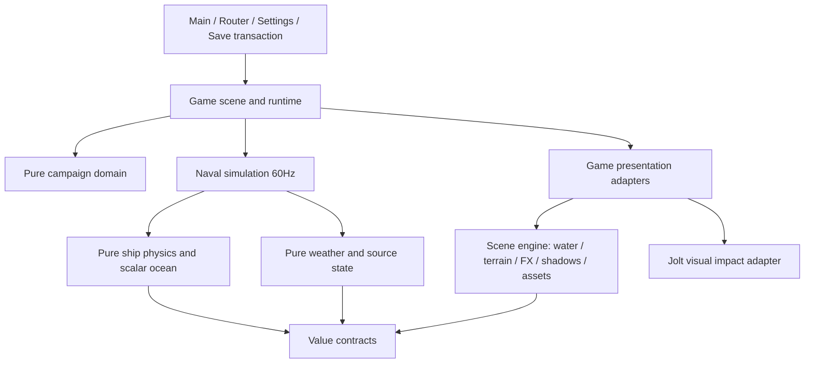

# Runtime ownership and performance contracts

本文件是新增系统的接入约束。收敛设计与取舍见 [convergence-2026-10-21.md](convergence-2026-10-21.md)，实施及验证状态见同目录 plan。这里的容量来自当前实现；毫秒数必须引用特定硬件和输入的测量，不是所有机器的承诺。

## Dependency direction

Scene engine通过注入的水位/地形Callable读取世界，不直接import physics实现。现存少量原件纯数据编译器由环境层复用，其审计白名单在 `tests/test_layer_boundaries.gd`；白名单及其明确的纯数值helper不允许Node、GPU资源或隐藏时钟。旧路径shim只转发，不能再长出第二份实现；例如 `game/presentation/world/prepared_rigid_shadow.gd` 仅继承引擎中的 `modules/scene_engine/fidelity_fx/prepared_rigid_shadow.gd`，后者是准备物和owner receipt的唯一实现。

## Owners, clocks and budgets

| 系统 | 唯一权威/资源owner | 输入与输出 | 更新及容量合同 |
|---|---|---|---|
| 场景切换 | Main + GameRouter | 菜单intent→带generation/nonce候选→成功后交换 | 失效候选不能提交；个人存档无隐式改写 |
| 设置 | App注入的UserSettings；standalone可自行创建 | 已确认snapshot→场景和海面 | App只加载一次；首次建图前应用质量；场景不重复读盘 |
| 航程/经济/任务 | Campaign纯数据 | 带上下文命令→业务状态/事件 | 不创建Node，不读墙钟或输入；存档由事务入口写入 |
| Mingqi调度 | MingqiRuntime | 可变frame dt、倍率/暂停→已接受tick | 60Hz；每次最多24tick，pending最多2秒；拒绝量可见 |
| 自由试航/海战 | NavalPracticeRuntime→SailingSimulation | 鼠标航向/键盘意图→Encounter | frame入口维持原0.1s上限；已预算调用用advance_fixed；暂停清输入与余量按原合同 |
| 操船/AI/炮战 | Encounter | 控制/订单→船体、弹道、命中和有序事件 | step_fixed只做一次60Hz；不再次消费frame预算；不得让表现反写伤害 |
| 船体运动 | ShipDynamics | 同接受时刻的海水标量、控制、船型/载荷→数值状态 | 内部step_in_place；外部step仍返回detached快照；标量只取高度，法线按需计算 |
| 天气 | WeatherState | 种子、接受时间、原状态→天气/光照/云源包 | RNG有owner；暂停/同刻刷新不随机推进 |
| 海面/地形 | WorldView及其资源 | 快照、水位Callable、质量→海面/地形/岸浪 | 不隐式推进模拟；static/natural模式复用地形；camera_chunks模式随focus创建/释放chunk及near-shore纹理；质量变更另按合同重建 |
| 自然岸浪显示/裁剪 | WorldView提供视图，NaturalWorld持有每岛NaturalShoreSurf；ShoreViewBounds持有视图/几何包络 | 接受时间、实际主/反射camera、海面uniform→原岸浪patch | surf独占sampler/material/state/staging；accepted/evaluated/submitted分离；只有精确CompiledShoreSampler允许延迟，1704个原patch不减量 |
| 移动云 | Atmosphere + WorldCloudLifecycle | 源包、主/反射视锥→显示云与云影 | 保留源定点坐标与天气中心漂移/复位合同；显示不随镜头重置，可见范围内不能硬消失；接受时间与视图时钟分工明确 |
| 船尾/接触水沫 | SourceWakeRenderer及每船contact owner | native历史、水位、覆盖状态→局部水表现 | GPU场覆盖时仍推进原历史/控制器；跳过不可见投影/裁剪/上传；同刻失去覆盖立即恢复 |
| 交互水 | InteractiveWakeSystem | 最多3船的运动→局部GPU场及覆盖证明 | actor容量3；GPU能力失效走原尾迹fallback；不读取整纹理做每帧CPU同步 |
| 炮火粒子 | CombatEffects→SourceEffect→ParticleRuntime | 原事件/明确种子→系统batch与原资源池 | 原资源num_vertices限定池；主线程提交GPU；worker独占replay可变数据并在同帧join |
| 通用动态表面 | DynamicSurfaceBuffer无状态函数 | caller-owned node/arrays/layout→新layout | 仅同mesh/完整拓扑/精确format可region update；重算AABB；无全局Node表 |
| 破坏叠层/水花 | CombatEffects / WaterSplashes | 有序去重事件→短生命对象 | puffs上限160；水花上限32；去重表有回收；资源校验早于Node创建 |
| 船体显示 | ShipView | 船型、姿态、损伤、帆/炮事件→所有LOD | 配置期绑定角色；不每帧发现整树；重配/dispose清绑定；帆morph保持顶点index合同 |
| 甲板人物 | CrewView | crew数量/角色、距离和事件→3D船员 | 近/中/远请求24/8/2，超远0；全场分配器控制总额；保持3D表现 |
| 人物碰撞 | ImpactPool/Jolt视觉adapter | 命中定义、船甲板、海水→视觉事件 | 进程最多12个人物碰撞实例，每实例多刚体/关节；不决定业务伤害；释放归还容量 |
| 阴影 | PreparedRigidShadow + SourceShadowRenderer | typed immutable准备物→原体积/纹理合成 | 引擎不反向依赖game；receipt验证owner与不可变内部数组；资源在scene销毁时释放 |
| 资源 | AssetLibrary | 模型ID/LOD→实例及缓存资源 | 缓存PackedScene而非活跃模型Node；每模型独立Skeleton/动画；dispose清cache；provenance可诊断 |
| 镜头/UI/声音 | 场景适配器 | 玩家意图/确认状态→演出 | 不成为第二份游戏权威；镜头晃动不改变船体碰撞/吃水 |
| 实验室 | 现有Laboratory host | 已登记论文/参数→隔离生产组件实验 | 无campaign/save/settings写入；原参数、种子、时钟和证据随截图保存 |

自然岸浪的accepted时间在收到有效快照时更新，evaluated时间表示源controller数值已求到的时刻，submitted时间及显式hasSubmittedTime表示相应材质已提交。外视锥可延迟数值/材质工作；diagnostics可补求当前数值并暂存三项controller值，但不把未上传的surface值写进提交cache。相同accepted时间重新可见时仍须先同步完整surface，再恢复暂存值；首次t=0不能因默认零时间戳被当成已提交。自定义sampler及CompiledShoreSampler子类可能有历史/副作用，精确script身份不匹配时保留原同步路径。

WorldView在镜头移动、实际ocean mirror同步后向NaturalWorld注册camera引用；shore在sync/apply时读取当前main与已启用mirror的frustum并取可见并集。只有实际viewport明确UPDATE_DISABLED才省略反射；缺camera/viewport、无效frustum/海面时间/波浪信息均走保守全路径，保留原无效surface输入的拒绝行为。世界包络的XZ来自配置期固定子mesh，Y覆盖当前及最后已提交的tide与全部wave amplitude绝对值之和，并保留高度guard及近面epsilon，防止旧uniform仍在绘制时过早跳过。owner变换刷新包络，configure/dispose清视图、几何、surface/staging和时间标记；子mesh/局部变换在该配置生命周期内不变。

## Hot-path and lifetime rules

1. 只有active frame owner接受可变dt。下层固定tick接口不累计dt；单条运行链不能混用两个frame budget owner。当前正式NavalPractice显示消费current detached快照及已接受时间；SailingSimulation保留current/previous和render_snapshot插值接口，但该接口未接入这条正式显示路径，不代表已新增显示插值。公开查询保持detached，内部简单读数不复制世界；表现不得推进第二份游戏时钟。
2. 配置期发现树结构、编译不可变数据、验证资源；热路径处理连续已准备数据。所有缓存必须写明key、失效时机及owner。禁止为了少分配而共享可变船体、骨骼或粒子replay。
3. 合适的对象池/系统batch可保留；容量满时走明确策略。不能把粒子、船员和伤害混成一个通用Manager，也不能把所有空间对象塞进失去局部裁剪的大batch。
4. 场景释放先停止新命令和producer、失效epoch/发布资格并清消费绑定；pending CPU worker必须join后再释放其独占数据（不强行终止线程）。Node和每场景cache按owner释放，资产cache最后释放。RenderingDevice资源的销毁在render thread完成，dispose返回不等于全部RID已释放；最终清理以回执/fence确认。dispose可重复，晚到的deferred/RD回调不得复活旧场景或重新绑定旧纹理。普通Node的process/physics回调冻结不等于AnimationMixer/Skeleton内部处理、CompositorEffect或PhysicsServer已冻结；工具须另存实际冻结状态及待发布队列证明。
5. 所有效果以接受时间驱动。镜头重绘、暂停和coverage丢失不是新原算法调用；资源名不能替代对原生命周期的证明。
6. 旧模型ResourceLoader路径与authoring适配器现在不能互换：本轮27模型顶点/颜色顺序、部分人物动画轨道不等价。先建立离线规范化资产和逐姿态/帆morph等价证据，才替换默认路径。

## Entry gate for future systems

- 指定唯一owner、输入/输出和所在层；说明时间、RNG、资源及多视口归属。
- 给出真实缺陷或成本的基线，先在现有实验室登记一个有问题/候选/实验/结果/局限的课题。
- 验证相同输入的数值/事件合同；视觉优化另验原生GPU截图及动态过程；CPU计数不能冒充GPU或FPS结论。
- 性能比较固定硬件、viewport、quality、seed、输入和可见负载；保留未裁剪样本、p50/p95、启动和steady-state。先确保没有并行测量污染，再比较。
- 通过层依赖、暂停、重入、资源释放、失败回退以及相关游戏回归。保留失败记录，不能通过放宽阈值、删除效果或减少3D人物制造成功。

本轮目标帧时间16.67ms目前尚未被证明达成。第一批静默串行整场98.238→93.466ms（均值改善4.86%）；随后集成Crew与岸浪候选的两轮有效正式quiet pair分别为94.242→72.700ms、93.702→72.606ms，仍超过目标。GPU workload03的1904/0只证明原生工作量/恢复合同；岸浪GPU06的1940/0在shore-environment-no-foliage范围内验证非空原shader贡献、主/反射同刻与重入零字节差异，保留ground/ocean/depth/灯光/船体/compositor，排除Crew/UI/foliage，不能外推这些排除owner的全世界像素等价或GPU耗时收益。结构合同、验证覆盖与性能预算分别验收；最终集成全套尚在执行，证据和最终结果见本轮研究目录。
