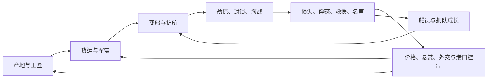

# 海上明旗：世界与玩法总纲

- 文档 ID：`naval-world-gameplay-20261029`；版本：0.4；日期：2026-10-29。0.4 采用用户确定的郑芝龙／郑成功双主角主线与分阶段玩法，取代旧原创青年船长主叙事。
- 性质：用户方向记录、文献研究后的原创系统设计。所有新规则均为提案，未实现、未做玩法实验或实机验收。
- 范围：海上生涯、舰队战术、船兵器组合、攻港与经营的统一设计。具体数值、AI、物理、界面、模型生产另立实验与实施记录。
- 入口：[文档索引与维护约定](README.md)；[生涯、势力与经济](careers-factions-and-economy.md)；[历史研究包](../../research/2026-10-29-naval-tactics/README.md)。

## 1. 已经确定的方向

**当前主线为郑芝龙、郑成功父子双主角。** 前半经历海上谋生、劫掠、贸易、明朝受抚、护镖、保卫和征讨；父篇在1646前后的父子分途交棒，子篇通过重组、经营、守港和舰队行动，最终汇集到1661—1662年收复台湾战役。每阶段首次引入明确玩法，随后用变式复用，最后在多阶段大战役组合运用。章节以[双主角战役](dual-protagonist-campaign.md)为主，传承以[交棒设计](generational-handoff.md)为准。

用户明确选择“跨时代借鉴船型与战术，玩法优先”。中国古代的船、兵、器械、组织和战争经验，应改变玩家的策略。玩家可以贸易、护航、劫掠、追捕、从军、攻港、经营舰队并成为海盗首领；海战要让击沉、夺船、护送、突围、登陆等目标分别成立。

**《武经总要》作为核心内容资料主轴，全书内容进入持续研究与玩法转化范围。** 已核条目可成为常用装备、敌方能力、港防设施、训练与任务规则，不只作为图鉴文字或稀有彩蛋。逐卷核读尚未完成；“全面进入候选库”不等于“已把全书逐项实现”。与海战联系较远的内容可进入登陆、守港、后勤、人物文化和战例关卡，逐项记录去向。

用户给出的楼船远射支援、艨艟快速突击、福船综合能力、大刀水手近战等是明确的玩法期待；具体船体、年代、抗火程度及编制须分开考证。不得用史书中的绝对修辞给任何船设置无条件免疫。

用户进一步要求客栈随机招募有独特能力的英雄好汉，可同行、带船或独自发展舰队；同时要求丰富的普通船员职业及直接效果，包括庖师、乐师、修船工、炮手和射手。英雄、普通人员、职业与在岗任务分别记录，允许普通船员成长，也允许名厨、巧匠等成为重要同伴。

艺术方向沿用既定参考：青绿海疆、靛青、朱砂、象牙纸与克制旧金；船型轮廓、人员动作、海岸地形都要帮助辨认战术。窗口有清晰层级与投影，适量云纹，避免白色后台式面板、满屏金饰、粗糙占位模型。默认声音关闭；视觉和文字须独立传达关键信号。

## 2. 设计选择与尚未确定的边界

| 方案 | 所得与代价 | 本次处理 |
|---|---|---|
| 严格单一年代复原 | 年代一致；会排除用户想要的跨时代战术和船器组合 | 用户已选跨时代方向，不采用为总限制；图鉴仍标来源时代 |
| 船名与兵器大量堆叠 | 内容表很长；容易只有伤害和价格区别 | 不作为组织原则；名称可以保留，规则按实际功能归并 |
| 历史灵感的系统沙盒 | 船体、装备、船员、目标、风潮与经济互相作用；需要验证组合和反制 | 推荐采用；具体规则是本稿的设计建议，尚未经玩法测试 |

主笔暂定：默认单人生涯，世界中有持续活动的 NPC 船长与势力；世界排行榜是该存档内的海上人物榜。多人联网不在当前实现承诺内。玩家亲自操控旗舰航行，向小队与僚舰下达目标和交战意图；接舷先研究可见的甲板分区与小队争夺，不默认另做一套个人动作 RPG。

正式目标改为双主角主线。现有1650／厦门原创船长试玩与郑芝龙阅读版保留为旧版资料和兼容基线，不再限制新主角姓名、年龄、身世与开篇。主线的历史骨架、原创场面和跨时代装备规则分别标识；用户选定的古制船器仍可经流派、试制和关卡配置出现，不因采用真实人物便退回单一炮战，也不冒称同年普装。[海域与势力设定](world-bible-and-regions.md)是约1650阶段的主要快照，父篇早年与1661战役须按年代变更港口和政治状态；[具名英雄](hero-roster-and-relationships.md)先供子篇使用，不让青年角色跨二十余年保持同龄。

领域词义见[项目词汇表](../../../CONTEXT.md)。尤其分清港口与海图标注、船体与配置、人物职业与当前岗位、船舶所有权与指挥权；剧情和系统共享这些含义。

## 3. 世界运转的主循环

玩家从一艘负担得起的小船开始，选择一笔买卖或一项委托，打听航路，配人配货，出航承担风险，带着货物、缴获、伤员和新的关系回港。收入可以购买更大船，也可以换成可靠船员、更好的情报、工匠关系、海外仓、据点和舰队。

世界中的货物确实从产地流向缺货港；战争征用运力，海盗截断路线，商号提高护航需求，水师争夺港口，赏金吸引猎手。玩家能从任何一段介入。一次战斗的影响要回到这些链条中：抢到的货物需要销路，俘获的船需要押船员，夺下的港口需要粮秣和治理。

世界推进要让玩家理解原因。港口缺木材应能追到船厂订单或航路损失；悬赏上升应能追到事件和发布者；敌方援军应有基地、行程与预警。经济具体模拟粒度与离屏推进方式需独立研究，不在文档中假装已有完整模拟。

具体循环落在[六条任务链](mission-chains-and-encounters.md)与[成长体验](progression-and-player-experience.md)中：让同一处缺粮、旧案、港口争夺或英雄失联，可以由多种生涯介入，成功、部分成功和失败留下不同后续。世界不是等待玩家到来才刷出的任务列表。

## 4. 六类海域，提供六种决策环境

以下为原创关卡生态，不是历史地理定论。

| 海域类型 | 玩家机会 | 持续约束与战术变化 |
|---|---|---|
| 河口浅滩与潮道 | 浅吃水商运、伏击、绕开重舰、引航收费 | 潮窗改变路线；减载换通行，不能全靠大型深吃水舰 |
| 岛链内海与海峡 | 护航、截击、据点争夺、火攻威胁 | 岸线遮挡、窄口拥挤；一条退路比额外火力更值钱 |
| 外海长航线 | 高价值贸易、远航护送、侦察商路 | 风浪、补给、船员疲劳；轻艇需母船或中途港支撑 |
| 大港外锚地 | 查验、封锁、走私委托、舰队补给 | 中立船与战船混行，误击、失约和侵港有关系代价 |
| 江湖水寨 | 车船与桨船、障碍筏、岸水协同、夺渡口 | 风弱、出口有限、轮桨受阻；岸上控制可改变水面局势 |
| 季风边缘与偏远群岛 | 新航路、救援、打捞、海盗藏港 | 情报滞后、维修不足；收益来自准备与判断，不能反复用随机风暴清空资产 |

## 5. 船的组织：家族、结构、动力、用途分层

“楼船”主要描述上层结构，“车船”主要描述推进，“火船”主要描述任务改装，不能全部做成互斥职业。同一艘船可以有楼台、轮桨和某次火攻任务。可建造配置由船体适配、稳性预算、甲板岗位、吃水、载荷、人员与补给约束；改装应在合适港口消耗工时。

下列二十项是可玩职责候选，**不是二十种互不重叠的历史船体**。来源与异名详见[古代船型](../../research/2026-10-29-naval-tactics/ancient-vessels.md)及[明清船型](../../research/2026-10-29-naval-tactics/ming-vessels.md)。本表优缺点均为游戏设计方向。

| ID | 船式或配置 | 独特的玩家用途 | 必须付出的代价与应对方式 |
|---|---|---|---|
| SHIP-01 | 楼船射手／指挥配置 | 高位瞭望、较多射手岗位、集中压制人员，掩护其他船接近 | 近舷死角、转向空间、风浪影响；敌方可贴近或迫使换面 |
| SHIP-02 | 蒙冲／艨艟遮护突击配置 | 遮蔽操作人员，快速切入，近舷弩窗与长兵协作 | 可用战兵和视野有限；遮护有方向与损伤，抗火不等于免疫；撞击有自身风险 |
| SHIP-03 | 斗舰战线配置 | 在火力、守舷与抢船之间轮换，稳定牵制敌主力 | 无一项能力满额；抽人支援会显露另一面的空缺 |
| SHIP-04 | 走舸机动配置 | 追踪、接应、救人、抢航道口，带走登船小队 | 动力员占比大，人数与耐久有限；不能与大船长时间互耗 |
| SHIP-05 | 古制游艇传令配置 | 侦察、传令、引导预备队，改善舰队信息 | 轻防护、低输出；必须有安全路线，受遮挡不能透视 |
| SHIP-06 | 海鹘沿岸配置 | 沿岸护航与较稳定的作业平台，侧板构成可辨轮廓 | 更大横向空间、复杂维修；稳定性不能写成所有海况不覆 |
| SHIP-07 | 车船／轮桨配置 | 弱风时仍可争位，适合河港与封锁突破 | 消耗人力体力、动力部位暴露；障碍和长时间追击可消耗它 |
| SHIP-08 | 五牙灵感拍竿大舰 | 近距离重击扇区、保护登陆水域或通道 | 显著预警与回收间隙、多人岗位；可被诱击、绕侧、压制操作位 |
| SHIP-09 | 大翼／小翼桨战配置 | 同一船族形成载兵中坚与侧翼轻队 | 动力和战兵共享人力，适用水域有限；古籍定员不直接成为平衡值 |
| SHIP-10 | 突冒灵感破阵艇 | 短程冲入、推挤、改变敌船朝向，制造友军窗口 | 冲线可预判、失速后危险；金属水下撞角并无本轮确证 |
| SHIP-11 | 福船综合／重型配置 | 深水航行、护航、火力与载员的可靠基础 | 吃水、转向、无风机动与维护成本；浅水工作需小艇 |
| SHIP-12 | 沙船运输／登陆配置 | 浅水运货、运兵、抢滩、运送攻港器械 | 重载时牺牲战斗位与机动；恶劣外海条件限制任务 |
| SHIP-13 | 广船耐损近战配置 | 承受压力、接近并保持甲板争夺 | 维修材料与时间昂贵；不能把一种木材变成万能防御数值 |
| SHIP-14 | 海沧中型护航配置 | 跟随商船、反截击、在重舰与轻艇间接力 | 火力和浅水能力都有边界，依赖任务选择与编组 |
| SHIP-15 | 苍山近岸追击配置 | 帆橹协作，进入大船不能追击的浅处 | 持续划行影响接战体力，低舷登高船需更多准备 |
| SHIP-16 | 鹰船开路配置 | 遮护接近，替后续载兵船争取入口 | 遮护挤占载荷与射界，弱侧可被迂回；并无绝对防火 |
| SHIP-17 | 网梭／八桨侦察配置 | 分别侧重近滩隐蔽侦察、较主动的通信探路 | 不把两个名目强认同型；低载荷、低持续战力，武装后要牺牲任务空间 |
| SHIP-18 | 地方哨船／开浪勤务配置 | 引航、短程截击、河港巡逻、救援 | 按文献与水域分实例；不能凭同叫“哨船”让江船通用外海 |
| SHIP-19 | 同安商战配置 | 同船在商运、护航与海盗战斗间改装 | 清代灵感明确标识；多装武器就少货舱，不能同时取满收益 |
| SHIP-20 | 火船、障碍筏、修护／载兵改装 | 迫散阵形、改变通道、保存资产、运送登船主力 | 来自既有船体或专用辅助平台；火船消耗资产，筏机动弱，支援船占舰队资源 |

不做“大船购买后小船全部淘汰”的线性科技树。小船承担航道、情报、接应和拦截，大船提供可持续作业平台；同价、同补给预算的混合编组是否有优势，必须通过不同目标与海况验证。

## 6. 船员与兵种：人力是共同资源

前期研究提出十二种战斗与作业编组：刀盾水手、大刀突击手、长枪守舷兵、钩镰接舷手、弓箭手、弩手、鸟铳手、器械班、火攻班、操船班、修护救援班、旗鼓瞭望组。它们不是全部船员职业，也不是历史军籍的逐字复原；证据与职责见[兵种和战术](../../research/2026-10-29-naval-tactics/troops-and-tactics.md)。完整职业体系见[船员职业与船上生活](crew-professions-and-shipboard-life.md)，人物专长及独立带队见[英雄与同伴](heroes-and-companions.md)。

- 刀盾先取得落脚点，大刀在较宽甲板扩大突破；大刀不应在狭窄通道也拥有无条件优势。
- 长枪守舷兵维持接近距离，钩镰组争夺连接点；动手拉住对手也约束自己。
- 弓箭持续压制，弩与铳形成不同射击窗口；射手需要方向、遮护和补给，不能自动穿过友军。
- 操船、修护、瞭望是可培养的关键岗位，不能永远免费全效率；替补水手能降低损失带来的失控。
- 船员同一时刻只能在一个岗位。调派需要时间和可通行路径；总载员不等于同时上场人数。
- 训练建立专长和协同，工资、分成、伤病、疲劳、救助经历与个人关系影响留任。高级船员带来新选择，避免纯粹加百分比。

玩家应能设定“保留操船最低人数”“遇火先救人／先保船”“登船到此区域即撤回”等意图，由小队执行。细节规则、撤退卡住的处理和 AI 能否兑现意图需实验；不把繁琐逐人操作当成深度。

### 6.1 每种职业必须有看得见的效果

下表是用户明确要求后的设计规则。属性收益与可执行行动可以同时存在；具体倍率与恢复曲线待测。人员界面显示“当前实际效果”和未生效原因，不能只显示人物称号。

| 职业 | 直接效果 | 条件与选择 |
|---|---|---|
| 庖师（厨师） | 提高伙食品质与粮食利用，改善休整疲劳恢复；合适膳食可改善船员情绪 | 需要库存、炊事时间和可用作业区；可选节粮或改善伙食，小船无专职庖师仍能由水手轮值供餐 |
| 乐师 | 在可用的演奏／休整活动中增加或恢复士气，参与人物交往与庆功 | 花费人员和活动时间，士气有上限；默认静音时效果保持，演奏状态与收益通过视觉／文字呈现 |
| 修船工 | 消耗修材与工作时间，实际恢复可修复的船体状态；支持海上应急修补 | 严重结构损伤需船坞；修复上限、可作业区域与物资清楚可见，不能只有敲木动画没有状态变化 |
| 炮手 | 改善在操作火炮的准备、装填和操用效率，降低缺员导致的效率损失 | 整套班组、弹药、方向和岗位共同生效；调人救火后必须相应降低炮位能力 |
| 射手 | 改善所训练弓、弩或铳的射击表现与压制效率 | 专长与武器对应，受视线、遮护、疲劳和实际人数约束；弓弩铳的差异保留 |

其他职业同样写出直接收益：领航员帮助选路，瞭望手改善可见范围内的发现，医者改善伤员照护，帆缆手改善操帆作业，账房帮助清算与成本管理。兼岗者可切换工作，但不能同一时间领取所有岗位收益。低配船有基本能力，专职人员让其更好；避免每增加一个岗位就制造一个不开船的硬门槛。

### 6.2 客栈英雄与同伴

客栈是遇人的场所。到访人物受港口、航路、战乱、商机、主角名声和已发生故事影响；可以通过谈话、帮忙、报酬、共同目标或救援建立关系。一次生成后人物在世界中持续存在，进出菜单不无限刷新，也不把同名英雄复制到多个港。

专长要改变选择：近战好汉能带队突破；侦察能手发现更多可验证线索；神射手把握暴露岗位；水性高手可以接收潜伏接近、侦察、接应与登船指令。水性行动受虚构游戏中的体力、海况、警戒、可攀点与撤回条件约束；普通熟练水手保留基本游水救援能力，英雄提供独特优势而不是垄断整个系统。

沿用旗舰操控与人物／小队指令的主笔暂定，不因加入英雄自动扩成另一套个人动作 RPG。英雄参与已有的岗位、甲板区域、射界和人力规则；强项可以含直接数值优势，也可以提供特殊动作、指令、交涉选项和新的任务路径。

### 6.3 允许同伴离船成长

同一英雄可以成为旗舰伙伴、单船舰长、受托分舰队长或半独立合伙人。让其独自发展时明确拨给多少船、人、钱，哪些资产归玩家，哪些是本人财产，允许接哪些任务、扩张到什么程度、如何分红、何时求援和撤回。

独立英雄会接合同、花工资、受损、修船、招人、存钱买船、结交或得罪势力，也可能成为知名船长。消息按世界通信条件到达；任务、位置、资金与人员都有去向，不能在旗舰当炮手的同时又在另一片海带队。他的舰队扩张必须支付真实成本，失败也可能需要主角救援。

分舰队仍受玩家委托的范围与半独立伙伴自行决定的范围必须在关系界面说明。召回不是瞬移；已承诺的合同与正在发生的战斗有后续处理。重要的离队、越权、预算耗尽与关系破裂要可预警、可谈判，不能用毫无铺垫的随机背叛代替人物故事。

## 7. 《武经总要》内容怎样进入核心系统

逐项证据由[全书覆盖台账](../../research/2026-10-29-naval-tactics/wujing-core-coverage.md)与[兵器火器目录](../../research/2026-10-29-naval-tactics/weapons-and-firearms.md)维护。下面是设计转化方向，具体章卷以台账核读状态为准。

| 核心系统 | 可能出现的古代元素 | 玩家实际做什么 | 成本与反制 |
|---|---|---|---|
| 接近与拒止 | 钩拒、拍竿、弩窗、矛穴 | 选择距离、方位、锁船或撑离，诱使重器械空挥 | 双向连接、回收间隙、人员暴露、船体相对运动 |
| 抛射与覆盖 | 弓弩、床弩、抛石器；不同弹道功能 | 压住一个岗位、封一条路线、支援登陆 | 有限射界、人力、甲板空间、遮挡和补给 |
| 局部火患 | 火箭、火毬、蒺藜火毬、火船等 | 制造需要处理的甲板危险，迫使转向或抽调人员 | 风流、湿损、有限投送与库存、己方风险；敌人可隔离清除 |
| 投送观察 | 引火毬等史料提供的观察／校射灵感 | 观察着点后调整下一轮目标，而非远程自动命中 | 暴露意图与预备时间，目标可转向离开预测区 |
| 防护与修护 | 遮牌、护棚、湿毡等防火记载 | 保护作业面、安排防火准备、抢救局部设施 | 遮护占重、遮视线、有方向与耐久，作业占人力 |
| 水陆通路 | 渡水工具、桥与岸上接应的相关记载 | 从侧翼登陆、救回断路小队、建立补给渡口 | 运输船需要护卫；天气、岸防和渡口容量限制 |
| 港城攻守 | 攻具、守具、城门与壕障等 | 先夺岸点、开通道、切补给，再决定强攻或逼降 | 工事不能凭血条瞬修；攻具运输、守军预备队与援军构成对抗 |
| 侦察与号令 | 旗鼓、候望、营卫与烽警等 | 发现敌人、传达意图、保持警戒、留预备队 | 遮挡、烟雾、距离、岗位损失；必须显示消息为何不确定 |
| 训练与组织 | 选士、教阅、部伍等研究主题 | 让不同岗位更可靠，形成擅长特定任务的舰队 | 训练耗时间工资、空缺岗位需补员；禁止魔法指挥增伤 |
| 战例与判断 | 后集战例、地形及占候相关材料 | 战例挑战、人物信念、航路知识与情报判断 | 历史战例不直接给“必胜按钮”；占候不得伪装成已验证气象学 |

**核心资格规则：**每个候选必须说明它改变哪一个玩家决策，至少一个有效使用条件和一个可理解的应对办法。相近形制可共用机制，但在图鉴、工匠流派与模型上保留文化差异。对于仅见图名、含义有争议或本轮未读原段者，保留研究席位，不制造已定型的装备性能。

明代鸟铳、佛郎机、碗口铳、虎蹲火炮等补充独立来源，不倒填进宋代《武经总要》。宋代同名“虎蹲砲”所指抛石器与明代火炮分开；“火箭”也必须区分弓弩发射的燃烧箭和后世推进火箭。火蒺藜、普通铁蒺藜、火雷不能合成一类现代手榴弹。

## 8. 海战的共同规则

### 8.1 五条不同的致胜途径

| 目标 | 行动方式 | 为何不总选击沉 |
|---|---|---|
| 破坏船体 | 迫使敌方修护、进水、放弃战位 | 收益是排除威胁，代价是货船和缴获价值损失 |
| 压制人员 | 对暴露岗位、通道与操作区形成压力 | 操作效率下降可创造窗口，但掩护与轮换可恢复 |
| 削弱机动 | 针对动力部位、控制通路、追击方向 | 抓船、护航脱离和封锁更有效；失去机动不应等于所有武器停工 |
| 局部夺控 | 建立连接，夺船首、甲板、操船区，接受投降 | 可保留船货；必须投入人员并防止反夺 |
| 完成任务 | 商船越过危险区、登陆完成、营救成功、时间内阻敌 | 击毁更多敌舰不自动弥补护送失败 |

士气是对局部态势的反应：孤立、退路、指挥、伤亡、救援与承诺都可影响选择。优先表达迟疑、离岗、后撤、谈降，不设一声鼓令全舰瞬间归顺。各状态变量的公式尚未选定。

### 8.2 接舷的完整过程

侦察守军与舷高 → 压制一侧 → 操船匹配距离和相对速度 → 建立可争夺连接 → 前锋落脚 → 控制甲板区 → 决定增援、抢货、抓人或撤回 → 脱离并安排押船。

连接双向可用，敌军能反登船；第三艘船能介入。母船脱离后已登敌船的小队仍在那里，必须有撤回、救援、投降或继续作战的结果。跨船人员身份、伤亡、所有权不能被进度条结算抹去。敌舰投降也需要押船人员、航行能力和最近安全港；没有押船条件可以收货、赎回、拖带或放弃。

### 8.3 火与防火是一组玩法

火攻击中后先出现可辨识的局部威胁，影响作业与通道；发展受区域材料、状态、风和修护响应影响。必须给防守方察觉、调人、隔离、清除或撤离的窗口。具体算法需课题验证，不能先宣称真实物理。

设“低易燃／遮护良好”而不设“某船永久不怕火”。火会危及友军、货物和己方登船兵；追求夺船或保护商货时，过量火攻可能让胜利收益变差。雨与湿损改变准备和可靠性，但不能让整套兵种随机永久报废。

### 8.4 地形和信息

水深影响路线和载荷；风与流影响接近与退出；岛岸、船壳、遮护和烟影响观测。玩家看到“上次确认位置”和情报年龄，不获得未观察敌人的完整兵力。普通难度须提供清楚的移动预测、意图回执和可选择的战术暂停；指挥延迟不能制造按键失灵感。

## 9. 十二套可组合的战略

以下是共同规则组合，均为原创示例，不宣称古籍已有同名体系。

| 体系 | 核心组合与目标 | 对手能怎样反制 |
|---|---|---|
| 制人夺船 | 楼船／斗舰射手 + 蒙冲遮护 + 刀盾与大刀 | 留机动守兵、避免两船并排、反夺连接点 |
| 轻艇狼群 | 走舸／苍山分组追踪、攻击孤立目标、轮换退出 | 保持互援、用地形缩小来袭方向、转攻轻艇接应点 |
| 重舰护航 | 福船／海沧护住运输船，轻艇前探 | 佯攻重舰、截逃路线；护航者须守任务而非追战果 |
| 浅滩贸易 | 沙船减载走潮道、轻艇引航、避开重兵 | 出口截击、控制引航情报与潮窗，迫其改线 |
| 近舷破阵 | 突冒灵感艇扰乱朝向、鹰船开路、载兵船进场 | 预留转向空间、诱其冲过、攻击失速后侧面 |
| 拍竿堡垒 | 五牙灵感舰守通道，弩兵和轻艇补回收空档 | 引出重击、两侧牵制、绕过目标而非硬闯 |
| 弱风机动 | 车船／桨船局部抢位，帆舰承担载荷与远航 | 拉长交战、障碍阻轮、消耗动力员体力 |
| 火攻迫散 | 火患迫使分队，快艇抢失去掩护的运输或登陆点 | 提早分散、保留修护与拖救、改变迎敌方位 |
| 反接舷伏队 | 长枪守住入口，预备刀盾队等待敌人投入 | 分批接战、保留第二入口与退路、直接改目标 |
| 长期封锁 | 岸哨 + 拦截舰 + 补给船 + 外交施压 | 夜间突围、浅水补给、攻击封锁者的补给来源 |
| 水陆协同攻港 | 海上牵制 + 沙船登陆 + 岸队夺信号／障碍控制点 | 守军内线调动、袭击登陆运输、援军从另一航道到达 |
| 贸易与势力经营 | 提前供军需、建立商号信用、护航盟友航路 | 对手争取其他供应源、谈判停战、提高地方支持度；市场不永久接受同一笔暴利 |

## 10. 生涯、声望、悬赏与世界榜

完整方案见[生涯、势力与经济](careers-factions-and-economy.md)。最低覆盖自由商人、护航船长、势力水师、海盗、赏金猎人、海盗首领、岛港经营者、探路救援者等。生涯可以转变，但债务、承诺、船员记忆和已发生事件留下后果。

世界知名度、商誉、守约、威慑、船员信任、各势力关系是不同信息。悬赏由具体发布者针对具体事件或目标产生，具有适用区域、领取条件和有效期；一个势力的罪犯可能是另一个势力认可的军官。高悬赏是风险与故事的来源，不直接发放通用战斗增益。

榜单以生涯文档的 `WORLD-BOARD-01..08` 为统一定义：舰队实力、海上功业、商业成就、江海声名、追索悬赏、海路守护、猎首功绩、海盗盟旗。港口影响通过可维持的舰队、据点与关系体现，不再另设口径不同的“港口榜”。各榜比较不同成就，以 NPC 同样遵循的有限资源与事件更新；不得用悬赏金额统治所有榜单，也不为维持挑战在玩家背后凭空补满敌舰。

## 11. 攻港应是一场行动

侦察锚地与岸防 → 选择谈判、封锁、突袭或登陆 → 开通外港 → 护住运输和登陆区 → 争夺岸防／仓库／指挥点 → 要求投降或继续推进 → 建立守备与补给。

这些阶段可以绕过或组合，不要求每次都打全套。商人可以资助补给换取通航，海盗可以只夺仓撤走，水师可以摧毁敌军事设施后交还地方。占港后的修复、粮食、治安、贸易信誉和驻军会持续消耗资源；不把“占一旗”当作永久拥有全部税收。

原书攻守器械可成为岛城设施、可运送的攻具或守军动作。规模过大的陆战机械不随意缩小放上每条船；将它送到岛上、争取安全部署时间本身就是海战任务。平民区、商会、船厂与军营有不同关系后果，战后治理留给玩家多种路线。

## 12. 一个能串起全系统的任务：粮船过峡

原创场景：三艘运粮船要穿过有潮道和小港的海峡。外侧有一艘楼船监视，近岸藏着两艘遮护突击艇；岸上信号台可以召来增援，风向和潮窗预先可侦察。

- **护航者**：以海沧牵制楼船，走舸探浅道，载兵队守商船；粮船大部安全抵达即可成功，追沉敌旗舰却丢掉粮船仍失败。
- **海盗**：让一队迫使护航偏离，另一队争夺末尾商船；俘获后还要分出押船员，火烧货舱会降低收益并影响船员分成。
- **赏金猎人**：识别首领在哪艘船，打残其行动能力并争取活捉；其他海盗逃走不等于失败，误认目标会影响结算与信用。
- **水师**：可以先运队上岸夺信号台，再清理遮护艇；陆队被困时，救援会与追击争夺船只。
- **商人**：提前购买潮汐与引航情报，减载走浅道、雇护航或与地方谈安全通行；价格差须覆盖多花的时间和风险。

同一地图应因目标、情报、配船与人员不同形成多条有效解法。完成一次脚本演示只能证明可走通，不能证明体系已平衡或长期好玩。

## 13. 成长、人物与失败后的故事

成长包括船体与改装、船员专长、舰队默契、工匠与港口关系、航路知识、贸易信用、势力职务和据点。保留低成本船的长期用途，不要求所有路线都最终转成同一艘最强炮舰。

重要船员应有可记忆的经历：曾被营救、分成争执、同乡招募、与俘虏的旧识、拒绝特定委托。这些是人物关系与局面选择，不只是一排好感度条。故事支线必须有触发原因、人物诉求、至少两种行动及后果；不重复把每个剧情都写成付钱或拒绝。

[十二位具名好汉](hero-roster-and-relationships.md)提供首批可写剧情的人物实例，包括既有设计中的林澈、秦鹞、沈知衡、顾望川，以及庖师、乐师、修船匠等人物。随机英雄另有生成路径；具名身份不被重复抽取。个人线与共同任务的奖励共享真实事件，不能同一笔救援在两处重复领取。

失败后可以负债修船、赎回船员、接受临时雇佣、以小艇重新起步、寻盟友复仇；默认生涯避免一次失误删除全部长期进度。彻底败亡规则可另设挑战选项。缴获船、伤员、战俘和货物均有后续处理，不把战后结算缩成钱与经验。

## 14. 美术为规则提供证据

- 楼船能看见层级、射手位置和近身死角；蒙冲能看见覆盖、射孔、动力口和防护缺口；运兵船能看见通道与候战空间；车船能看见轮和操作人员。
- 兵器姿态要区分准备、可用、受阻、回收与受损。玩家在常用镜头能读到拍竿将落、射手被压住、接舷处争夺、修护正在进行。
- 地图使用纸本东亚航图的艺术语言；实时海战保留海水体积、风浪、岛岸远近和船的重量。不要把概念插画当成真实运行画面。
- 生图可制作有来源记录的纹样、材质和装饰 PNG；动态文字、状态与交互保留真实控件。金边与云纹用于分层，主要界面保持海战视野。
- 每种核心配置需要剪影对比、装备位置、登船通路和人员尺度图，再进 Blender；避免先做一个通用粗船再用装饰区分所有船型。

## 15. 分阶段推进，保持完整内容库

| 阶段 | 要回答的核心问题 | 拟交付 |
|---|---|---|
| R：资料与规则设计 | 内容来自哪里、改变什么选择、如何反制 | 本总纲、全书覆盖台账、五份研究笔记、术语与决策记录；当前处于此阶段 |
| P1：混合水战实验 | 压制、接近、双向接舷、火患与修护是否形成选择 | 独立固定场景：楼船支援、遮护突击、综合护航、载兵、轻艇、商运六个职责；刀盾/大刀/长枪/射手/操船/修护/器械岗位；引入蒺藜火毬与对应清除响应 |
| P2：海上生涯片段 | 多目标能否让相同战场有不同最优行动 | 商运、护航、劫掠、赏金四种任务；少量港口、货物、具名敌手；缴获与结算 |
| P3：水陆与世界联动 | 港口、战线和经济能否互相改变 | 登陆攻港、封锁、据点经营、势力服务、榜单和悬赏；英雄受托／半独立经营与舰队扩张 |
| P4：内容扩充 | 新古籍条目能否带来新玩法而非冗余 | 车船、拍竿、重弩、更多火器、攻守器械与海域；持续扩展《武经总要》覆盖 |

P1 的人数、同屏数量、时间长度和性能预算尚未测定；它是验证顺序，不是缩减最终题材。火患与修护作为同一首批验证链，不允许只加伤害而推迟全部反制。复杂重器械可后续扩展，但须保留核心内容身份与明确研究路径。

人员扩展的阶段落点：P1 验证在岗、调人、战斗与修护的真实作用；P2 加入客栈招募、英雄同伴，以及庖师／乐师／修船工的航程生活效果与工资库存；P3 验证英雄离船带队、授权经营、共享世界中的资产与人物唯一性；P4 扩充完整职业和英雄内容。完整名单进入内容库，分阶段验证不改变其核心身份。

每个算法课题遵循[研究流程](../../research/README.md)：先固定假设、单位、初态、随机种子、时间步、相机、基线与失败判据，再做独立 Godot Demo，保存状态合同、连续 GPU 原帧与必要性能证据，最后接正式入口。没有运行不能标 validated，更不能把文档当作已实现。

接入正式生涯前，须审计现有入口、故事／沙盒模式标识、存档字段与资产所有权，记录兼容和迁移方案。“保留既有故事”目前是约束，不能当作模式接线已经兼容的证据。本总纲负责跨专题制作次序；研究笔记的分批建议服从这里的阶段定义。

### 预先写定的玩法验收问题

1. 相同预算下，至少三种不同组合能在各自适用条件完成任务；改变地形、目标或人员分配会改变优势，不能只看预设赢家胜出。
2. 每种核心威胁至少有一种玩家能够辨认并执行的应对；风、火、接舷等失败原因能从画面与记录中解释。
3. 被接舷方能反夺、断开或组织撤离；断开后人员与资产归属保持一致，第三船介入不复制人员。
4. 火攻、杀伤与击沉不能在夺船/保货/救援目标里总获最高收益；保存资产与放弃追击是有效选择。
5. 船员不会同时在多个岗位计数；调人、修护、操船与战斗争夺资源在画面中可见。
6. 市场、悬赏、排行按可解释事件更新，不存在重复领取、自己制造无限需求或原地买卖无限盈利。
7. 默认静音时，玩家仍能辨认号令、威胁和目标完成；常用镜头能区分船型职责和关键动作。
8. 真实游戏入口完成一个出港—遭遇—结算—回港—保存读取循环；实验场正确不代替正式游戏正确。
9. 庖师、乐师、修船工等在同一初态下有可解释的实际效果；缺食物、无修材、人员离岗等条件正确限制效果；静音不改变士气与演奏结算。
10. 同一英雄只有一个世界位置与一份人员身份；离船带队后不继续给旗舰加成。独立舰队购买、损失、分红、召回与存读档前后资产一致。

## 16. 决策记录与文档习惯

| ID | 决策或暂定 | 来源与状态 |
|---|---|---|
| DEC-01 | 跨时代借鉴船型与战术，玩法优先 | 用户已明确选择 |
| DEC-02 | 多船型、多兵种、多武器、接舷与水陆协同 | 用户要求；具体规则为提案 |
| DEC-03 | 贸易／护航／从军／劫掠／猎赏／海盗首领、名声榜单悬赏 | 用户要求；结算与平衡未实现 |
| DEC-04 | 《武经总要》全书作为核心候选内容资料库 | 用户最新明确要求；逐卷研究进行中 |
| DEC-05 | 每项新设计写用途、条件、代价、反制、证据和验收 | 用户要求持续写文档；执行格式见索引 |
| DEC-06 | 默认单机、旗舰操控＋小队/僚舰指令 | 主笔暂定，便于先验证核心；并非用户已批准所有细节 |
| DEC-07 | 保留既有历史叙事资产与生涯入口，区分历史故事和跨时代沙盒 | 延续已有项目，模式接线尚未审计 |
| DEC-08 | 首批同时验证火攻与防火、接舷与反接舷 | 主笔设计判断；防止只有进攻机制的单调循环 |
| DEC-09 | 客栈随机遇见特殊英雄，可招为同伴并独自发展、带领船队 | 用户明确要求；招募、能力和授权规则为提案 |
| DEC-10 | 丰富普通职业及直接效果：庖师、乐师加士气、修船工修船、炮手、射手等 | 用户明确要求；各岗位细则和数值待验证 |
| DEC-11 | 沿用已有生产地点与海图ID，扩展具体海域、组织、人物和多结果任务 | 主笔提案；历史政治背景与原创活动分列，新增内容未接入 |
| DEC-12 | 主线采用郑芝龙、郑成功双主角，父篇结束后交棒，最终收复台湾 | 用户最新确定；取代旧原创青年船长主线，DEC-07仅保留旧资料／兼容基线含义 |
| DEC-13 | 故事按阶段引入贸易、护镖、劫掠、保卫、征讨等，再在大战役综合运用 | 用户明确要求；不能只换对白反复炮战 |
| DEC-14 | 1646父子分途为交棒支点；1628明朝受抚属于父亲，儿子后期征讨／守港另据史料 | 主笔方案与来源核查；交棒不是父亲死亡或全资产无损遗赠 |
| DEC-15 | 数值平衡是核心要求；同预算比较收益、成本、反制与阶段成长，保留基线和失衡案例 | 用户最新明确要求；[平衡验证方案](balance-principles-and-validation.md)已建，船员课题已有局部扫描，完整战斗／经济／章节平衡尚未验收 |

完整需求状态和下一步见[交付与缺口](DELIVERY-AND-GAPS.md)。已写设计、已查史料、已做独立实验和已通过正式入口分别证明，不以其中一种替代其他。

后续讨论产生新方向时先追加决策及原因，再更新相关条目；实现后补真实入口和证据。更换方案须保留旧方案为何失败，不用新总结覆盖旧验收。原书漏读、异文、外观证据不足与许可证未知均进入待办，不能用想象补成“已考证”。
