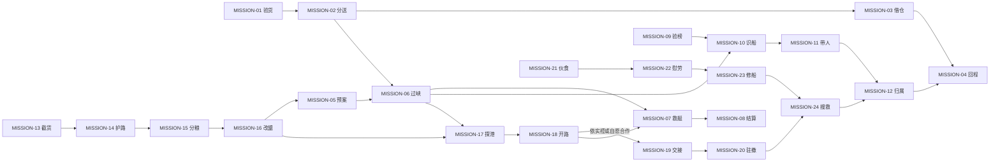

# 二十四次出海：任务链、遭遇与失败后的世界

- 文档 ID：`naval-world-mission-chains-20261029`；版本：0.1；日期：2026-10-29。**原创关卡设计提案，未实现、未运行、未验证平衡。**
- 上位合同：[世界总纲](WORLD-AND-GAMEPLAY.md)、[生涯与经济](careers-factions-and-economy.md)、[世界与航区](world-bible-and-regions.md)；人物与岗位沿用[具名英雄](hero-roster-and-relationships.md)、[英雄合同](heroes-and-companions.md)、[船上生活](crew-professions-and-shipboard-life.md)。
- 空间边界：`xiamen` 厦门、`kinmen` 金门、`forward-supply` 前沿补给点为现有生产三点；**本文新增的任务与局部战场仍未接入**。`quanzhou`、`macau`、`dayuan`、`hirado`、`naha`、`manila`、`malacca`、`java` 沿用 atlas 扩展计划，只作未来任务落点，不能据此称已经可玩。
- 八组织统一采用世界文件的稳定 ID：`house-lin` 林家商行、`qingqi-transport` 青旗督运营、`jinsha-watch` 金沙守望团、`baigong-yard` 百工船作联号、`shuangfan-brokers` 双帆通事社、`tide-lantern` 潮信灯会、`black-tide` 乌潮盟、`henghai-claim` 衡海公评行。中介只能转交许可，不能自行授予国家执法权。
- 双主角更新：本库是可复用任务模板与子篇区域实例，主线章节另见[父子战役](dual-protagonist-campaign.md)。父篇使用时须另实例化相应年代的人、船、组织和权限，不把1650左右的具名英雄或沈断潮原样移到1620年代。
- 史料索引：下文 `WJ-Cxx`、`WJ-Sxx` 见[《武经总要》主题台账](../../research/2026-10-29-naval-tactics/wujing-core-coverage.md)，`WPN-xx` 见[兵器与火器目录](../../research/2026-10-29-naval-tactics/weapons-and-firearms.md)。原书据点、陆军行列及器械转入海战均明确是**原创改编**；目录层级材料不充作逐段核读证据。

## 共同判定：任务结束，因果继续

每个节点包含四种结果：**胜**为约定主要目标完成；**部**为可交付的部分成果；**撤**为主动中止并保留已造成的变化；**败**为主要目标错失、被夺或超期。结果按实际船、人、货和交接事实结算；撤退不会回档，失败也不删除下一次出海机会。下文“世界自由委托”是合法终点，可换职业，不是未写完的悬空任务。

任务实例以 `world_event_id + contract_id + claimant_id` 归档，同一真实货批、船、人、港防事件只有一套所有权与结果。多个雇主可分别付已签费用，但同一份货不重复交付，同一人不重复拘捕领赏；任务板只展示仍有需求的工作。状态用货批库存、可航损伤、通路、许可、关系原因、证据、合同与消息时间表示，不先定未经测试的增益数字。

以下六链各四节点；编号表达内容归组，不是通关硬锁。每项的“触发”允许从世界事件直接承接；前项只改变初态与报酬条件。后继表示新机会，不强迫自动接单。任务中的传闻均显示来源与消息年龄；没有侦察依据的敌军位置保持未知。

## 链一：贸易不是把货卖给无限的钱袋

### MISSION-01 湿仓里的第二张货单〔贸易；可不战〕
- **触发／委托：**厦门船坞因木索未到停工；百工船作联号请玩家查林家商行仓单，避免把已付款的同批料再买一次；独立短缺事件也可开局承接。
- **可见情报：**旧仓单写满载，现验货见水渍与改封；沈知衡（NPC-H03）只能指出账期矛盾，不能隔空知道谁吞货。
- **两种做法：**逐仓验存、比对收货人并协商拆批交付；或承运替代木索，承担原货随后到港压价的风险。前者耗核验时间，后者占本金与舱位。
- **四种结果／后继：**胜：可用料实交、坞期恢复，开 MISSION-02；部：仅解一处停工、余单延期，开 MISSION-03；撤：保留验货证与短缺，开 MISSION-09；败：误验导致订单失约、商誉留痕，开 MISSION-23 的修船劳务自救。
- **重复／资料：**货批验收只能一次；自运自买不算外部利润。生成型按新订单再生；WJ-C16、C22 的保管检修改为仓储与坞期决策。

### MISSION-02 两港都说等不起〔贸易；可不战〕
- **触发／委托：**林家商行在厦门与计划泉州两处订单撞期，请玩家决定先送修船索还是居民粮；即使未做 MISSION-01，也能以自有船接运输段。
- **可见情报：**两港实际接货能力、欠货用途和已知竞争来船；短航较早结算，长航净收益只给区间，竞争船期会更新。
- **两种做法：**直送一港确保完整订单，另港接受明确延期；或在金门分驳两批，付搬运与二次护送成本，减少单处断供。
- **四种结果／后继：**胜：两方签收、各自库存增加，开 MISSION-04；部：一港到货、另一港仍缺，开 MISSION-06；撤：未交货归原货主、改仓耗费记账，开 MISSION-03；败：货被扣或损失、债务按合同生效，开 MISSION-09。
- **重复／资料：**同批转仓不产生新销量；竞争货抵达后重报价，不锁永久短缺价。生成型；WJ-C15、C16、C24 改为分流与运输接点。

### MISSION-03 借仓不是借走一座港〔贸易／灰色运输；可不战〕
- **触发／委托：**金沙守望团缺临时仓位，委托玩家向潮信灯会协商堆存；村民担心军粮挤占自家救荒粮。计划大员亦可出现同类新实例。
- **可见情报：**仓位、租期、民用最低储备与双方落款不同；守望团允诺不等于村民同意，更不自动给港口驻军权。
- **两种做法：**分舱封记、保留民粮通道，以较低吞吐换认可；或租船作浮仓，支付值守与转运时间，避开征仓争执。
- **四种结果／后继：**胜：双方确认储位与取用权，开 MISSION-04；部：只获短租、供给窗口收窄，开 MISSION-06；撤：军粮移出、地方关系保留，开 MISSION-02；败：越权征用引发拒供、误扣货需返还，开 MISSION-12 调解。
- **重复／资料：**同一容量不能重复出租；征用后再归还不刷救济名望。生成型；WJ-C14、C16、C18 的营务与分配为原创港仓改编。

### MISSION-04 回程没有人等原价收货〔远航贸易；可不战〕
- **触发／委托：**双帆通事社撮合计划澳门—马六甲—爪哇回程货约，商户要稳定来货而非单次高价；玩家也可凭独立信用直接接此节点。
- **可见情报：**各计划港的买家资金、货物准入、船期与最后报价；消息有时差，未核准的海外许可显示待验。
- **两种做法：**签低溢价分段交付、先预留粮水和修材；或只承运不买货，以较少利润换较低库存风险，仍负责途中保管。
- **四种结果／后继：**胜：外部净收益入账、稳定回程约成立，转世界自由委托；部：减价售出部分、剩货占仓，开 MISSION-21 的补给重排；撤：按约交还未发货、预付结清，开 MISSION-01；败：违禁扣货或买家失约、分别记录责任，开 MISSION-12。
- **重复／资料：**新航期、新库存、新买家资金才生新单；内部转账与资产重估不加商业榜。生成型；WJ-C11、C16、C24 为航路知识与长航后勤灵感。

## 链二：护航胜利是人货到了，不是追得最远

### MISSION-05 断旗前先说好〔护航／训练；可不战〕
- **触发／委托：**青旗督运营要送粮至前沿补给点，请顾望川（NPC-H04）与玩家试编队；普通护航船长也可教基础预案，不强制拥有英雄。
- **可见情报：**快慢船差、峡口旧报告与传令艇航时；顾望川要求先约定失联集合处，屏幕同时显示旗意文字，默认静音不丢指令。
- **两种做法：**沿安全航段演练分批过口和后卫接力，消耗航期；或分成独立小队按同一交接时段出发，减少集中堵塞但降低互援。
- **四种结果／后继：**胜：各队实际读回预案，开 MISSION-06 常态；部：一队未练熟、改保守序列，开 MISSION-06 慢速初态；撤：取消总队、保留分段小单，开 MISSION-02；败：逾期失去主约、原船仍留世，开 MISSION-07 救助委托。
- **重复／资料：**演习只记录熟悉度与耗费，不造敌船战功；同队反复开关命令不刷成长。教学节点可跳；WJ-C03、C12、C13 明确改编为舰队预案。

### MISSION-06 粮船过峡〔护航；可不战〕
- **触发／委托：**青旗督运营与承运商共同雇护航，厦门—金门—前沿补给点的一段原创狭口出现截粮风险；可直接接替退出的护航者。
- **可见情报：**粮船低速、窄口只容分批通过、上次见敌在外侧；前哨回报空船诱敌与漂流木，但敌后队位置须再查。
- **两种做法：**轻艇复核内汊、候窗口分驳，靠隐蔽和接力无战通过；或重舰守口牵制、按序护送，留一队救拖，不以歼敌为完成条件。
- **四种结果／后继：**胜：粮货完成交接、前沿供给恢复，开 MISSION-08；部：到一批且有人失散、前沿只延长有限供给，开 MISSION-07；撤：主队退金门、补给仍缺，开 MISSION-17；败：粮货被夺或船毁、损失绑定货主，开 MISSION-10 追踪同批赃粮。
- **重复／资料：**成功货单与 MISSION-02 共用交付回执；护航费与贸易收益分账。生成型换真实航次；WJ-C03、C07、C15、C23，钩拒 WPN-26 仅作争距改编。

### MISSION-07 救艇只能再装一班人〔救援／护航〕
- **触发／委托：**潮信灯会接到落水者与伤舰急讯，请玩家支援；秦鹞（NPC-H02）可能在伤舰，也可能只是要求兑现救人条款的同行。
- **可见情报：**载人容量、最后目击时刻、伤舰可拖状态和追货方向；可看见空置货舱能换救助空间，不能先知失散者生死。
- **两种做法：**卸下仍有货主的部分货物并留标记，先多批接人；或由护卫牵制追兵、修护班稳定伤舰后拖回，把风险集中在拖航段。
- **四种结果／后继：**胜：已定位人员全接回、伤舰按事实保全，开 MISSION-08；部：救回一批、余人仍待搜索，开 MISSION-08 分段结算；失散者含独立英雄时另开 MISSION-24；撤：带已救者回港、遗留对象与责任保留，开 MISSION-22；败：错过可救窗口、确认损失并告知家属，开 MISSION-08 争议结算。
- **重复／资料：**救人不取得船货；同人转船只付一次约定救助费用。生成型；WJ-C02、C17、C18、C22，WPN-28 的损管为原创状态规则。

### MISSION-08 交粮后谁的名字写上去〔护航／结算；可不战〕
- **触发／委托：**金沙守望团组织收粮与抚恤交接，护卫争功、货主追责；即使未参战，也可受衡海公评行委托核实现场证言。
- **可见情报：**签收货量、救援名单、失散名单、实际命令送达记录；杀敌最多者不必然是保粮贡献最多者。
- **两种做法：**开联席验单，按合同和救援见证分配；或先兑现无争议部分，把争议款留在原付款方待证，不拖住全部船员工资。
- **四种结果／后继：**胜：货权与应付款明确、护航信用成立，转世界自由委托；部：多数结清、争议仍挂账，开 MISSION-12；撤：暂不作证、本人可领无争议款，开 MISSION-22；败：采信伪证导致追责或军纪调查，开 MISSION-09 查证。
- **重复／资料：**一个航次只有一份贡献账；补证改旧结论不新增功绩。故事节点；WJ-C18 的功赏见证改为交接制度，严刑不成为增益按钮。

## 链三：猎赏先辨人，再决定要不要拔刀

首个具名实例为 **CASE-R01「芦汊秋粮案」**，目标是乌潮盟外围船长沈断潮，别号“半帆”（`NPC-R01`）；人物、舰队、悬赏分项和失势去向以[对手船长档案](rival-captains-and-bounties.md)为准。林家商行为受害货主，衡海公评行承办；不能由中介字号自动推出任何辖区的抓捕权。

| 节点 | 此案实例化内容 | 可改变的过程 |
|---|---|---|
| MISSION-09 | 核林家货批和真实发布资金，区分追货与带人两项委托；当地许可另核 | 发现伪加的赏单时仍可只接追货，不必为整条链放弃航程 |
| MISSION-10 | 沈的海沧“折潮”号与无辜同名商船混淆；右舷三角补板与前帆斜补缝是可观察线索 | 补片、旗号都能变，须结合当前航迹与装卸确认；远射击沉同名船不算找到首领 |
| MISSION-11 | 沈按补给、警戒和已走航程转往赤沙泊外围，不从金门瞬移 | 可以截住尚未转移的船、迫其部下分离、谈带人移交或争取登船窗口；发现过晚就追踪下一条线索 |
| MISSION-12 | 对实际找回的同批粮、船只与人完成交接，分别处理未追回部分和其他受害者 | 沈逃走、被俘、谈降或阵亡各留不同后续，不能所有结果都刷新同一首领满额赏单 |

首领有自己的船员、资源、退路和求生目标；他可以主动出击、丢货保船、与部下决裂或提出条件。此案只有在扩展世界真实生成对应货批与遇袭事件后才启动；叙事“袋”与现有游戏 `grain` 单位尚未换算，不从当前开局库存凭空创建赃粮。

### MISSION-09 真榜上的假落款〔猎赏；可不战〕
- **触发／委托：**衡海公评行发现同一目标两张互斥赏单，委托核验发布者；来自贸易受损或港口告示均可直接进入。
- **可见情报：**发布地区、追索对象是人还是货、旧许可日期、独立受害者口供；赏金高不等于有跨港拘捕权。
- **两种做法：**往返签发港复核并通知可能误捕者；或带证人追货到转卖点，用物证锁定实际受益者而非追同名船长。
- **四种结果／后继：**胜：有效范围与目标确认，开 MISSION-10；部：货权确认但人证不足，开 MISSION-12 仅追货；撤：停接拘捕保留线索，开 MISSION-01 合法承运；败：误捕或伪证交付、受害者需获释放补救，开 MISSION-12。
- **重复／资料：**关联雇主、被害者和同次事件合并审计，抓放循环不发赏。生成型；WJ-C10、C11、C18 为符契、参验、见证的原创改编。

### MISSION-10 同名船换了一面帆〔猎赏／侦察；可不战〕
- **触发／委托：**有效赏单或失粮货单出现新目击，货主经衡海公评行雇玩家识别金门外两艘相似船；未来可扩至计划平户、那霸航线。
- **可见情报：**修补痕、装货吃水、船员证言、目击时差；叶归岑（NPC-H09）的斥候经验能提核验方向，不能直接标红真目标。
- **两种做法：**保持距离跟踪交货，记录买卖方并等合法靠港查验；或申请有范围的临检，在可见证地点拦停，承担耗时与误拦赔偿。
- **四种结果／后继：**胜：船、人、货至少两源吻合，开 MISSION-11；部：仅找到货物转移线索，开 MISSION-12；撤：停止追船、报告最近位置，开 MISSION-06 新护航；败：真船逃脱或拦错船、警戒提高，开 MISSION-09 重核。
- **重复／资料：**同船改帆不换身份；追踪奖励只结新证据，不按尾随时长刷钱。生成型；WJ-C07、C11、WJ-S01 的可疑痕迹须可反证。

### MISSION-11 活口已经不在那艘船〔猎赏／营救〕
- **触发／委托：**衡海公评行取得合法交付条件，目标转到乌潮盟外围锚地；发布者要活人辨认账册，玩家若无相应许可只能带证转介。
- **可见情报：**最后下船时间、同案人员之间的欠饷争议、岸边接应通道；目标本人可能愿以归还货物换安全受理，不保证免罪。
- **两种做法：**保护见证人并提出有第三方在场的自首移交，目标有时间谈条件或转移；或由刀盾取得落脚点、大刀队在宽甲板突破并带人撤离，抢在账册销毁前同时保住证据。敌人退入狭道后需换长短兵协作，不能一路无脑冲到底。
- **四种结果／后继：**胜：身份确认且实际移交，开 MISSION-12；部：救回证人或取回账册、目标未获，开 MISSION-12 部分追索；撤：撤出并通知执法方目标仍在，开 MISSION-16；败：误伤或无证拘捕、当地追索玩家，开 MISSION-12 辩责。
- **重复／资料：**目标死亡不自动满足活捉条款；同人同案不得多地重复领全赏。故事节点；WJ-C05、C09、C18，WPN-28 遮护接应为原创关卡。

### MISSION-12 一船赃货，三家收据〔追索／调解；可不战〕
- **触发／委托：**衡海公评行受原货主、善意买方或获救船主委托厘清产权；澳门、马尼拉等计划港的当地许可须另核，公评行不能代替执法。
- **可见情报：**货批来源、转售价、救助费用、扣押地点；烧坏或售出的实物不能在判定后凭空复原，救援船长也不是当然船主。
- **两种做法：**返还可识别原物、由争议方分期处理剩余损失；或先放行无争议货，把争议部分封存并提交当地受理人，换航期以保商路。
- **四种结果／后继：**胜：产权和追偿责任获有权方确认、旧案结算一次，转世界自由委托；部：物归属明但欠款未清，开 MISSION-04 带债经营；撤：不强行处分争议物、改做代理运输，开 MISSION-02；败：伪造或侵占坐实、扣货与当地限制生效，开 MISSION-16 退出冲突区。
- **重复／资料：**反复扣放、自己制造损失再追偿不增猎首榜；收回本金非利润。故事节点可由新案生成变体；WJ-C10、C18 只提供核验与见证灵感。

## 链四：从劫一船，到决定谁还能在这片海谋生

### MISSION-13 要粮，还是要一笔快钱〔劫掠／有限袭击〕
- **触发／委托：**乌潮盟一支队缺粮，提出截取敌对运力；水师也可能发布有边界的军需截获令，两种授权分别记账，不能互洗犯罪。
- **可见情报：**目标舱单仅部分可信，船上可能混有民粮；高价小货容易带走，粮能续航却需更多载荷和押运人员。
- **两种做法：**逼停后索取小批高值货并迅速脱离，收益较少且可能错过整船；或趁护卫换位强行接舷，秦鹞或普通突击队夺控宽甲板，连同货船一并俘获。后者可直接扩充运力，但必须留押船员、保住操船岗位并及时拖离援军航路。
- **四种结果／后继：**胜：货物实装或整船押回，夺船路线取得可修复使用的俘获船控制权与盟内分利话语权、原权属和追索保留，开 MISSION-14；部：仅少量货、缺粮仍在，开 MISSION-15；撤：停止截取、改接合法承运，开 MISSION-02；败：被护卫击退、损失与追捕生效，开 MISSION-16。
- **重复／资料：**自己的关联货船不可成为领奖目标；同批赃货销赃与追索共用身份。生成型；WJ-C02、C15、C16，WPN-26 的牵连双方约束适用。

### MISSION-14 收了护路钱以后〔海盗首领／护路；可不战〕
- **触发／委托：**乌潮盟已收商船护路费，内部船长却劫走受保护的货；首领议会要求玩家带回解释，否则商人将改线，盟友也可能退伙。
- **可见情报：**保护航段、期限、交费凭据与劫货分配；犯约者声称欠饷，无法靠口头说“都是一家”注销货主损失。
- **两种做法：**追回原货并用有限公账赔补，公开追究但留其申辩；或护送受损商船完成余程，以真实补运与分期赔付换继续来航。
- **四种结果／后继：**胜：补偿兑现、护路合同保留，开 MISSION-15；部：商船获救但成员拒分利，开 MISSION-16；撤：退还未履行保护费并退出收费航段，开 MISSION-06；败：包庇再劫导致商路转移、盟内离心，开 MISSION-15 缺粮初态。
- **重复／资料：**自演劫货再营救不赚保护信誉；赔款不列海盗经营收入。故事节点；WJ-C13、C18 的授权与分赏为原创盟约制度。

### MISSION-15 分粮的岛，分开的旗〔海盗据点／后勤；可不战〕
- **触发／委托：**乌潮盟据点粮水不足，潮信灯会要求先保居民取水；玩家以盟主、受雇运粮者或调停人均可承接，计划大员周边为扩展舞台。
- **可见情报：**居民与各船实际人数、余粮、补水路、外来商船是否因抢掠改线；有旗无粮的船长不会无限效忠。
- **两种做法：**公开份额、缩小驻军并开辟护送补给，以控制规模保据点；或转为流动盟约，带走自有船货、按约分散借住，放弃固定税入。
- **四种结果／后继：**胜：储备恢复且各方同意承担份额，开 MISSION-16 常态会盟；部：居民保住、部分成员离队，开 MISSION-16 缩队；撤：移出驻军、社区通行恢复，开 MISSION-04；败：强征引发断供或水师围逼，开 MISSION-20 撤防任务。
- **重复／资料：**同仓粮不能同时计船粮与居民存量；搬一次家不重刷建岛成就。生成型按真实危机；WJ-C14、C16、C17、C18。

### MISSION-16 没有主岛，也有一面旗〔海盗首领／转型；可不战〕
- **触发／委托：**乌潮盟残余船长请求重新订约，或青旗督运营提出限定招抚谈判；玩家可在丢岛、分赃争议或越权后直接进入。
- **可见情报：**各人自有资产、欠薪、旧案、受抚可免与不可免事项；招抚提议只有送到有权方且确认后才有效。
- **两种做法：**维持小盟只护指定航段，追求有限收费与相互救援；或交还被追索公产、逐项处理赔付并申请限定海防委托，旧仇仍可能在。
- **四种结果／后继：**胜：新约实际生效、船队规模与权责明确，开 MISSION-05 或 MISSION-17；部：部分同意、其余按账退伙，开 MISSION-04；撤：解盟分产、各人保留本人船，转世界自由委托；败：谈判破裂或越约、公权追索继续，开 MISSION-07 受限救援谋生。
- **重复／资料：**同次解盟、受抚不反复重置犯罪与榜单；新约不追溯抹旧债。故事节点；WJ-C13、C18、C25 改为誓约与可信承诺，不靠仪式洗罪。

## 链五：水师围港，要先留下可回去的路

本链先记录行动类型：**友港解围**保持友方港口与仓区归属，敌方据点只在外锚地、封锁船和另设的临时岸上阵地；**收复占区**则必须有此前已发生的敌方占领事件，明确哪个仓区／岸点失守、谁仍控制港内其他部分。两种初态都不能凭接任务修改生产港口阵营。临时岸点是局部战场对象，不另算新历史港口。

开路成果再区分：仅取得通航许可、友方保有港区且封锁解除、实际夺得敌占仓区。前两者不自动产生接收仓钥、缴械或征收权限；MISSION-19 必须按真实控制和自愿交接生成相应版本。

### MISSION-17 港里还有几天粮〔水师／侦察；可不战〕
- **触发／委托：**青旗督运营请求核查前沿补给点的封锁。默认友港解围型：核己方可撑多久、敌外锚地补给及来援；只有已记录敌占仓区事件时才启用收复占区型。保留现有点身份，不把它自动改成敌港或新历史城池。
- **可见情报：**商船少到港、仓门封闭、各方守备换班与来援传闻；每处观察分别标所属方与确认时间。友方仓门紧闭不等于敌占，仓内可能缺粮也可能在隐蔽卸货，情报必须交叉核实。
- **两种做法：**轻艇观察补给航次、访回港船员，给围困方案；或侦察旁岸登陆与退路，给限时开路方案。观察会暴露活动且耗己方粮水。
- **四种结果／后继：**胜：粮、援、通路获足够交叉证据，开 MISSION-18；部：只确认一项、降低行动范围，开 MISSION-18 有限目标；撤：报告不可判定并撤回运输船，开 MISSION-02 保供；败：误报导致先遣受困、敌方警戒提高，开 MISSION-07 救援。
- **重复／资料：**同一旧情报不能按新侦察领赏，情报过期须实查。生成型；WJ-C07、C11、C19、WJ-S01，均不提供全图视野。

### MISSION-18 围港开路〔攻港／解围〕
- **触发／委托：**青旗督运营命玩家为补给船打开进出窗口；由 MISSION-17 或亲历封港承接，并继承已确认的友港解围／收复占区初态。主要目标是连通航路，攻取额外仓区须有相应任务范围和实际敌方控制。
- **可见情报：**外锚地拒止区、敌临时岸点或已失守岸防、障碍门、可见修护班与援军最后报告；敌我与未知控制分别显示。引火毬试投只给当时落点，非必中标记。
- **两种做法：**重型器械船压住敌外侧弩台、突击船夺其岸上作业面，遮护清障并抢先送粮；友港型由原管理者给后续补给合同，收复型依实际所得处理仓区使用。或切敌转运节点、维持己方轮换补给，提出可核验的通航停火。前者能在援军到前扩大成果，后者少伤船但让敌方有时间转仓和议价；任何通航协议都不自动转让仓产。
- **四种结果／后继：**胜：来回通路与交接窗口均成立，记录“仅通航／友港解围／已夺仓区”子类型；有新的合作或交接需求时开对应 MISSION-19，否则进入 MISSION-20 轮换或世界自由委托。部：只送入补给未能建立持续通路，开 MISSION-20；撤：带回工兵与船、围港仍在，开 MISSION-06 替代运粮；败：通道关闭且先遣受困，开 MISSION-07，保留敌防损伤与己方耗材。
- **重复／资料：**开一次门不反复领攻港功；守方修复需实际材料。故事节点；WJ-C19—C22、WJ-S02，WPN-03／04 重器械与 WPN-09／10／17／28 的舰载、甲板和港防应用均为原创，重器械先补部署与作业空间实验。

### MISSION-19 仓门后不是空城〔登陆／接管；可不战〕
- **触发／委托：**当前仓区控制者、货主与合作方存在真实交接需求。仅通航型只能协商获准的租位／转运，不移交控制；友港解围型是原管理者主持复开与物流；已夺仓区型才可接收获控范围、处理留守者。即使别人打通港门，也须核对控制者、货权与移交依据后才生成委托。
- **可见情报：**军粮与民粮分别封记，修桥班、伤员、居民通道争同一卸货位置；友港原守军仍有其岗位。仅在已发生投降的占区版本显示降旗与缴械范围，不能凭通航停火虚构守军投降。
- **两种做法：**在有实控／正式移交依据时接收约定仓钥，组织民用与伤员通道；或通过当前管理者租借转运区，让原守卫继续管民居，以较少控制权换快速恢复。友港版本的第一项为协助原管理者复开，不夺友军仓钥，不要求先赢一场战争才能合作。
- **四种结果／后继：**胜：仓区和居民通行可持续、权责清楚，开 MISSION-20；部：仅一处码头恢复、驻留受限，开 MISSION-03；撤：退出本次接管／复开／租用事务，按实际归还物资或完成救济交接，开 MISSION-08；败：按已发生的越权、毁约或敌方反攻结算，只有占区型且敌方实际反攻时记录守军反扑；吞吐与驻留受影响的范围据实改变，开 MISSION-20 的对应限制初态。
- **重复／资料：**同一批缴获不能既入公仓又入私货；抢粮再赈不刷安民。故事节点；WJ-C14、C17、C18、C21，攻具不被当作统治完成条件。

### MISSION-20 守得住，才叫拿下来〔水师／驻防或撤防；可不战〕
- **触发／委托：**现控制者要求安排补给轮班、临修与撤防预案；可接 MISSION-18 的不完全胜利，也可受雇撤出被围的乌潮盟成员，授权分别核验。
- **可见情报：**船坞队列、现库存、援军行程可信度、伤员运力；杜照棠（NPC-H07）可判别临修与必须入坞的损伤，不会凭手艺凭空造料。
- **两种做法：**缩防线、送伤舰回坞并维持接力运输，以有限驻留保通路；或按约交港／撤港，先转移伤员与属于各方的物资，拒绝无用的最后一战。
- **四种结果／后继：**胜：驻守轮换成立或约定撤防完整、控制权按实记，转世界自由委托；部：保人船但弃部分仓货、对手接收实物，开 MISSION-23；撤：提前退出、合约违约部分结算，开 MISSION-16；败：失守与被俘分别登记、幸存队有退路，开 MISSION-07；独立舰长失联时另开 MISSION-24。
- **重复／资料：**固定占港不按点击领钱，税入取决于实际经营；交港反夺不能刷同次功绩。生成型轮换单；WJ-C13、C16、C17、C22。

## 链六：一船人如何继续做伙伴

### MISSION-21 一锅饭，两本账〔庖师／粮水／贸易；可不战〕
- **触发／委托：**长航延期后陶素禾（NPC-H05）要求重订菜单，司粮员发现贸易粮与口粮混记；本人不在船时由普通庖师提出基础版本。
- **可见情报：**真实食材批次、保质、可供餐次、伤员适口需求与被挤占货单；丰盛菜单能改善相应休整，却不能补回欠饷和睡眠。
- **两种做法：**征得货主同意改用途，扣同批贸易库存，采用耐存轮换菜单；或保留全部商货、改走补给港并轮值做简餐，牺牲航期换履约完整。
- **四种结果／后继：**胜：粮账相符且全员基础餐次恢复，开 MISSION-22；部：能吃饱但偏好与恢复有限，开 MISSION-22 疲劳初态；撤：中止远航回港补给、迟约如实结算，开 MISSION-02；败：强扣货或偏餐致信任下降、人员求离船，开 MISSION-08 分配调解。
- **重复／资料：**同一餐、同次休整只结算一次；做饭真实耗粮水、工时与岗位。生成型；CREW-24／25，WJ-C16、C18；菜单效果属原创，无营养医学保证。

### MISSION-22 这夜不宜庆功〔乐师／士气／关系；可不战〕
- **触发／委托：**归航有人获赏、有人等失散者，闻停舟（NPC-H06）请玩家决定船上夜间活动；不拥有英雄也能由普通乐师或水手组织。
- **可见情报：**已确认伤亡与未确认失联分列，欠饷尚在、值更人员未休；同一首庆功曲对不同经历的人可能有不同反应。
- **两种做法：**举行自愿追悼／慰劳、公开兑现救援与分赏承诺，再给足休息；或保持安静，把乐师派作港口访谈与口述留录，先让疲惫人员休整。
- **四种结果／后继：**胜：士气与信任按实改善；相应英雄在船时，陶素禾的故乡饭和闻停舟为失散者留下的曲，让获救者愿再随船、教新水手，开 MISSION-23；部：部分人参与、矛盾仍在，开 MISSION-08；撤：取消活动、退未耗物资并休息，开 MISSION-23；败：强迫欢庆或空置值更致冲突、留任下降，开 MISSION-08 留任与分配调解。
- **重复／资料：**不以连点演奏洗掉欠饷／死亡；静音与有声同判，疲劳与重复活动限制收益。生成型；CREW-26，WJ-C09、C25 只采用安众与信念影响。

### MISSION-23 这块船板还撑得住吗〔修船／独立带队；可不战〕
- **触发／委托：**百工船作联号要交回待修船，杜照棠请玩家选择修复范围；沈知衡或顾望川可提出以真实出资／借船另跑一条线，二者不是必选入队条件。
- **可见情报：**可航临修、结构坞修、缺料与排期分开；独立计划列船属、预算、薪资、最低储备、交战禁令、报信港与失联预案。
- **两种做法：**先保可航、缩货与航区让小队低风险试营，留下一笔真实维修债；或等待大修并让英雄参与出资，按份额共有新购船，付等待成本后远航。
- **四种结果／后继：**胜：修复与验收完成，转世界自由委托；若另签独立合同且英雄同意、实际启程，才可能开 MISSION-24 的后续消息机会；部：只完成临修、试航范围受限，开 MISSION-05；撤：不派遣、退未耗料并结工钱，开 MISSION-01；败：忽略限制致试航返修或违约、损伤不清零，开 MISSION-07。
- **重复／资料：**修复消耗材料并改损伤状态；同船不能同时在坞、旗舰与独立队，借船不变赠船。故事节点；CREW-18，WJ-C13、C22，WPN-28 为有限修护改编。

### MISSION-24 最后一封信不是死亡证明〔独立英雄／搜救／产权；可不战〕
- **触发／委托：**已独立经营的英雄超过约定报信期，副手或合伙人请求查访；既有独立队也能直接触发，失联不能由重开菜单随机生成。
- **可见情报：**最后报信港、消息年龄、已获许可航区、借船与本人船的清册；计划那霸—平户或澳门—马尼拉可作长航版本，地图扩展前只做三点近海版本。
- **两种做法：**循港单与接力传信核实，申请当地放行或见证移交；或按最后航迹派轻艇搜索、拖救与接应，主动缩小范围，不把失联点直接标成敌寨。
- **四种结果／后继：**胜：人船去向核实、能归还的实际归还并清账，转世界自由委托；部：救回本人但船货被扣，开 MISSION-12；撤：先保搜索队、更新未核范围与家属通知，开 MISSION-07；败：确认损失或错过窗口、借产按约追索，开 MISSION-23 重建，未知者仍标失联。
- **重复／资料：**救英雄只恢复同一人物身份；本人自有船不因获救归玩家，救助费用有实际付款方。故事节点；WJ-C08、C10、C13、C17，所有消息／产权机制原创。

## 三个可交给关卡设计的完整场景

**粮船过峡（MISSION-06）。** 船队在金门外等到潮窗，粮船船长报告满载回转慢，顾望川要求先选“前队走失后在哪里等”。玩家看到的不是完整敌阵：只有一艘快船在外口故意露帆，以及轻艇带回的漂木。若玩家让全部护卫追帆，敌侧翼不会无视空出的粮船，而会接近后队迫其停船；后卫收到迟到的旗意时只能执行此前约好的退路。玩家仍可转回救粮或先接人，任务按抵达批次和实际损失结算。

另一种选择是让快艇复核内汊，把粮拆到浅吃水船并分批过口。敌人发现外口没有主队，先试探岸上观察点，再改派轻船搜索内汊；留守船只要维持警戒和接应，不必主动开战。若恰逢搁浅，修护班投入拖救会少一组守舷人员，玩家可抛下有记账的部分货减载，或者等下一窗口。成功时前沿粮仓确实多一批粮；部分成功则让 MISSION-07 去救失散者，失败则把同一批被夺货交给 MISSION-10 追索，没有另刷出一船“任务赃粮”。

**一次围港开路（MISSION-18）。** 本例采用收复占区型：此前一次已记录的失守使敌方控制侧岸与外仓，友方仍守内侧补给泊位；这不是生产开局自动变成敌港。任务开始于“给补给船留一次来回窗口”。玩家已见外锚地障碍和侧岸观察点，却只得到仓储的一份旧报告。敌方先以固定弩位控制清障区，待玩家器械准备时把机动队留在其控制范围；它不会把全部兵力站成等待轰击的一排。玩家可先夺观察点，再用遮护保护作业班；引火毬灵感试投只显示当时落点，敌方转移器械或以烟遮断观察后，下一次投送必须重判。

玩家若把蒺藜火毬灵感载荷投向外侧作业位，收益是迫对方抽人处理局部火患，火不会自动烧穿整个港。器械船随后以牵引投石器压住外台，守方退入第二线时，玩家能看见原本交叉封锁的水面出现缺口；突击船穿口、刀盾站稳、大刀队冲开宽阔码头，补给船在重器械的威慑下整批进港，这就是敢投入重舰和精锐取得的主动权。守方仍可让出外位、保住障碍门，以短程猛火油柜灵感拒止区迫登陆艇换边；这些船港应用全属原创改编。玩家也可转控外运接点，拿补给压力谈有限通航；拖延会给守方转仓和来援时间。只送进一船而未保住返路算部分成功，撤走工兵后由 MISSION-20 继续讨论驻撤；成功抢出双向通路则获得实在的仓区优先权与下一批补给合同。

**一次失联远航的搜救与产权（MISSION-24）。** 顾望川完成独立经营后，曾按合同借用玩家两艘船，并用已结个人分红从真实卖方购得一艘小船。他从计划那霸发出的最后一封信说要避开新战区，返信晚于报信期。玩家此时只知道延迟，不能召回远端人物、删除其自有船或判定背叛。先向可达港口送停用新额度通知，通知尚未送达的旧合法支出仍按原约有效；搜救出航也要配人、配粮、留容量。

玩家若循商馆收据走，可能先发现一艘借舰在修船，顾望川为救人耽误航期，另一艘借舰与自有小船遭地方扣留；这不是双帆通事社一句担保就能抹掉的许可问题。玩家可核旧令和救援见证，申请释放人船，也可先接回伤员、把争议船留在当地封存。若改走海上搜索，敌对扣船者看见搜救队后会提高警戒或提出换人；玩家可退到可交涉处，或投入带撤回条件的游戏内营救，而非被迫击沉载着同伴的船。

救回顾望川时，界面分别列出“本人已归”“玩家借舰待返”“本人小船待返”“货主货物待认领”。付了救助费不取得他的私船，英雄复职也要本人同意；他愿继续独立经营、退回任职或清算退出都是有效结尾。若只寻得可确认的损失证据，任务结算相应损失并触发重建；另有一艘仍不明就继续标失联。玩家的及时援助改变关系，但不会凭空补回三艘船。

## 依赖图与生成归属

下图是主要机会流；**具体四结果去向以各节点条目为准**。每组首尾都有独立世界触发，不要求从最左边开档；箭头不表示成功门锁。

- **与主线的关系：**正式主线采用[郑芝龙／郑成功双主角章节](dual-protagonist-campaign.md)，本库提供支线、教学变式与不同生涯的区域任务。“保供开海”仍可作为以 MISSION-06、18、20 为核心的可选区域链；它不替代新主线。自由生涯可拒接本库全部任务；主线关键目标则按章节给出的等效路径、重整或明确重试处理，不以一条支线失败锁死整个故事。
- **哪些可跳：**24 节点均可拒接；MISSION-05 是教学、MISSION-08 是交接争议、MISSION-19 是治理，已有等效经历可直接承接后项。关键英雄缺席使用普通职业的基础办法，不复制英雄、不把招募变成开链钥匙。拒接后的 NPC 结果须有运力、预算和消息依据，不把未玩的任务全部默认胜利。
- **哪些可重复：**标“生成型”的 MISSION-01／02／03／04／06／07／09／10／13／15／17／20／21／22 可由新真实需求生成；MISSION-12 仅新产权案生成变体。其他节点是同一事件或人物阶段内的一次故事，重复读取旧回执不能领新收益；新档复玩另算。
- **冲突如何合并：**同一粮船先被 MISSION-13 截取、再被 MISSION-06 护送时，先核合法货主和已发生损失；不能自动变干净贸易。玩家不能同时承诺独占护航和劫同批货，接受后一任务前显示需违约／退出的前约，原追责不消失。援救、护航、贸易的不同劳务可分别付费，但同一货、人、船的物权变更只写一次。
- **验收待办：**逐节点制作四结果状态夹具；查库存／产权守恒、命令送达时序、重复回执、失败恢复成本与跨链冲突；三深描场景再建立固定初态与相机的独立研究 Demo，保留失败与真实 GPU 连续画面，验证后才接生产入口。本文只完成内容与转移设计审查，不能据此声称 AI、经济、动态场景或平衡已验证。
