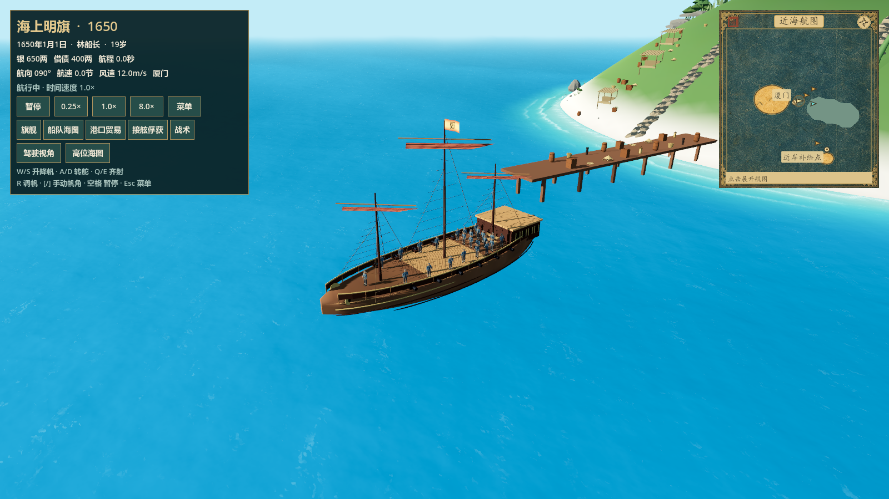
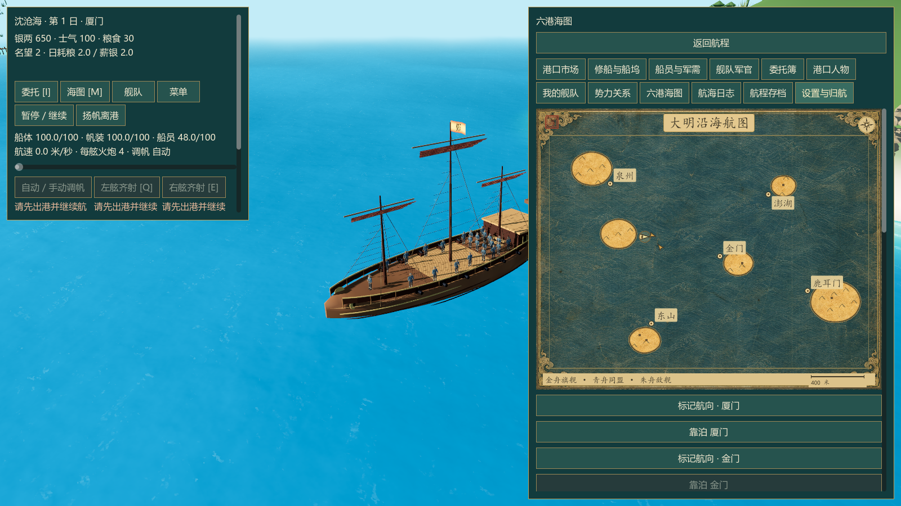
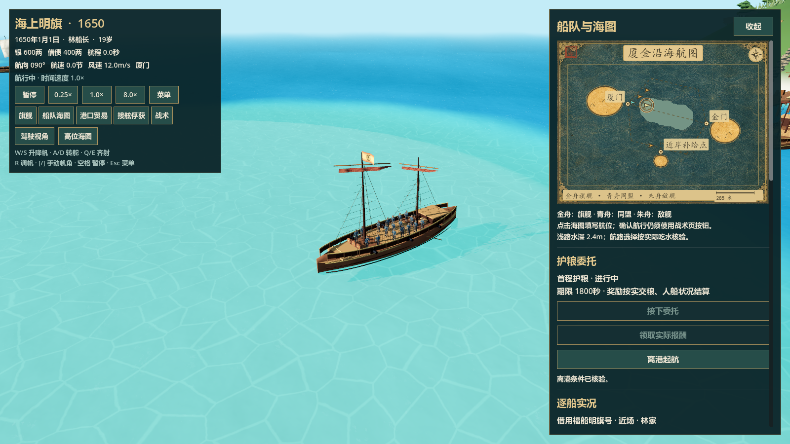

# 古航图 v2 与原生入口验收

2026-10-11。工作目录为 `C:/Users/dains/Documents/Git/ming-armada`，分支
`codex/godot-migration`。本记录只关闭本轮已验证事项，完整 Godot 迁移目标仍在进行。

## 用户参考与实现

参考用户提供的明代风格航图，采用靛青海墨、赭金陆地纸纹、云纹边框、
楷体港名、罗盘与朱红印记。两张美术材质通过内置 imagegen 生成，保存于项目内；
完整提示词与生成文件来源见 [素材记录](nautical-chart-v2-art.md)。

这是一张实时游戏航图。陆地轮廓由现有 HeightField 采样、裁切与缓存得到；
港口、舰船、选中舰、航向、任务标记及航线来自原生状态。陆地纸纹使用世界坐标 UV，
跟随船位或改变窗口时保持连续。小图优先显示附近港名并避让船位；点击小图展开，
展开图保留现有航点和战术交互。800×900 窄窗口隐藏重复小图并将展开面板置于 HUD 下方。

现有世界仍是已迁移的海岛与浅滩布局。参考图中的整片东亚地理、各国远航区域、
人物插画和大型海兽装饰没有被当作已完成内容。明旗航图中的青绿色块为实际浅滩。
本轮没有修改原水面波形、浮力或操船物理，也没有修改原网页项目。

## 可复现证据

全部命令在目标仓库执行，Godot 可执行文件为
`C:/Users/dains/Downloads/Godot_v4.7.2-stable_win64.exe/Godot_v4.7.2-stable_win64.exe`。

| 验证 | 实际结果 | 证据 |
| --- | --- | --- |
| `rtk proxy node tools/verify-godot.mjs` | 53/53 测试通过，退出 0，Godot 错误和警告为 0；验证器自身 16 项检查通过 | `evidence/verification-full-53.json` |
| 原生航图截图脚本加 `-- --chart-v2` | 11 张，失败 0，退出 0 | `evidence/charts/v2/` |
| `rtk proxy node tools/record-chart-captures.mjs` | 11 张 PNG/元数据、两张材质与完整 53 项测试报告校验通过 | `evidence/charts/v2/integrity.json` |
| 原生主菜单 QA 按钮与场景选择截图 | 15 个源场景及 5 张命中、恢复、窄窗口截图，合计 20 张，失败 0，退出 0 | `evidence/visual-qa/` |
| 船舶检阅真实鼠标输入截图 | 旋转组合按键、平移、缩放前后共 4 张，失败 0，退出 0 | `evidence/shipbook-orbit/` |
| `rtk proxy node tools/record-native-qa-captures.mjs --check-only` | 20 张 QA、4 张船舶检阅、3 项真实命中与 2 项浮态停留元数据校验通过 | 两目录的 `integrity.json` |

GPU 截图使用 Godot 4.7.2 stable official、D3D12 Forward+、Intel Arc 130T 16GB。
截图脚本使用独立的、含进程 ID 的设置与存档路径；本轮截图使用均衡画质。
没有打开额外浏览器页面。原生截图和生成美术材质分别保存，截图均来自实际视口。

主代理亲自查看全部 11 张航图截图、20 张 QA 截图及 4 张船舶检阅截图。
航图检查覆盖旧航海模式、1650 模式、移动船位、切换快船、展开和收起、
800×900 窄窗口，以及默认试航入口。港名清楚，船位与航向可辨，未见破碎陆地纸纹或标签覆盖船位。

## 并行迁移及审查结论

船舶检阅补齐源 OrbitControls 的阻尼、平移、视角范围与鼠标组合规则。
独立审查发现的“第二个鼠标按钮覆盖当前手势”已修正；专项测试 229 条断言通过。
源行为要求切换预设或成功载入模型时保留未耗尽阻尼并更新一次，离场销毁时清除。

QA 入口迁移原有 15 个 VisualScenarios，实际使用原生 Encounter、舰船视图和 Jolt。
炮击使用真实可见按钮与真实弹丸，没有注入命中或伤亡。命中元数据记录活动物理身体、
18 个骨骼刚体和 17 个关节；弱炮击恢复保留生还船员。两项浮态检查按源行为在 4.6 秒停留。
独立审查发现的“普通操作丢失上一帧墙钟区间”已修正；QA 四项专项合计 198 条断言通过。

原生截图过程曾因其他桌面窗口获取焦点触发正常的失焦暂停；脚本改为点击实际“继续”按钮，
再执行炮击。第一次未成功的运行不作为通过证据，最终重跑 20 张完整截图失败为 0。

1650 Runtime 补齐当前受控舰 ID 与实时战术指令状态投影；UI 读取源状态字段 `state`。
实际 Runtime 与 UI 的专项测试 9 条断言通过。地图专项 507 条断言通过。
各项独立复审关闭已发现 P2，未留下本轮范围内 P1/P2 问题。

## 保留的验收边界

本轮固定步长截图不能证明帧率或 20 秒预热加 60 秒真实墙钟性能；性能验收仍需单独运行。
宽镜头中的受击船员较小，部分被 QA 面板遮挡，虽然命中和 Jolt 活动已由真实数据证明，
清晰的近景击飞连续画面仍需后续验收。海岛内部仍需增加地形层次和生活细节。
完整护航、俘获、回港救治、续航与存档恢复旅程，以及 Windows EXE 导出尚未关闭。

一次早期 QA 场景测试遗漏设置隔离，把本地默认画质写成了“低”；原始字节未留存。
该测试已修正为独立设置路径，后续测试和截图均隔离。未猜测恢复或覆盖用户其他设置。

## 主要画面

