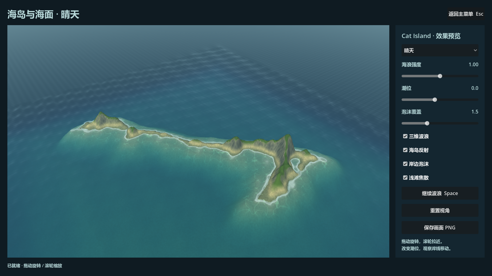
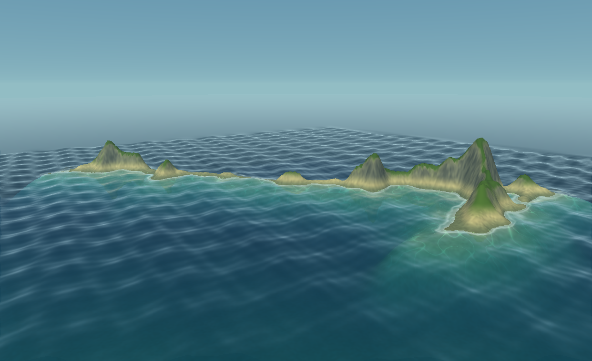

# 海岛与海面 Godot 源码移植：本阶段验收

日期：2026-10-11。当前阶段仅海岛、海面与岸线效果。下一阶段才处理 `atmosphere-fx` 的云雾、炮火和烟，之后返回航海与战斗玩法。按用户要求，本阶段不设性能验收门槛。

## 交付范围

参考入口是 `C:/Games/Pirates-REA-Reference-20261011/naval-study/island-water/demo/`。本次直接移植其 `model.mjs`、`renderer.mjs`、`shaders.mjs` 与 `app.mjs` 中已有实现。原参考目录及原 Three.js 仓库只读。

Godot 主菜单新增“海岛与海面”，通过实际 `water-study` 路由进入 `game/scenes/reference_island_water/reference_island_water.tscn`。本阶段先交付独立的原生效果场景：它使用自己的 World3D、相机与状态，不改既有航行存档、游戏地理和五波浮力采样。

| 原示例内容 | Godot 落地 | 验收依据 |
|---|---|---|
| Cat Island 原高度索引、三维地形、海底 | 原 120×140 索引；160 分辨率地形；160 段海底环带；实际 Float32 顶点生成 161×161 R32F 岸线高度纹理 | 原 JSON 字节哈希；全部位置、法线、UV、索引和高度纹理与原 JS fixtures 的字节哈希对照 |
| 沙滩、湿沙、草地、岩石、浅滩 | 原 terrain shader 材质混合、照明和距离雾公式 | 源码审核；晴天、高潮位、低潮位与夕阳实景截图 |
| 四组 Gerstner 波 | 原方向、幅值、波长、速度、水平位移、解析法线及远海滤波 | 原 JS 数学 fixtures；Godot 原生波浪开关和低角度截图 |
| 镜像反射、深度折射、吸收与 Fresnel | 共享场景的镜像 Camera3D/SubViewport；反射排除水层；Godot reverse-Z 深度恢复和纹理坐标适配 | 实际相机投影对照、目标尺寸/释放测试、反射开关 GPU 截图 |
| 岸线泡沫、滚动亮带、潮位和浅滩焦散 | 原 water/terrain shader 的时间与深度公式；同一接受时间驱动 | 同相机、同时间开关对照；4.2 与 4.8 秒画面；高低潮位截图 |
| 晴天、夕阳、风浪与观察操作 | 原预设、范围、旋转/缩放、暂停、重置与 PNG 保存；原生界面 | 实际菜单路由和原生控件调用；暂停像素稳定；小窗口截图；实际 PNG 保存 |

颜色处理保留原示例的显示 RGB 运算：Godot 屏幕/反射纹理各四个 texel 先转回显示 RGB，再做原双线性过滤；原公式输出限制到 `[0,1]` 后转为 Godot 线性色。没有随意增加原示例不存在的调色系数。

## 主线程亲自查看的实际画面

使用 Godot `4.7.2.stable.official.ed1daf0bf`、Forward+、Intel Arc 130T GPU 实际渲染，捕获脚本从实际主菜单“海岛与海面”按钮进入。最终过滤实现的原生运行输出为：`REFERENCE_DEMO_CAPTURE_COMPLETE captures=15 failures=0`，进程退出码 0。

15 个状态各保存一张原始 3D 视口 PNG 和一张带原生控件 PNG，共 30 张；另通过场景保存接口写出 `native-saved-frame.png`。5 张联系表仅供查看，原始 PNG 未经后处理。每个状态的 JSON 记录相机、接受时间、开关、GPU、反射方法和文件 SHA256。

主线程已逐张检查 5 张联系表中的全部状态，并放大检查晴天、低角度、夕阳和同参考静态状态画面。具体观察：

- 晴天具有与参考示例相近的蓝绿海色、浅水渐变、细白岸线和浅滩焦散；海岛保持同一长条形轮廓与山峰位置。
- 低角度能够看到三维波面和反射；关闭反射后岛下颜色与亮度确实变化，不是只切换界面标签。
- 关闭泡沫、焦散或波浪，各层实际画面发生对应变化；暂停前后同相机同接受时间的 PNG 像素完全相同。
- 高潮位淹没低地、缩小岸线，低潮位露出更宽沙地；潮位移动与地形一致。
- 夕阳采用原示例的太阳与颜色状态，风浪采用原 strength=1.8；小窗口调整后界面仍可操作。
- 检查画面中未发现空白纹理方块、镜像递归反馈、水面纹理上下颠倒或地形网格缺口。

实际原始截图：

完整记录见 [visual-index.json](evidence/reference-demo-port/visual-index.json) 和 [manual-review.json](evidence/reference-demo-port/manual-review.json)。

## 检查状态

地形 focused 测试 591 项、海面 focused 测试 3,249 项、场景 focused 测试 35 项，共 3,875 项断言，均为零失败；独立审核实际重跑了地形、海面和原场景测试。新增正式启动参数及其实际路由检查也已单独通过，最终审核记录另见审核报告。

完整回归已完成：78 组测试全部通过，严格 runner 自测 16 项通过。首轮唯一失败为渲染层对物理层的直接依赖；修复后完整重跑零失败，层边界守卫保持不变。新增 16 项逐分量严格相等检查确认四波 GPU Float32 上传值不变。

在完整回归之后，独立审核又发现正式启动截图请求的取消串场问题。最终补丁将截图绑定本次 generation/nonce/operation，所有等待返回后验证请求与场景身份，并防止视口释放后继续保存。该补丁涉及的三组相关测试重新实际运行：场景 35、菜单 61、router 55，共 151 项断言，全部零失败。完整 78 组证据见 [full-regression.json](evidence/reference-demo-port/full-regression.json)，最终补丁回归见 [post-capture-guard-regression.json](evidence/reference-demo-port/post-capture-guard-regression.json)。这两轮范围分别记录，没有把后一次定向回归冒充全量重跑。

Windows 当前可运行包及其实际 release EXE/GPU 验收正在收尾，当前结果会写入本阶段最终交付索引。

独立审核、原始数学和来源映射见：

- [地形移植说明](reference-demo-terrain.md)
- [海面移植说明](reference-demo-ocean-port.md)
- [独立代码审核](reference-demo-port-review.md)

## 对照范围

已在浏览器打开原示例，并切换同一静态状态、相机默认位置和渲染尺寸，与 Godot 实景作定性对照。原网页截图下载等待超时，因此未获得可用于自动误差统计的原 PNG；没有声明 WebGL/Godot 逐像素相等。

原 WebGL 的逐 texel RGBA8 八位量化没有模拟；Godot 的栅格化与原网页 CSS/DPR 尺寸策略也不同。原生窗口失焦时暂停、离散滚轮映射属于宿主适配。源码公式、地形数据与数学对照的通过结果不等于复原原游戏的完整 DX9 渲染。

本阶段证明参考海岛与海面效果已能在 Godot 原生运行。船舶、水手、炮弹与新海面在产品场景中的整合，以及新云雾、炮火、烟粒子，按用户指定顺序在后续阶段推进。
