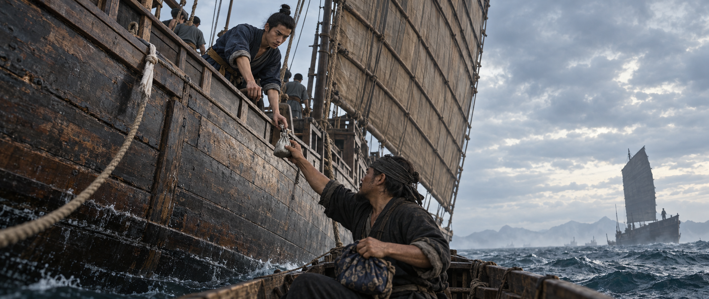
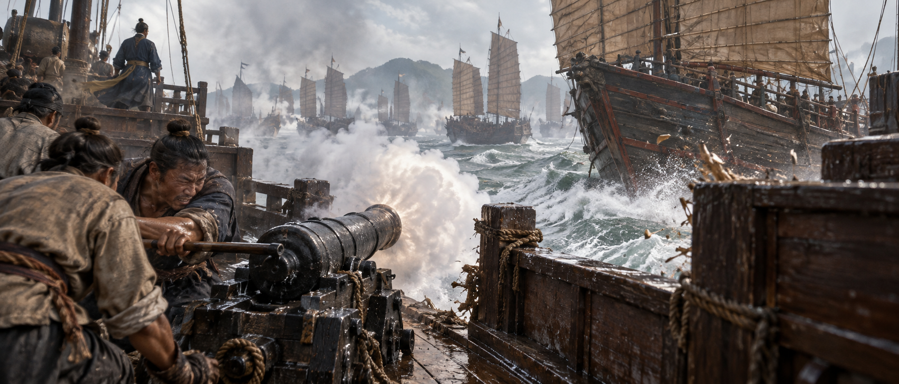

# 一官入海

> 历史小说剧本与当代生成插图。本文由唯一剧本 JSON 完整生成，编辑应修改 JSON 后重新生成。结构校验不能代替文学或史实验收；具体虚构战事依各场说明区分。

五幕二十场 · 第八稿 · 晚明海上人生 · 1621—1646

版本：v8-engagement-historical-2026-10-23

天启年间，寄身澳门货栈的福建青年一官，想凭一张会说异乡话的嘴挣出自己的船位。他与船工结伴，在平户成家，往返于明朝海防、海外商路与海盗争夺之间，终于有了船与官身。救命的盟约、等不到的家书和朝代倾覆，一次次逼他决定先保住谁；当他要替全家选定最后一条生路，妻儿与旧友各有了不肯交出的回答。

按幕阅读；章首与场首只交代眼前困境。梗概、对白摘记和编辑解析含情节结果，默认折叠。

## 第一幕 · 借来的舌头

幕 ID：act-1　｜　年代：1621—约1623

> 赴日大船缺一个随货的人。一官想让舅父看见，自己已经不只是搬箱子的。

本幕梗概（含情节结果）

澳门货栈里，一官想凭新学的葡人话挣到赴日船位。他能替人把生意说成，也急着替别人作主；一次逞强夜航，使阿旺丢了两件吃饭的工具，自己背上旧损。下一次机会到来，他拿未来的分成换船位，与陈添、阿旺、阿禾一同入海。到了海上，会说话还不够：阮老六手里的炮，能随时改掉讲好的条件。

### 一筐橘子与一潮黑水

年代：1621　｜　地点：澳门外港货栈—近岸接驳水面

> 码头缺一个随货赴日的人。一官只听懂半句洋话，眼下却人人等他开口。

本场梗概（含情节结果）

一官想凭译话挣到赴日船位，错译后重新问清，用阿旺的修箱办法谈成加钱。得了货主认可，他却向舅父瞒下误听，求陈添不抄原话。赴日船催最后一驳货，他谈妥脚钱和留灯，仍越过阿旺的判断抬上重箱、藏下阿禾，驳船刚离岸便进水。

赴日的船少一个随货的人。一官从清早等到日头偏西，舅父黄程仍只叫他扶箱。外港泊着大船，桅灯还没点，他已经看了三回。阿旺拿铁凿敲敲箱沿：“扶正。你的人还没走，魂先上船了。”他赶紧把歪了的铜扣按住。

大明天启元年，澳门栈门外，一担糖才卸下，又来两担丝货。葡人货主绕到箱子另一头，指着旧裂说话。阿旺停了凿，几个脚夫也都望过来。一官这几个月替人送货，听一句学一句，正愁没有在人前开口的机会。他往前凑，先听清了一个词：半。

“这活只给一半工钱。”话一出口，阿旺便将凿口倒转，要退掉新铜扣。货主赶紧抓住凿柄，两个人各说各的，谁也不肯松。一官再听，后半句全淹在吵声里。他想叫他们等一等，货主臂弯里的橘筐已经撞翻了。

橘子滚下湿阶。一官追着捡，草鞋滑出去半尺，阿旺用伤脚踩住筐口，骂他看水。三个人蹲成一排，货主捧着一颗裂橘子，又指箱子的另一头。这回没人抢话。一官看看旧裂，再看看新扣，终于知道自己把什么听反了。

他用不大顺的葡人话问，是不是那一半也要补。货主立刻点头，将手从箱头划到箱尾，再取出银钱。阿旺听一官重说，盯了他一眼：“原来我的手艺还值全价。”脚夫先笑，货主不明白，也跟着笑起来。

一官没急着答价。他拉来一只空箱比过大小，告诉货主旧板已裂，单添铜扣不成，得照阿旺的法子加钉补板；又让货主亲手摸两道松缝。话虽磕绊，意思这回说到了。货主肯添钱，阿旺才下凿。一官蹲回箱旁，一颗一颗替他递钉。

箱修好，工钱比原说的多了几枚。货主挑出两颗没碰坏的橘子塞给一官，指定下回还叫他来。隔院的脚夫喊“译事的”，他应得太快，阿旺拿凿柄碰了一下他的头：“手别松。”他抱紧箱口，嘴角仍收不回去。

散工时，他把钱送进里屋。黄程问：“头一句，你到底听懂了没有？”柜上摆着赴日货单，空着的那一格就在舅父手边。一官看见自己的汗滴上柜沿，想说后来已经弄明白，临到嘴边却只剩一句：“听懂了。”

黄程没接话，叫阿旺进来。一官站到门外，听见老人讲箱缝和钉钱，并没提橘子。阿禾抱着饭碗蹲在阶上，问日本人是不是都说刚才那种话。一官摇头。阿禾顿时发愁：“还得再学一套？”他把一个橘子丢进少年怀里，说先把饭吃了。

陈添拿回结算纸，第一句就念出“那一半，可否一道补上”。一官伸手要纸，陈添抬高了：“这句我倒看得懂。”他笑不出来了。陈添才低声补一句，货主还夸你后头说得清楚，下回仍找你，并没说不要你。

一官请他账上只记两头补好、工钱照结，别把闹错的原话誊进去。陈添看了看里屋，照办了。他正要说声谢，门外管事叫人催货，陈添已经卷起纸：“下回先问第二遍，省我抄第三遍。”一官答应着跑出去。

外头的赴日大船要趁风起锚，今夜还收最后一驳货。管事说能把货赶到，随货的缺就给他；催单上掌船的写的是阿旺。老人看过风，摇头说借来的驳船才补过缝，宁可等下一条。管事便要抽单，换别栈接手。这一等，未必只等几天。

一官按住单角，先谈妥脚夫的接脚钱，又请管事让外船留一盏灯。三个人肯搬，管事也肯等。他回头见阿旺还站在门框边，便说：“只到外头，卸完就回。”老人没应，提着工具箱下阶试船。他当成已把最难的一处说动了。

阿旺试过舵，叫最重的两箱留岸。可那两箱不去，这趟货便算没交齐。一官让脚夫先抬上，说自己去跟旺叔讲。阿禾端着饭挤来，想看大船，也想学掌船；他怕再生枝节，将少年按在箱间：“坐稳，哥管你。”转身时，离岸的缆已在松。

阿旺见重箱上船，刚要开口，横风已将船头推离石阶。他喝令几人坐低，自己蹲下把最后一颗钉敲进舵柄。大船那盏灯在前面，一官还望得见。脚底却先凉了：黑水穿过补缝，浸到新铜扣下方。第一道横浪拍进舷内，阿禾的饭碗响了一声。

对白摘记（辅助稿；含情节）

**阿旺：**扶正。你的人还没走，魂先上船了。

**阿旺：**原来我的手艺还值全价。

**陈添：**下回先问第二遍，省我抄第三遍。

**一官：**只到外头，卸完就回。

**一官：**坐稳，哥管你。

#### 史实与创作边界

层级：adaptation

澳门、平户、大员的历史脉络依据随文来源；本场具体事件、交易、私人对白与心理、原创同行均为文学虚构，不是郑芝龙已证亲历。

- [五幕新稿史实护栏、编年与来源](../../research/yiguan-v5-historical-guardrails-2026-10-22.md)

### 工具箱不能扣

年代：1621　｜　地点：澳门外泊水面—黄程货栈

> 一只手还扣在舷边，两箱货堵住救人的位置。天亮后，这笔损失要算在谁头上？

本场梗概（含情节结果）

一官舍不得弃货，阿旺为救阿禾落水；割掉两箱后，众人才把老人拖回。清点时他先只报风浪和船缝，直到管事按被补填的单子扣工具，才认下应航、抬箱与迟疑。陈添重新分清赔数，一官负担余损与两年扣薪，失去本次赴日船位；凿锉仍抵出去，阿旺却替他敷药，把锯借给他继续做活。

一官扑过去抬箱，箱子沿湿板滑向另一舷，整条驳船跟着倾斜。阿旺喝他放手，把瓢抛给陈添，叫阿禾爬高。少年的饭碗撞在箱角，白米浮了一层又被水吞掉。外船的灯还在前面，隔着浪，看上去比方才更远。

“割外头两箱！”阿旺用腋下夹住舵柄。一官抽出老人腰后的刀，碰到绳结时却停了。箱是各家寄运的，封记还齐，丢掉便要有人赔。他想着把水舀快些，也许还能靠过去。就在这一停之间，阿禾叫了一声叔。

老人腾手去够箱后的少年，迎面来的浪正撞上舷。松箱先撞他的膝，半个身子随即翻出去，只剩一只手扣着船帮。舵失了人，船头横过来。一官伸手去拉，脚下无处着力，差一点跟着滚出去。

“别拽我。先把绳割开。”阿旺在浪缝里说。一官收手，刀尖钻进浸透的麻绳，第一下没断，第二下割中了自己的掌根。他再压下去，绳终于弹开。第一只箱从舷边翻下，船身抬了一点，阿旺的脸露出了水。

第二只也要下水，偏卡住半只铜扣。一官用肩抵箱，陈添放下瓢来帮，两人合力推过去。米从破口淌出来，他已顾不得看。回身抓紧阿旺的衣领，陈添抱住他的腰，阿禾也攥上老人袖口，一齐倒在板上。阿旺先咳出水，接着骂他们压住了他的腿。

回到石阶，阿旺伏着呕，末了一口带着血丝。阿禾抱着他丢了鞋的伤脚，怎么劝都不松。一官披上陈添递来的干麻袋，仍冷得牙响。工具箱从舵后卸下，箱底还是干的。外泊大船在收岸缆，管事却先带着货主到了。

一官报了少两箱，说风横、船缝进水。管事让他按印认数，他以为先把数认清，后头还来得及说明。陈添抬头想插话，货主已经追问自己的封记。一句葡人话，一句乡音，挤得屋里转不开身。单上认水路的人是谁，没人当着他问。

待货数点完，管事却来取阿旺的工具箱。老人将锉从布里摊出，听说要抵赔，问：“拿了这些，我靠什么还？”管事把单子往案上一放，原先空着的栏里已经填了林阿旺。黄程坐在案后，看见外甥赶过来，将算盘推开。

阿旺求留铁凿，去别栈还能找活。管事嫌他磨蹭，连锉一起拿起。一官看见案上那张单，认出了自己方才按的手印。天亮时他还在想，怎样解释才能留住船位；这会儿再等一句，连阿旺明日的饭也要没有了。

他把单子转过来：“扣我的。夜航是我应的。”管事问他拿什么赔。他报出往后两年工钱，又看向黄程，请舅父垫余数。黄程没说肯不肯，先问重箱是谁上的。一官答是自己。阿禾忽然站起来，说自己也是愿意去的，被阿旺拉回了身边。

一官把抬箱、藏人都讲了，最后才说，旺叔叫割货时，他舍不得。他没再借风声盖过去。黄程听完，问两年之后还欠着又怎么办。他说继续做。陈添将缺箱数重新算了一遍，把货主与工匠两笔分开，请黄程看清，工具不能连整箱都算走。

黄程划去阿旺的名，叫一官重写。已取出的凿、锉仍折进缺货钱，余损由舅父先垫，从一官工钱里扣；赴日随货的那一格同时涂掉。管事抱走铁器，外头有人催他登船。屋里一下安静了，只剩陈添拨算盘的声响。

傍晚，阿旺往工具箱空位塞了两块杂木，免得锯刨一路磕碰。一官借下受潮的锯，说替栈后锯板，工钱另算，慢慢买回凿锉。老人没拦，却先叫他坐下，把药粉按进他的掌心。“疼就叫，别咬我的麻袋。”阿禾噗地笑了一声，又赶紧去看叔父。

大船出港的号声传来。一官在门边站了片刻，还是抱起锯往栈后走。阿旺背好工具箱，到门口告诉他：“板别锯短，我明早还要用。”他答应得响。前头那条船已走了，栈后的板却一块都还没锯；他得先把这件事做完。

对白摘记（辅助稿；含情节）

**阿旺：**别拽我。先把绳割开。

**阿旺：**拿了这些，我靠什么还？

**一官：**扣我的。夜航是我应的。

**阿旺：**疼就叫，别咬我的麻袋。

**阿旺：**板别锯短，我明早还要用。

#### 史实与创作边界

层级：adaptation

澳门、平户、大员的历史脉络依据随文来源；本场具体事件、交易、私人对白与心理、原创同行均为文学虚构，不是郑芝龙已证亲历。

- [五幕新稿史实护栏、编年与来源](../../research/yiguan-v5-historical-guardrails-2026-10-22.md)

### 把明年的钱押上

年代：约1622—1623　｜　地点：澳门货栈—赴日商船

> 船位空出来了，旧债还没还清。舅父将一份三年分成的契纸推到他面前。

本场梗概（含情节结果）

下一次赴日机会要靠未来三年分成换取。一官听清旧损、新垫本和十二两差额，撤下阿旺工钱单，接下洗桨守夜的船位。阿旺自主带阿禾同船，陈添为另存契底被押工钱，却有攒出自己账柜的打算。几人一起做活、学话，约定到日本查齐货价，尽早结清这一航。

陈添算到最后一行，先把笔搁下：“有船位。没有白给的船位。”一官从栈后赶来，肩上还粘着锯屑。几个月里，他白日搬货，夜里替人锯板，欠款却只薄了一点。陈添把新账推过去，他看见赴日两个字，先坐稳了。

桌角是他捡来的半面废纸，阿禾替他挑齐了。少年问日本沿海有没有雪，听说未必见得到，失望一会儿，又问那边的船怎样掌舵。一官说先学会在自家船上站稳。阿禾把最好的一张给他：“你写大些，我也认几个字。”

黄程有一小份合货，要派人一路看货，肯替一官垫本。货是运去日本卖的丝与杂货，卖得银，才有他的分成；船沉了或货赔了，并没有一笔钱在那里等他。旧损还要照还。舅父讲完，指着他的肩：“你不出本钱，就出别人不肯出的工。”

一官问要押几年。三年。陈添把三页排开：上一回丢箱的旧损，这一回由黄程先出的本钱，末页才是估算能分到的银。这样摆开就明白了，他不是签个名便成了货主，而是拿往后三年可能挣到的钱，换今天登船的机会。

“若第一年便挣够呢？”黄程推给他一张空纸，让他写怎样算清。他写旧损、新本，添上“以本人所得偿之”。旁边还压着阿旺的工钱单，舅父提议不够先从那里周转。他抽走了那张单：“他那份不押。”黄程看了他一会儿，让陈添照抄。

照眼下的估算，三年分成还差十二两才能还清，约是陈添抄一年的钱。陈添把差数指给他，没让他糊涂签下去。一官重新算了一遍，答应把船上另外挣的工钱也往里补。谁也没说这样就一定够；契上留下差额，留给他自己认。

他问能不能做通译，黄程说正式通译已有了人，洗桨、守夜倒缺。“那就先洗。”他把签好的纸推回去，陈添另外留了一份。黄程要他立即跟管事点货，他走出门，脚步比进来时快，直到摸见掌上的旧伤，才想起把袖口扎紧。

登船前，阿旺把阿禾的工食褡裢递来，叫他顺路交给船上管饭的。老人这回自己接了船工活，带孩子学水路。一官怕又牵上他的账，推说不要。阿旺道：“钱又不是给你娶媳妇的。”阿禾在背后笑，被叔父叫去扛箱；一官也笑着接了。

黄程的货搬进主舱，一官铺席的地方在舷边，翻身就碰木肋。半夜叫拉湿缆，阿禾从后面压住缆圈，边出力边数一二，数到第十下便乱了。一官替他接着数。阿旺掌着舵听见，叫两人少吆喝，省下气等下一阵。他们这才知道还远没拉完。

船上通译有时使唤他记话。他听不清，便请对方再说，挨笑也不抢答。货箱分属几个商家，同一个“送到”有时说船边，有时说货栈，弄错便多出一趟脚钱。陈添替他在纸边画小记号；纸用完，他拿炭条写在掌上，洗掉后再去问。

风平的一日，陈添挪开账本，让他坐半张席。说起这趟挣的钱，他想攒到够租一个小柜位，专替过海商家写账，不用再夹着笔到处求活。一官问柜上写什么字号。陈添认真想了想：“先有柜，再请你题。”阿禾立刻说他会把字题到隔壁去。

笑过，陈添取出替一官留的契纸。栈里不乐意他另存底，临行押着这一航工钱，等合货结清才发。他没有先前说得那么轻松。一官说害他吃亏了，陈添摇头：“我要开自己的柜，总得会留自己的底。”阿旺路过，把半块姜放到两人席边。

舱外又催洗桨。一官约陈添，到了日本，自己去问货价和脚钱，两个人把这趟账做齐，早些领回押款。陈添说成，别只问便宜的。一官钻出舱口，阿禾已经占住一只桶，给他留了另一只。海风扑在脸上，他第一次觉得这张窄席真能一路铺到日本。

对白摘记（辅助稿；含情节）

**陈添：**有船位。没有白给的船位。

**一官：**若第一年便挣够呢？

**一官：**他那份不押。

**阿旺：**钱又不是给你娶媳妇的。

**陈添：**我要开自己的柜，总得会留自己的底。

#### 史实与创作边界

层级：adaptation

澳门、平户、大员的历史脉络依据随文来源；本场具体事件、交易、私人对白与心理、原创同行均为文学虚构，不是郑芝龙已证亲历。

- [五幕新稿史实护栏、编年与来源](../../research/yiguan-v5-historical-guardrails-2026-10-22.md)

### 缺一角的木筹

年代：约1623　｜　地点：赴日海道近岸水口

> 旧木筹对不上新筹。水口外的炮口朝着他们，阮老六却先问船上谁会补缝。

本场梗概（含情节结果）

水口三条快船拦路，一官看出阮老六急着修船，想以阿旺的手艺换路钱，却无法制止对方改口留人。阿禾按板时被缚腕，一官留下盯住商船、送料，并坚持接回叔侄再付末笔。补船到天亮仍多付银；旧筹留在他手里。抵平户后返航没有他的位置，他与同伴进町找活。

快到沿岸水口，商船被三条快船拦住。最外一条还在漏水，桶从舱底传到舷边，忙得没空吓人；中间那条却已露出炮口。一官放下自己舀水的瓢，看见船主把柜里的钱袋拿出来，又放了回去，改拿一块旧木筹。

那是去年给过路钱的凭据，边上缺一角，墨被海水泡淡。阮老六的人拿新筹来比，说今年的数不一样。船主提起沿岸官军，那人朝外海一指，叫他请来。这些船没挂官旗，路钱也不是交给大明衙门的；眼下商船过不过得去，却是他们说了算。

阮老六站在舵楼下，不急着收钱，先看了那条漏船一眼：“会补缝的，你们有几个人？”一官随他看过去，水桶已经传了十几趟，补上的板又鼓起来。对方急着要的东西，恰好就在自己船上。他先问阿旺，那个裂处能不能补。

阿旺说得近看，料足、人手够，大约能止住。一官把这句话带过去，提出让老人帮修，抵一部分路钱，余下三两到下一处再给。商船主嫌他把价开高了，又怕阮老六转头走，催他接着说。一官补上一句，船上老小得一起走。

阮老六只点了前半句：“人留下修，你们先走。”一官立即说不成，阿旺还掌本船的舵，不能留下。阮却转身叫人搭板，仿佛条件已经讲定。货主的担子挡在身后，炮口在前头；一官追了两步，这才发现自己没有一样东西能叫对方停下来听。

漏船的堵板再次被顶开。阿旺过去看了，说要两个人按住。一个阮的手下拉阿禾，少年甩开他的手，自己跟上叔父：“我按板，你别推。”一官也要上去，阿旺叫他留这边，盯紧商船，别真让船主先走。他应了一声，站在过板口不动了。

阿禾左腕被绳圈缚在栏边。阿旺要解，阮的人说怕他跑。一官隔船喊小孩又不会飞，反把对方惹笑了；最后只肯放宽两指，让少年能伸臂按板。他没再争嘴，跑回去催搬麻絮桐油，亲自把最干的那包递过去。阿禾咬着牙接住。

天亮才止漏。等过板搭回来，船主交出的银比三两多了一叠，修船没抵掉多少钱，另有等候的花费。陈添点清时，一官要求先把两人接回，再交末笔。阮老六嫌他烦，终究挥了手。阿禾一过板，一官就接过他的工具，叫他到舱里坐。

阮的人让船主在新筹背面写航向，说下一处不必再问。一官捡起脚边缺角的旧筹，阮老六认出他的动作，准他带走：“下回我认得你。”他听不出这算好话还是坏话，先收进袖里。那两件没买回来的铁器，还得靠下一航的钱去找补。

船主骂他白费了半夜手艺。一官不再与船主争省了多少，只说两个人都已回来。阿禾在舱里忍着痛解鞋，问以后有自己的船，还用不用让人绑。没人能给一句准话。一官坐下来替他脱另一只湿鞋，说至少船开走前，得由咱们自己点人。

阿旺替侄儿洗腕上的伤，一面念叨，若女儿在，准要骂自己又拿破布包伤口。他女儿还在福建，家里的门被雨打坏，早说好等他回去修，再住些日子。阿禾问哪天。老人说挣够这一程再看，随即看了眼自己的手，也觉得这话说过不少回了。

到了平户，岸上的人用另一种话招呼卸货，屋檐下晾着衣，门里却堆满箱包。管事念返航留用的人，没有一官。黄程这份货一卸，差事就算结束，回程另有人。他问哪处缺工，管事朝町里指了指。陈添背着账本等他，阿旺接过工具箱；一官跟上众人，先学着念清这处港口的名字。

对白摘记（辅助稿；含情节）

**阮老六：**会补缝的，你们有几个人？

**阮老六：**人留下修，你们先走。

**阿禾：**我按板，你别推。

**阮老六：**下回我认得你。

#### 史实与创作边界

层级：adaptation

澳门、平户、大员的历史脉络依据随文来源；本场具体事件、交易、私人对白与心理、原创同行均为文学虚构，不是郑芝龙已证亲历。

- [五幕新稿史实护栏、编年与来源](../../research/yiguan-v5-historical-guardrails-2026-10-22.md)

> 终于到了平户，返航名册上却没有他。码头上人人忙着回家，他得先找一处过夜的地方。

[继续阅读 · 带血的平安](#yiguan_a2_s1)

## 第二幕 · 带血的平安

幕 ID：act-2　｜　年代：约1623—1625年初

> 平户的窄屋里，一官有了愿意一起过日子的人。海上那份高工钱，又催他离岸。

本幕梗概（含情节结果）

一官在平户学会做生意，也与田川氏有了一个会漏雨的小家。为了养家还债，他接下大员炮船上的通译活，却用自己的保证劝下一条唐船的帆，没能保住船主与货物。杜七逼他把名字写进索赔书，也与他凑钱夺来第一条快船。人有了船，船又要吃掉家用与归期；儿子已经出生，平户收到的仍只是一封信。

### 没有帆的船

年代：约1623—1624　｜　地点：日本平户，河内浦一带

> 在平户，一官会问货价，却修不好一处屋檐。屋里的女人替他扶住梯子。

本场梗概（含情节结果）

一官在平户跑货、学话，与田川氏从修漏相识，合租窄屋，成家待子。旧债与家用使他接受大员炮船的高酬通译差事，先擅填阿旺为保人，随后读清一年工值和工具作价的条件。妻子直问风险，给他歪船图；他去找阿旺却没有说明保事，离岸前只赶着还了旧锯。阿旺另接同航修缮活，带阿禾随船去大员，仍不知自己被填作保人。

一官在平户找到的第一份熟活，是替华商跑货；最不熟的一份，是替田川氏修屋檐。町里临街住人，里间堆货，他往来问价，渐渐能听懂附近人家的话。她替邻家浆洗衣物，见他借锯路过，问会不会修漏。他说会一点，已经迟了，她把梯子搬了出来。

他钉上一块薄板，雨反从板底分成两道，正落在晾衣竿上。她抢下邻家的三件衣裳，抬头看他。他说木头旧，她把盆放在梯脚：“木头原先只漏一处。”他撑不住笑，也没法下梯逃走，只好拔钉重来。

第二遍，他顺着屋檐凿出槽口，水终于流到院外。她扶梯让他下来，把湿袖子翻给他看，叫他明日赔一回晾衣。他伸出磨破的掌根讨饶，她仍给他留了碗热饭。后来再到这条街，他常找些绕路的借口，最后连自己也懒得信。

她帮他纠正问价的话，他替她向唐船上的客人问便宜针线。有一天，她看他写货账夸字齐整，便叫他写自己的名字。他郑重落笔，末笔拖得过长。她说像条缆没收好，折起纸不肯还。他索性在旁边又写一遍，非让她看清不可。

她另取废纸画了条船，底宽，船头有点歪，没有桅帆。他拿起来左右看，笑说一场风就要把这船吹翻。她把纸往门里移：“先有地方装我们。帆你回来添。”他还想说船该怎样画，忽然听懂了那个“我们”，话便停住了。

成亲时，他拿不出置屋的钱，想等挣足一些。她已经问好靠海窄屋的租价，后间能放活计，窗下够两个人坐，把自己攒的钱也拿来。一官先问冬日漏不漏，她说去看才知道。两个人在屋里转了两圈，最后是他先说，窗下这块地方够摆一张小桌。

搬来头一夜，门闩松得扣不住。他拿长凳抵门，刚躺下，凳脚便吱响，两人又起来搬。她笑得手软，怪他只会修会漏的地方。他说至少今夜没下雨。折腾半宿，终于睡定，天亮邻人来敲门，他们竟合力半天才把凳子拉开。

货栈零工加上她的活计，够吃饭，旧债却仍逐月扣着。后来她有了身孕，他算家用时，连饭都忘了吃。她拿碗沿碰他的筷子，问孩子一天能吃几碗。他说眼下倒不吃，只怕往后。她把多盛的一口饭拨给他：“那你先吃。”

李旦一系商路上认得的人，替他荐了去大员做通译的差事，酬钱比押货高一倍。陈添随去记货，先替他问清按航结钱。华商代理领两人看船，船边正在搬炮弹。一官问翻什么话，答说叫遇见的唐船落帆查验，还须找个在平户有手艺、有身家的人具保。

一官知道这不是寻常货栈的活，也知道错过眼前一航，旧债与孩子不会跟着等风。他签自己的名字，在保人栏里填了林阿旺，修船匠。老人还没答应。他想先占下差事，回头亲自去说，代理却立即收了正纸，只留给他一份副纸。

回家，他给妻子看随船通译那一行，讲能挣多少、偿债后还剩多少。她问炮船会不会打仗，他答：“不拿刀，只替人翻话。”她说：“那也得站在拿刀的人旁边。”他沉默片刻，答会看清再说，不随便替人应承。她把歪船图给他，另缝牢衣袖，叮嘱风不对便等，别硬赶回来。

收拾行李时，他把副纸逐行看完。中途退出，已结的也要追还；保人押着一年工值，必要时家伙作价。他这才明白自己写下的不只是一个熟人的名字。穿鞋赶去河内浦，阿旺正在舢板上收桨，阿禾站在船尾，认真照叔父教的方向转舵。

阿旺问他怎么这个时辰来。他原想一口气说完，见老人俯身收起新买回的锉，话却在喉里堵住，只说来道别。阿旺笑他在岸上也要晕船，把油衣扔给他，叫他回来别走夜路。他接住，仍没把纸拿出。阿禾的舵转过了头，老人过去纠正；他站了一会儿，走了。

第二日要离岸，他想起借的锯还在席下，把包袱撂给陈添，跑回窄屋。妻子坐在廊下缝小衣，见他气喘，以为漏带了什么要紧东西。他抱锯出来，低头碰了碰她的额头：“到了托人报信。”她说好，这回没再催。阿旺今晨临时接了这一航的修缮活，带阿禾同船去大员。锯赶在解缆前还入老人箱里，阿禾跑去收篙；一官跟着上船，保人那句话仍没有说。

对白摘记（辅助稿；含情节）

**田川氏：**木头原先只漏一处。

**田川氏：**先有地方装我们。帆你回来添。

**一官：**不拿刀，只替人翻话。

**田川氏：**那也得站在拿刀的人旁边。

**一官：**到了托人报信。

#### 史实与创作边界

层级：adaptation

澳门、平户、大员的历史脉络依据随文来源；本场具体事件、交易、私人对白与心理、原创同行均为文学虚构，不是郑芝龙已证亲历。

- [五幕新稿史实护栏、编年与来源](../../research/yiguan-v5-historical-guardrails-2026-10-22.md)

### 收帆以后

年代：1624　｜　地点：大员外海武装贸易水面

> 雇主迟迟不发译费，眼前唐船又不肯落帆。炮衣掀起，一官只能先试着把人叫过来。

本场梗概（含情节结果）

雇主拖着译费，要一官劝唐船落帆，又不肯保证不扣人夺货。他争得先对货册的机会，怕开炮而以自己名义保证不伤人。唐船收帆后，周船主仍被打伤、失去两包生丝。一官与杜七把老人送下船，领取不足额译费，留下药钱、家用和部分赔货钱，署名写索赔书，并答应次日亲自同行追索。

到了大员外海，一官翻完几日货话，去领酬钱，管货者却把洋文那半页抽走，说下一航并结。陈添已经写好译费数，笔停在纸上。一官不让合册，指出自己接的是这一航，对方听得懂，却只把钱袋移到桌后。

华商代理把他叫到舷边，指着水口的唐船：先劝那条落帆，这趟就算做完。大帆仍张着，船离炮口远远的。一官问船不肯停怎么办，代理朝炮位看了一眼。他回到舱里拿副纸，第一次想认真算清，退出这趟到底要欠多少。

阿旺的名字就在最后。一官把纸收回，去找代理，要一句不扣人、不夺货的准话。陈添跟着递笔，对方不接，只说照查验结果办。是不是查完就走，没人答。他们在热舱里等到午后，饭都凉了，管货者也没再露面。

他又拖了两日，给家的信只写下“事尚未毕”。第三日，陈添把食钱摊开，说再等得先借饭钱。一官知道这不是想明白才能走的差事。他叫陈添记下自己讨过的保证，收起未封的信，到舷边去看那条唐船。

炮衣已经掀起一角。唐船的帆打过旧补，帆下有人把箱子挪往里舱；再这么僵着，一炮下来，人货都未必留得住。他提出先让船主乘小艇过来，把货册对清，再谈落帆。管货者嫌慢，终究许了。他朝远处喊过去，喊的是乡音。

小艇先来一个带刀的年轻人，踩稳过板才扶老船主上来。年轻人叫杜七，艇是他自己的。周船主指着舱单上的两包生丝，说里面有家本，也有借来的钱，不能卸到这里便没了。杜七守在板口，没催老人收单，只问查过以后能不能回船。

一官向管货者复述了两遍，换来的仍是叫他们落帆。炮衣此时整个撤去，唐船那边也看见了，甲板上的人四处躲。他怕再迟片刻就会开炮，朝对面拢起双手：“先落帆！人过来验，我不伤你们。”喊完才觉出，最后几个字没有人许给过他。

杜七看着他：“你能作主？”他答人先过来，自己就在这里。周船主听见同乡的口音，又看一眼炮，终于回身示意。帆索脱开木桩，重帆一层层落下；船上有人探出头，等这边下一句话。一官让他们慢慢靠，不要挤在一舷。

杜七与老人回到唐船，带船靠拢，艇系在外舷。四个持械的人一登船就往货舱走。周船主蹲下对货，将一枚有凹痕的碎银夹进舱单，预备付搬验的脚钱。一官还在问两边怎样点数，头一包生丝已经抬出了舱。

老人拉住货绳，枪托砸在背上，将他撞到船帮。一官追去喊停，被顶回来，转身抓住代理说自己答应过不伤人。代理拨开他的手：“不伤人是你说的。货归谁，你没说。”他再用洋话争，管货者只按着刀，叫他让出路。

他回唐船时，周船主伏在舷边吐血，手还护着舱单。老人认出他，喘着问：“方才不是你在说吗？”一官说是，伸手扶他坐稳。后面又有人来拿单，他先把单塞回老人怀里，喊陈添拿水和布。这回没人等他的译话了。

杜七上来扶人，被两个人按肩推回艇。他在下面骂，一官从舷边将周船主慢慢送下去，两人合力接住。两包生丝则从另一头过板抬上炮船。管货者递来欠货回执，赔银一栏空着，仿佛一张纸已经足够把这一天结掉。

一官还站在板上，想找个能说话的人。杜七仰头叫：“你下来，别站在他们后头讲。”他翻过船帮，落在小艇里。杜七把布塞给他，让他压住老人背上的伤，又撑开艇篙离了炮船。船身一摇，一官蹲稳了，一直按着没松。

夜里译费终于发下，比原说的少。那枚凹痕碎银滚在席上，他认得是谁白日夹在单里的。陈添问要不要退，他说先拿着办眼前的事，分出阿旺的药钱、给平户的家用，再留一份赔货。钱不多，两包生丝的失货单仍摊在旁边，填不上去。

杜七替周船主找到了暂歇的船舱，回来等索赔书。一官递银，他不接，叫把落帆前的原话也写上，署说话人的名字。一官写完问：“现在怎么办？”杜七看了两行，将纸推回：“天亮同去。你认得他们的话。”他这才知道杜七等的不是一声赔不是，接过纸，答应明早来。

对白摘记（辅助稿；含情节）

**一官：**先落帆！人过来验，我不伤你们。

**杜七：**你能作主？

**华商代理：**不伤人是你说的。货归谁，你没说。

**周船主：**方才不是你在说吗？

**杜七：**你下来，别站在他们后头讲。

**杜七：**天亮同去。你认得他们的话。

#### 史实与创作边界

层级：adaptation

澳门、平户、大员的历史脉络依据随文来源；本场具体事件、交易、私人对白与心理、原创同行均为文学虚构，不是郑芝龙已证亲历。

- [五幕新稿史实护栏、编年与来源](../../research/yiguan-v5-historical-guardrails-2026-10-22.md)

### 借来的旗，抢来的船

年代：1624　｜　地点：闽台海道，一处礁口

> 周船主的货没讨回，阮老六又来催路钱。两人凑出的银，买不起船，倒够装成一笔买路钱。

本场梗概（含情节结果）

追索周船主生丝无果，阮老六又来勒索，两人决定凑银诱夺收费快船，先写定出资、船权与公事须共同点头。阿金缝袖、察礁，与众人商定水路后上诱艇。借旗败露，一官撒真银争时间，阿金撑板中刀身亡；顺生抓住空隙横切，阮弃船逃走。有主零货退还，周船主生丝仍未找到，一官所得银交阿金哥哥仍不足棺资。

天亮同去，连去几回，周船主的生丝也没讨回。索赔书退到一官手里，纸角一道墨杠，对方只肯说货还没清，往后再议。他带着纸回艇，见阿金正在替阿禾缝裂开的袖子，针又粗，线又歪。阿禾嫌难看，阿金说：“你掌船，又不掌花轿。”一官忍不住笑了一声，才把坏消息说了。

杜七想直接去代理泊地夺货。一官说那里泊着炮船，夺回来也没船运；顺生只能带他们这些人。话未说完，阮老六的人送来新筹，催这一程路钱，又许替他指认满载商船便少收两成。杜七把筹丢在板上：“还教我替他认亲戚不成？”几个人的笑声这回短得很。

一官摸出缺角旧筹，想到阮的收费快船吃水浅，礁口却容不下它轻易转身。他与杜七看了半日水，又问阿旺能不能进去。若拿下一条船，至少不用永远靠替人叫停唐船挣饭。周船主的货仍须另讨，阮船却是眼前能脱身的办法。

两人倒出各自的银。杜七掏得干脆，到末了抖出一粒藏在布缝里的，也认真拣上。一官解开家用皮袋，迟疑片刻，将留给平户的也倒了。杜七说往后挣回去，一官点头。凑齐仍不够半条快船，只够装成来付一笔大路钱。

一官想先还公欠，再分缴来的船，杜七不肯把今日出资全押在往后。两人当着陈添写定：顺生归杜七，新得快船归一官，公事两人点头。然后才议明办法，空艇带真钱入礁口，诱阮船转身来收；顺生在侧流外等，水路一空便横切进去。阿金指出一处会磨缆的石尖，阿旺把落篙的位置往旁挪了半丈。

出发前，阿旺磨好篙钩，阿金扶篙，阿禾留背水处看接应艇。借来的商旗有别船的号，老人提醒要换；一官怕素艇带着银更惹人疑，将旗角压下，决定先混过去。阿金把缝剩的线还给阿禾，说回来再补另一只袖子。少年让他先把针还了，他果真从嘴里取下来。

到了礁口，一官高举旧筹，收银小艇靠拢。对方摸到磨平的削纹，认出去年替商船说话的人，先问阿旺在不在。一官还没答，风把旗角翻了起来，船号露得分明。远处阮老六喊：“那不是这条船的旗。”收银人立刻站起，一只挠钩飞过来。

钩咬住艇舷，过板顺绳滑下来。一官把皮袋里的银全撒向艇尾，喊谁捞到便算谁的，扑来的人顿时乱了一下。阿旺用篙顶住过板，刀砍下来，篙断成两截。他虎口裂开，一官转头找顺生，那条船还被侧流顶在外头，船头转不过来。

阿金俯身拖住断篙，不让过板落到几人头上。刀从肩侧刺进去，他手一抖，又用膝抵住。阿旺喊他松开，他像没听见，只盯着脚下往外滑的木头。艇身一斜，他的膝盖跪到板上，血被泼进来的海水冲开，人也跟着软下去。

一官抓住断篙另一头，大喊阿金的名字，没人答。过板还压着，挠钩绳绷得笔直，他只能先抽出钩上的绳结。阿旺换上篙钩，从旁帮他挑开。空皮袋缠住一官拇指，他索性扯破袋口，手腾出来，推向脚边的空箱。

箱被踹翻，箱角正卡进过板底下；阿旺撑住板沿，让来人不能一齐扑进来。阮的小艇往里掉头追散银，终于空出水路。顺生压进侧流，杜七从阮船后横切过去，截住退口。阮老六见两边堵住，带人弃船蹚过礁间浅水，没人再追。一官跳上收费快船，先守舱口，杜七来接缆，两人才把夺来的船稳住。

前舱缚着四个人，一官割绳放出。几人认得舱里的零货，报得出货主和记号。杜七拿周船主的单逐包比，仍没有那两包生丝。他想留一部分抵这趟开销，一官请他先听货主报数。杜七听完，松开拦货的手：“拿走。别再走这个口了。”能退的退了，原来的失货却还欠着。

傍晚阿金被抬到岸右，伤者在岸左。他哥哥蹲在旁边，先解开弟弟勒得太紧的腰带，没有哭。一官将阮船银箱中自己分得的一半送来，汉子数过，仍不够棺钱。陈添找了薄木牌，一官写阿金的姓名。那个名字上午还会回他的话，如今只能由哥哥告诉他，中间一字写错了。

杜七从新船抛来舵绳，问明日走不走。一官点头，先和他商量把阿金送回哪一处岸口。陈添来问五个撑篙的工食怎么算，他说今日仍算五份，那份给哥哥带着，明日再补人。事情一件件都须有人答。阿禾从接应艇上来，听见要补人，便问自己能不能上。一官看着他尚未拆布的手腕，说先去帮旺叔，明日的事，明日再说。

对白摘记（辅助稿；含情节）

**阿金：**你掌船，又不掌花轿。

**杜七：**还教我替他认亲戚不成？

**阮老六：**那不是这条船的旗。

**杜七：**拿走。别再走这个口了。

#### 史实与创作边界

层级：adaptation

澳门、平户、大员的历史脉络依据随文来源；本场具体事件、交易、私人对白与心理、原创同行均为文学虚构，不是郑芝龙已证亲历。

- [五幕新稿史实护栏、编年与来源](../../research/yiguan-v5-historical-guardrails-2026-10-22.md)

### 寄不出去的银袋

年代：1624年后段—1625年初　｜　地点：大员近岸泊地—平户窄屋

> 平户来信说，福松已经出生。归船等风，合货的船主也在等他答话。

本场梗概（含情节结果）

福松报生信抵达，一官与伙伴真心欢喜，备银、棉与木鱼，答应乘返日船回家。两船合货却须他拿现银，他把新攒家用投入，并决定留下看货；分工食、修漏的耽搁后归船已走。他托捎物品，仍在信里以款未结省去买船、挪银和主动留船的实情。田川氏从同乡先得知有船，回信请他自己说明，并列家中真正所需。

家用银袋补了第三遍，一官还是嫌结打得难解。陈添说到平户剪开就是，又不是要把袋子供起来。他偏拆了重穿，想着田川氏手里抱孩子，另一只手也该拉得开。大员泊地灯火一盏盏暗下去，他把袋口拉开又束上，自己先笑了。

信走了两个多月才来，孩子已经出生，乳名福松。田川氏说他有力气，攥住衣襟就不松，夜里一哭，隔壁也跟着醒；另问他近来吃不吃得惯。一官读过一遍，叫陈添听自己再念。陈添听完说孩子会吵人，大约确是你的。

阿旺来坐，听说要买衣料，便比划孩子初生才多大，嫌一官两手撑得像买船帆。他拿出省下的一点药钱，叫一并捎去；一官不肯收，老人说先算借，回头要收利。说着两人都笑。一官把银放入袋底，问去平户的船何时能走。

报生信夹进那张无帆的歪船，他想添几笔，又怕自己画坏了她的船。次日找到返日船主，对方说等风合适便走，不敢给定日子。他答应随船，回去就盘算，把现下这条快船托杜七看住，自己去见孩子，再赶下一程回来。

回泊处，杜七正与合货船主争钱。两条船合走才接得下这票回程货，货主肯出本，却要他们也拿现银分担，不能只报船与力气。杜七的钱已填进补船料里。若这票放掉，两船这一冬的工食还得一趟趟做小活去凑；一官坐下来，把去平户的话暂放到后头。

礁口撒掉的皮袋早空了，如今布袋里是他新攒的工钱，一枚还没寄过家。细棉已买好，搁在旁边。他按船主要的数取出银，取到最后才发现，连阿旺借给孩子的也在里面。把这钱拿走，船能接货；留着，他就能带钱回家。并没有第三份钱等着他。

陈添问这一航何时能分利，对方答货出手才结，遇上压价还得等。他把“此间款未结”留在分账处，一官听得明白，不能拿尚未卖掉的货替妻子买米。但货主已经起身要找别船，他伸手留住人，请再等自己一盏茶。

银最终倒进货主箱里。杜七问是不是寄家的钱，他答：“只挪这一航。”又说这回挣下，两船不必逢泊便借粮，家里也能多寄。杜七沉默了一会儿，说自己去盯装货，让他照原计划回日本。一官摇头，这一票是自己接下的，货有几家的，话得当面说清。

阿旺知道后，没有骂，先把给福松的细棉收进工具箱，免得码头货乱丢了。他削一只小木鱼，伤手拿不稳，叫一官帮忙按住。两人做完一面，老人说：“哪日回，你自己写。”一官应了，低头修圆鱼尾，想孩子能不能握得住。

返日船遣人催，说风已经转好。一官把包袱提到岸边，船上却为两份工食争起来，没人肯先搬货。他分清人数，刚劝停，阿禾又从舱底喊漏水，手里提着湿麻絮。他叫来人等一顿饭；来人说船主不会为他错过这阵风，转身便走。

漏处塞好，阿禾还蹲着看水痕。一官跑上岸，泊位只剩滴水的缆桩，归船的帆已闪出水口。他知道来人催的时候，自己就该走，修漏并不缺他这一双手。阿旺打开箱给他取棉与木鱼。他没拆包，另请一位船家代带，问清下次去日本是什么时候。

夜里写信，他先写“事尚未毕”，觉得太像上回，划掉了。该说有了船，该说买货用了家用，该说自己走到岸边仍没走。他挨个想过，最后只抄合货契上的“此间款未结”，接一句“家用随后补寄”，又问福松如今长了多少。信写满一页，最难说的三件事仍不在里面。

他把无帆的船图夹回信中，图上沾了空袋的银渍，擦不掉。陈添来收信，问银是否另寄。他答：“这一封没有。”陈添说衣料和木鱼托了另一条船，信里最好注明。他添上两位船家姓名，抽下袋腰粗绳束住信口，空袋留在桌上。

【平户，数月后】田川氏抱着福松接信，同乡先道喜，说一官有快船了，两船合走，算站住了脚。她听到一半才笑，问什么时候的事。同乡以为信上会有，指指她手里的纸。她读完，问孩子父亲可还有话，得了一句没有。福松伸手要扯信，她把他换到另一边抱。

细棉尚未到，她拆旧衣给孩子改袖，先让邻妇替抱一刻，自己把回信写了。起头不再问归期，只道：船的事，是别人告诉我的。下回你自己说。随后写了米钱和孩子衣长，免得他又买错。歪船图收进福松衣匣，那截粗绳仍束在回信上，托过海船家带回。她送出信，才从邻妇怀里接回正睡着的儿子。

对白摘记（辅助稿；含情节）

**一官：**只挪这一航。

**阿旺：**哪日回，你自己写。

**一官：**这一封没有。

#### 史实与创作边界

层级：adaptation

澳门、平户、大员的历史脉络依据随文来源；本场具体事件、交易、私人对白与心理、原创同行均为文学虚构，不是郑芝龙已证亲历。

- [五幕新稿史实护栏、编年与来源](../../research/yiguan-v5-historical-guardrails-2026-10-22.md)

> 两条船开始一起做生意。每多一条跟随的船，就多一户人等着他们把银和人带回来。

[继续阅读 · 雾里的求援旗](#yiguan_a3_s1)

## 第三幕 · 雾里的求援旗

幕 ID：act-3　｜　年代：1625—1626

> 他们终于有船了，能不能靠自己的本事让这船上的人过得好一点？

本幕梗概（含情节结果）

有了船，一官想让跟他的人按时领钱，也想把欠平户的家用补上。他向一条替旧雇主运货的船追债，却连散户的货也一并拿走。杜七用自己的全舱私货救他回来，两人定下起旗接人的约定。等承诺真正要兑现，一官选择先保住全船人的本钱，又逼陈添将这一选择说成没有看见。杜七活下来了，阿禾的腿却不能再跑缆；他们仍在一起吃饭，话已不像从前那样说。

### 红封舱

年代：1625（具体航次虚构）　｜　地点：闽台海道，一条华商代理的合货船上

> 欠钱的人不露面，替他运货的船却到了。撬开舱盖，箱上写的名字与欠单不同。

本场梗概（含情节结果）

一官到替大员旧雇主运货的合货船追讨译费、脚钱与周船主失货的钱。掌柜不肯代付，开舱后又发现七家散户合寄的货。一官怕放船后再也讨不回债，仍叫先运走、日后对单，继而将超出的两箱记成公用。船上因此有米有药，吴家女人却须借艇来讨自己的布。

杜七甩出缆绳，套住对面商船的桩。顺生横在外头，挡住它离开的水路。一官抱着欠单上跳板，先叫自己的人把刀收低些。他来讨大员拖欠的译费和脚钱，也替周船主讨那两包生丝的钱；船上的米快尽了，不能再空着手回去。

这条船替当年的华商代理运货，舱口仍用那一种红封。陈添认过印，提醒一官：“认得运货的人，不等于这一船货都归欠钱的人。”一官说先见掌柜，手里那张欠单已经送出去几回，没有一回带回银。

掌柜承认替代理运货，却不肯替他还债。他看过周船主的记号，说生丝早已销账，银不在自己手里。一官问销给谁，掌柜让他到岸上找签字的人。跳板这头，一个讨工钱的船工脱了鞋，肿起来的脚塞不回去。

一官把欠单递近些，请掌柜先付这一航众人的工食，余下到岸再算。掌柜不接，回身叫人守舱。杜七朝外海看了一眼，一张陌生帆正在靠近。他问还谈不谈，一官没有退回跳板。

杜七的人将撬杠插进舱扣。掌柜抱账簿来挡，手背挨了一记刀背，账也掉进两船间的水缝。阿禾伏下去捞住。一官喝止第二下，叫人给掌柜包手，却仍准撬开舱盖。红漆和木屑一起落进舱里。

盖布揭开，底下并非一家的大货。几只小箱合放着布、针和药材，托单写明是七家散户合寄，运到对岸换米。陈添念了一遍，特意把七家两个字念清。阿禾刚把一箱抱起，又放回原处。

掌柜按着包好的手，指给一官看箱内的小签。这一箱三匹布，那一包针，各有主人；欠钱的代理不过替他们合船。他说总单在岸上，对过便知道。外海的帆越近，杜七催一官拿定主意，不能一直拦在这里。

一官蹲下来，想从底层找出代理自己的货。重箱压着小包，一时拆不清。他叫陈添把七家名姓照抄，先连货运走，到锚地再对单，多拿的便还。掌柜拦他：“布若剪了、卖了，抄名字也还不回来。”

阿旺抓住箱耳，主张留货、带掌柜去岸上对单。一官怕一放开船，代理和掌柜都再不认账。他知道旺叔说的办法少伤人，却不肯再等一次空答复，伸手拨开老人手指，叫阿禾来抬。阿禾看看叔父，弯下了腰。

后舱的女人挤过来，被横刀挡在跳板后。她说自己姓吴，下澳人，三匹布是婆家织的，要换米回去。陈添请她再说慢些，一字一字记好。她望着被抬走的箱子，问：“何时能领？”一官报了锚地，叫她带总单来。

已经装够抵旧欠的货，一官又留下两箱，说修帆、买药和新来船工的口粮都从这里出。陈添问还记在七家名下么，他改口说记公用。杜七皱眉看吃水，最终也拿走一包好布抵昨日火药。两个人都没有再叫停。

离船前，一官将药钱放到掌柜面前。掌柜没拿，问吴家的女人是不是还得借艇出外海讨她自己的布。一官说到了锚地就能说清。女人听见了，扶着舱口等他再给一句准话，他却已走回跳板。

当夜船上吃到了热饭，伤者领到药，新来的船工围着问下一航何时走。一官挨个答，手摸到怀里的家用银袋，袋是空的，回信带来的旧粗绳还缠在袋腰。平户那份仍要等。阿旺补帆时，剪下的布角露出一个炭写的吴字，便停刀叫他来看。他把布角留在帆脚旁，没有叫拆下新补的帆。

陈添不肯把这笔只写成旧欠收回，将七家名单另夹在账后。一官准了，叫明日再找掌柜对单。杜七在灯下缝靴，他递过锥子，坐下一起等饭。灯外，一条借来的小艇载着吴家女人到了；守船的人问该不该放行，他望见艇头那只空筐，迟迟没有答。

对白摘记（辅助稿；含情节）

**陈添：**认得运货的人，不等于这一船货都归欠钱的人。

**掌柜：**布若剪了、卖了，抄名字也还不回来。

**吴家女人：**何时能领？

#### 史实与创作边界

层级：adaptation

1625年李旦、颜思齐先后去世及郑氏网络发展属于历史背景；本场扣货、无风、被擒、赎人、顺生沉没、援旗及隐瞒全部为原创F，不冒充史实中的特定事件。李、颜关系与早年年表存在材料层次差异。

- [五幕新稿史实护栏、编年与来源](../../research/yiguan-v5-historical-guardrails-2026-10-22.md)

### 一舱货，一双手

年代：1625末—1626初（具体航次虚构）　｜　地点：无风海面、沿岸货埠与顺生号

> 船上只剩明日半天的水，新伙计说岸上能兑银。杜七的十四包私货还整齐堆在舱里。

本场梗概（含情节结果）

一官为多装布少带两桶水，无风耽搁后上岸换水，被红封舱旧掌柜按七家总单扣下。杜七告知老水手代价，押出顺生全舱十四包私货及快船两箱布的提单救人，右掌又被绳磨穿。他仍坚持顺生的自主船权，与一官当众约定赭黄旗三起便接人。阿禾学会旗绳活扣，两船暂且重新有了说笑。

风停的第三夜，杜七蹲在一官船边烤半只干鞋。鞋底补了又开，一官拿鱼骨挑着火，笑他上回把线缝进自己的裤脚。杜七将鞋朝他脸前一晃，叫他明日别借。两个人分完锅底的粥，才去看还够几日的水。

水只够到明日午前。阿旺揭开舱板，让一官看原本放水桶的位置：为了多装红封舱拿来的两箱布，那两桶没带。下一埠原说便能换水，如今无风，船迟了。一官承认是自己省下的，叫人别再往饭锅多添水。

顺生还有四十张嘴，杜七不肯全匀给这边，先拨一小桶应急。他问一官打算怎样办。一官说抬两箱布上岸换银，再买水。新来伙计认得埠上的掌柜，肯领路；他说去的是哪家，一官听着耳熟，仍跟去了。

出发前，阿禾请杜七教自己怎样靠有横流的埠头。杜七让他先看水边漂木，别只盯岸上的人。一官答应换到水便回来，再和他们试一回。陈添在船上等钱结旧工食，自己的柜位也还只攒下一小半。

岸上茶还没端齐，后门便闩了。红封舱的旧掌柜从帘后走出，手背裹着布；新伙计低头收走一官腰刀。桌上摊着七家总单，吴家的三匹布也在其中。这里不是来收他布的买主，是等他来还货的人。

一官说先算代理欠他的银，掌柜把总单推回，说散户没有欠他。他答应归还余货、赔已用的数，请先让两船装水。掌柜却要货先上岸，拿盐绳捆住他的腕，叫人去顺生传话。门外伙计追着讨领路赏钱，没人理他。

杜七听完来话，亲自看过一官还活着，回船便叫老水手聚到舱口。他没有假称奉谁的令，说清是救人，不是再去抢货。顺生十四包私货够掌柜开的数，押出去，这一航众人的本钱便都没了。阿泰看着自己的包，许久才把提绳递过来。

阿旺问可不可以分两次给，至少给船留点本钱。杜七摇头，怕拖久了掌柜把人移走。他对水手说这笔由自己认，不拿公欠糊弄；有人不肯，他便少拿那一包。众人陆续让开舱口，阿泰将替孩子缝了一半的鞋收进衣襟，弯腰帮他抬出第一包。

日落前，杜七载着十四包货进埠，又押上快船两箱布的提单。掌柜逐包点过，才让一官出门。一官看见杜七弯着腰卸最后一包，过去想接，腕上绳还捆着。杜七抬脸说：“先别添乱，上艇。”同船一个老水手伸手接走那包，两人一同抬上岸。

押人的不肯解绳，把绳尾扔进艇，又踢开跳板。一官跨湿阶时滑落半身。杜七坐下死攥绳尾，粗麻从右掌抽过，皮肉裂开；换了左手再收，才与阿旺把人拖到艇底。一官躺着喘气，杜七弯腰看他，骂他连一条沟也跨不稳。

两船终于灌满水，空桶旁却没了那十四包货。一官取出腰里剩银，不够还半包。杜七洗伤掌，问他记不记得两人怎样分船；一官说记得，顺生归杜七，公事两人点头。杜七说往后仍照这个办，救他这一回，不是把顺生交给他。

阿泰来问这一航还能不能领到工钱，杜七说先想法给他结，一同答应下的本钱也由自己认。一官请陈添把各家欠数另写清，不能混在公账里。陈添写完，问若以后有人落在埠上、货又舍不得，究竟听谁的。杜七叫阿禾取赭黄旗，自己从水盆里抽出伤掌。

那面旧旗是顺生的记号，阿旺前年重缝过。杜七说：“三起，求接人。不是叫你替我争货。”听不见炮也照旗走；旗从哪边起，小艇往哪边接。一官当着陈添、阿旺和阿禾答：“往后不管我押着什么货，你起这面旗，我回来接。”杜七点头，叫陈添连这句也记上。

阿禾给破旗补进一块蓝灰布，升起三次，又落回掌中。杜七让他重打活扣，说收慢了也不成。一官替他把灯举近，两个年轻人在灯下试绳。扣子一拉便开，杜七这才去睡，走前把烤干的鞋踢到一官铺边：“天亮还我。”

对白摘记（辅助稿；含情节）

**杜七：**先别添乱，上艇。

**杜七：**三起，求接人。不是叫你替我争货。

**一官：**往后不管我押着什么货，你起这面旗，我回来接。

**杜七：**天亮还我。

#### 史实与创作边界

层级：adaptation

1625年李旦、颜思齐先后去世及郑氏网络发展属于历史背景；本场扣货、无风、被擒、赎人、顺生沉没、援旗及隐瞒全部为原创F，不冒充史实中的特定事件。李、颜关系与早年年表存在材料层次差异。

- [五幕新稿史实护栏、编年与来源](../../research/yiguan-v5-historical-guardrails-2026-10-22.md)

### 雾太大

年代：1626（具体护航与战斗虚构）　｜　地点：闽海暗礁水道，货船与顺生号之间

> 左翼三起援旗，艉后追船逼近。退潮前还剩半个时辰，能接人的小艇只有一条。

本场梗概（含情节结果）

暗礁潮口前，顺生在左翼护货，阿旺的小艇留在货船艉后挡追船。一官、陈添与上跳板取缆的阿禾看清三起援旗；一官按住锣，叫陈添改传左翼无碍、先护货过口。等能顶潮回救，顺生已沉，四十人只救回两个，阿禾断腿。陈添依一官的话写下援旗被雾挡住，阿旺与杜七仍不知真相。

两船进暗礁水道时，顺生护在左侧外水，一官的满载货船向里走，阿旺带小艇贴在货船艉后。过了前面窄口，货船便能避开追来的掠船；若误过这阵潮，礁脊露出，谁也走不成。阿禾站在小艇上，预先把接人的长缆盘好。

一官请阿旺再探水。篙底带起黑沙，老人报只剩半个时辰，自己留在货船帆脚背后的艇上候令。这个位置望不见左翼的全船，只能听炮和等锣。陈添从货船舱口取出小锣，说远了喊话不中用，锣才传得到。

舱里装的布、米与药钱，都等这一航换银；顺生老水手被押走的本钱，也指望从这里慢慢补。一官刚向几人报过还款的日子，不愿再空口一次。雾一阵阵横过水面，他上到左舷，隔着白气找顺生的桅。

顺生先响两炮，将一条掠船逼向外侧，第二条却钻进两船间，追到货船艉后。阿旺撑艇堵住它靠舷的路，船工举篙拨开挠钩。小艇一离开，追船就能接上货船；一官看见老人抬头等令，心里已经在算离窄口还有几船身。

顺生的赭黄旗升起一次，落下，再升。第三次，一阵风将雾吹开，旗角的蓝灰补片展开，连边线也露出来。一官认得，陈添也认得。阿禾恰好踏上两船间的跳板来取另一卷长缆，仰头看见旗，随即望向货船舱口。

顺生那边的炮声停了一拍，船尾向下沉。阿禾抱着缆没有回艇。陈添举起锣槌，一官却问掌舵的还能不能先过口。对方说能过，但回来便要顶退潮；若立刻接顺生，小艇必须离开艉后，货船得自己挡追船。

一官走到锣边，手按住锣面。陈添没敢落槌，低声说：“旗起了三次。”阿禾就在跳板这头，听得清楚；阿旺仍在低处挡船，帆脚遮着脸，不知上面为什么没声。顺生那条船也听不到他们说话。

“槌子放下。”一官等陈添真的放下，才俯近说：“雾太大，左翼看不清。”阿禾抱缆停在舱口，两步远，听得一字不漏。一官停了一下，补道顺生还能守，先叫阿旺护货过口。陈添抬头看他。他没有改口；他怕的是一艇两头顾，最后人接不回，货也全失。上一航许过的那句话，他此刻不肯再想。

陈添到跳板口喊：“旺叔，左翼无碍，护货过口！”阿旺问究竟看见没有。陈添避开阿禾，只叫照令走。一官在舷上又催了一声。小艇转到货船正后，替它挡开第二只挠钩，阿禾抱着长缆，直到艇动才跨回去。

货船咬住潮流，底下擦过黑礁，拖出一声长响。左侧几乎同时响起木头断裂的闷声，顺生的桅横倒进雾。一官立刻叫放长索，掌舵的还没过完最窄处，求他再等几息。他扶住舷，看着船头一点点越过去。

阿旺的小艇绕回货船跳板下，阿禾抽开预留活套，让板落水，不再等人喊。他指着左翼，叫叔父转舵。一官在上面令小艇回救，后舱的人把长索一圈圈放出。艇头顶着回涌的水转过去，先前顺水的一程，如今怎么也走不快。

雾里满是散木。阿禾先拉住一个抓船板的水手，又伸篙去够另一只手。断梁被浪推到艇边，将他小腿夹在舷与梁之间。他叫了半声，篙已脱手。阿旺用肩顶开梁，裤管撕下时，小腿弯出不该有的角度。

杜七抱着断舵浮在稍远处，右掌的旧伤又裂了。阿禾坐着指给叔父看，不肯先躺下。阿旺打开工具箱，把工具倒进衣襟，将空箱塞到座板底，腾出艇尾的位置，再把长索甩过去。杜七攀进来，还在问货船过去没有；阿旺答过去了，没能说出别的。

背风处报数，顺生原有四十人，只接回两个。阿禾的伤腿得赶紧固定，他攥着叔父袖子，不让一官碰。杜七坐在旁边喘气，浑身都是海水，还不知道那面旗被怎样回答。一官请来医者，将新兑的第一袋银放到他身边。

天黑，陈添拿来航记，要填左翼那一栏。一官说：“援旗被雾挡住，接得迟了。”陈添看了一眼近旁的阿禾。年轻人已经疼得说不出话，眼睛却睁着。陈添仍把这句写下去；阿旺去煎药，杜七在另一头昏睡，谁也没有看见纸上添了什么。

对白摘记（辅助稿；含情节）

**陈添：**旗起了三次。

**一官：**槌子放下。

**一官：**雾太大，左翼看不清。

**陈添：**旺叔，左翼无碍，护货过口！

**一官：**援旗被雾挡住，接得迟了。

#### 史实与创作边界

层级：adaptation

1625年李旦、颜思齐先后去世及郑氏网络发展属于历史背景；本场扣货、无风、被擒、赎人、顺生沉没、援旗及隐瞒全部为原创F，不冒充史实中的特定事件。李、颜关系与早年年表存在材料层次差异。

- [五幕新稿史实护栏、编年与来源](../../research/yiguan-v5-historical-guardrails-2026-10-22.md)

### 好鱼留给谁

年代：1626，顺生号沉没后三日（虚构）　｜　地点：岸上养伤矮屋

> 杜七带来一块碎舵叶，只问接应艇为什么掉头。陈添在门边，阿禾躺在里屋。

本场梗概（含情节结果）

杜七来问接艇为何先掉头，陈添用真实的潮口险情包住没有看清旗的假证词，杜七暂且相信。一官亲付抚恤并面对家眷，杜七帮着认人、先发伤药。阿禾听见骨伤将留跛行，愿继续学坐艇与掌船，却拒绝一官的主船差事；因药费和叔父生计，他没有向阿旺说出真相。航记仍未改。

岸上借来的矮屋只够摆两张床。一官在灶前煎鱼，照杜七从前教的办法先把锅烧干，仍粘了一层皮。杜七进门闻见，说灶下火太急，叫他挪一根柴。话出口，两人都停了一下；从前一边吵一边吃的饭，隔了三天竟不知该怎样接。

杜七将一块碎舵叶搁上桌，问接人的是否阿旺那条艇。一官答是。他又问：“接人以前，为什么向后掉头？”一官让他坐，杜七没坐，右掌的布渗着水。他不是来领银，要先把这件事问明白。

陈添端水进来，杜七叫他从头说。陈添讲追船到了艉后，讲退潮将合，讲小艇先护货船过口。这些都是真的。他说到左翼时，手指还搁在盆沿，指甲下的墨洗了几回也没掉。

“一官哥也看。只看见桅顶。”陈添说。阿禾在里屋撑起半身，张口要叫人，伤腿却牵得他倒回床沿。阿旺放下锉刀去扶，问哪里又痛。他咬住牙，听外间再没有人提旗的颜色。

医者今日还要来，药包已按顿摊好，一官付的钱，末尾都写着他的名。阿旺叫阿禾别动，说熬过这几日再议船上的事。阿禾问叔父还要去哪条船，老人答主船的舵槽待修，修完便能领工钱。他把后半句话咽了回去。

杜七进来看阿禾，举起伤掌，笑说两个人这回都得让旺叔端饭。阿禾嘴角松了一点，问接回的另一个水手安置在哪。杜七说家里人已来，昨夜喝过热粥。阿禾点点头，伸手扶住床沿，没有问顺生还会不会再有。

杜七回外间要看航记。陈添念出援旗被雾挡住那一行。一官没有替他说。杜七摸着碎舵叶，说自己艉楼塌前也只见一团白，若他在货船上，也未必能看全。他暂且信了，却把木头带回自己身边，没有留下。

一官请他一起看伤药与抚恤单，自己的这一航分成已经挪到各家名下，寄平户的钱也划去了。他逐项说清哪个家眷来了、哪个还没找到人，求杜七帮着认。说到一个掌篙水手的名字，杜七纠正了其中一字。

杜七将伤药和伙食两项推到最上，说先给活人，船钱再缓。他没有接一官推来的私银：“我不是来抢你家用。”一官说不是这个意思。他摆手，让陈添先写正那个名字，别叫家里人领钱时又被拦一回。

门外洗砚，阿旺低声问陈添究竟看见多少。陈添望着盆里墨水，说雾里谁也没法说准。老人还想问，医者已提着夹板到了，他转身去接。陈添独自把砚洗完，想起自己攒的柜位钱，又想起方才念错的那个字，将袖口揉到透湿。

医者说骨能接，往后走稳却要拄东西。阿禾听懂了，先问能不能坐艇，才问还学不学得了掌船。一官忙说主船有看罗盘的差事，也可叫陈添教字，不必再去跑缆。阿禾摇头，没答应上主船。

一官还想说，杜七拦住：“等腿好些，再问他。”他从窗边拖来小凳，教阿禾把腿搭稳。阿禾问那条接人长缆有没有捞回，杜七说捞回了，活扣也还在；等能下床，绳归他管。阿禾这才说好。

银发出去时，外间吵了一阵，有家眷说人不值那一点钱。一官出去逐个听，没有让陈添替他挡。他知道付了钱也不能把人还回去，却不知道除这点现银，自己还能拿什么出来。杜七在门边认人，偶尔替他补一句姓名。

阿旺收药时，问阿禾方才究竟想说什么。阿禾看了看门口，那里已经有人等叔父去修舵。他想问若不再在一官船上做活，两人靠什么吃药吃饭，最后只叫叔父早些回来。老人答应，替他把拐杖放到伸手够得到的地方。

鱼重新热过，一官端进里屋。阿禾说留给叔父，自己只想睡。他放下碗，轻轻叫了一声阿禾，年轻人没有转脸。外间杜七催饭，他应了一声，却在门边站了很久才走；陈添把未改的航记收进包里，挪开凳子，让他过去。

对白摘记（辅助稿；含情节）

**杜七：**接人以前，为什么向后掉头？

**陈添：**一官哥也看。只看见桅顶。

**杜七：**我不是来抢你家用。

**杜七：**等腿好些，再问他。

#### 史实与创作边界

层级：adaptation

1625年李旦、颜思齐先后去世及郑氏网络发展属于历史背景；本场扣货、无风、被擒、赎人、顺生沉没、援旗及隐瞒全部为原创F，不冒充史实中的特定事件。李、颜关系与早年年表存在材料层次差异。

- [五幕新稿史实护栏、编年与来源](../../research/yiguan-v5-historical-guardrails-2026-10-22.md)

> 阿禾知道顺生为什么沉没。他还要依靠一官的药和叔父的工钱，会把看见的事说出来吗？

[继续阅读 · 令旗的价码](#yiguan_a4_s1)

## 第四幕 · 令旗的价码

幕 ID：act-4　｜　年代：1626—1635

> 来信说愿意周旋。船上的人想知道，交了刀能不能换来饭与上岸的路。

本幕梗概（含情节结果）

一官想让众人从随时被追捕的海上人，变成能上岸做活、有饭可吃的人。1626年地方招抚的信还没换来官职，他便先许了安稳，交刀之后却困在缺粮与真假传话里。1628年厦门晴天再遇求援，他仍不肯先放接艇，阿禾终于说出顺生旧事。后来一官确实守住四条接应艇，也与初见的福松有过好日子；但1635年芝虎未归，他又把无法留住弟弟的害怕，带回了妻儿每天的出入。

### 刀先交出去

年代：1626—1627（具体招抚交涉与劫粮虚构）　｜　地点：闽海泊地、候抚湾口与空米船旁

> 地方官递来愿意周旋的信，船上却已快揭不开锅。六把刀收好了，杜七的第七把还在腰间。

本场梗概（含情节结果）

顺生沉后，杜七先借旧船带人做零散航次。1626年地方招抚尚无官职与粮，一官便担保能有着落，收下部众兵器。缺粮候信时，他追问来路不明的传话者，又遇阮老六空米船设伏；杜七负伤，阿禾拾到粮船水程单。一官发还刀，明确不拿此事指控蔡善继，随后循单劫粮。众人因他拿到米，却仍要追问工钱和生计；芝虎早来帮忙，也首次看见兄长排位的偏心。

天启六年，一官的弟弟芝虎搭一条便船来找他，带来家里人托的口信，还没吃饭便先嫌船上粥稀。顺生沉后，杜七借来一条旧船，带着还愿跟他的人接零散航次。芝虎这碗粥便是从那边端来的。杜七让他把锅底也刮干净，他当真刮了，问兄长往后是不是能回岸上吃。一官说在等信。芝虎从包里拿出给他带的干衣，顺手抢回自己那件，众人笑了起来。

信来了，陈添在窗边念出蔡公愿意周旋招抚的话。蔡公便是蔡善继，一官认得这名字，也听懂这是地方上替他们设法，还得等后续允准，既未授职，更没有眼下能领的粮。陈添将这一层说给众人听，又对他说：“别只看信上一个愿字。”

一官已把六把刀收在帆布包里，第七把还在杜七腰上。船工问上岸后从前的欠税追不追，修船匠问能不能不再跟着出海。信里都没有准答。他却说：“蔡公愿意周旋，已经有着落。”杜七听他亲口担下来，才解刀放进包。

阿禾拄杖留在杜七船上辨旗、理绳；一官又提看罗盘，他说答应了杜头领，先把这边学会。芝虎留下帮忙，学着念船名，错把相近两条念反，阿禾笑他还不如自己。日子起初不难熬，等了十几日，米掺了糠，笑话便讲得少了。

有上岸送粮的人真想做成这件事，却只带来还在等的答复。一官去问那个总叫换泊、催报名的传话者，到底受谁差遣，对方绕着说，护尾的缺耳水手甚至拔刀催他回。他头一回怀疑自己信得太快，仍没弄明白消息在哪一程走了样。

一条米船从湾口来，吃水浅得不像载粮。杜七认出艉上有人曾替阮老六收路钱，带船压后，让一官先去看。一官的快船刚靠近，岸影下两艇便扯绳锁住舵。阮老六在米船上叫他名字，问还等不等官府来发饭。

一官掀空箱挡住挠钩，看见扯绳的是那名缺耳水手，便明白先前的传话至少有一处落到阮手里。他举起缺角旧筹拖住对方，阿旺趁机挑绳。杜七的船撞进来，推开阿禾时肩头挨钩；一个敌手登舷，怀里的折纸掉下，被阿禾用杖尖压住，挑进舱内。

回到泊地，一官当众拆开封刀包，把刀一把把发还。有人问是不是蔡公有意害他们，他说没有凭据，不能这样讲；但叫他们交刀等饭的是自己，今日不能再叫人空着手等。芝虎领回刀，没再问什么时候回岸上，先去帮伤者解衣。

缴来的折纸记着一条粮船的水程，船名、米数都在。杜七包好肩，来问追不追。一官说追，今夜便走，照单去取粮，不拿这次当官府已经准了。他们议定不伤船工，不追弃船的人，米拿到手就回。

陈添担心原来的名册仍会被人取走，一官叫留在自己这里。招抚信已受潮，他烧掉说得不明的几行，留下蔡公与传话人的姓名，日后还得问清。他不再等那条传话艇，叫各船先报能撑几日的米。没有答出的欠税与官职，暂且仍答不出。

天将亮，他们循单追上粮船，先断艇绳，逼它往浅处转。禁放箭的令传下去，杜七的人撬开舱盖扛米，卸完便撤。粮船船工举着断舵追来，一官叫陈添记下船号与坏舵，不许顺手再抢他们的衣物，船却仍留在浅处，得靠船工自己撑出去。

米分到各船，也给岸上等粮的人留份。阿旺替一个挤不上跳板的老者扛过去，回来问自己的补舵钱。一官已替他折成船钱，称等新货来再还。老人说女儿家的门也不能一直等，他这才把那笔另列，答应先结一半；今日的粮和旧债，终于不再全混进一项里。

潮满出湾，众船等一官排位，杜七的船在最外侧，芝虎想跟着也去，被兄长叫回里圈。他说：“肩伤没好的人倒在外头，我有什么不能去？”一官叫他先听令。杜七按着新伤望来，没有替谁争，阿禾在他身边提起了辨旗用的绳。

对白摘记（辅助稿；含情节）

**一官：**蔡公愿意周旋，已经有着落。

**陈添：**别只看信上一个愿字。

**芝虎：**肩伤没好的人倒在外头，我有什么不能去？

#### 史实与创作边界

层级：adaptation

1626早期招抚接触与1628正式受抚分开。本场交刀、使者用语、空米船、阮老六设伏与抢粮、分粮全属F，不把劫掠写成可确证的劫富济贫原案。

- [五幕新稿史实护栏、编年与来源](../../research/yiguan-v5-historical-guardrails-2026-10-22.md)

### 晴天里的那面旗

年代：1628，厦门战与随后数月受抚（私人战斗虚构）　｜　地点：厦门外狭口、战后泊区与受抚验船处

> 这天没有雾。蓝灰补片再次升到桅顶，阿禾盯着对面还未动的接应艇。

本场梗概（含情节结果）

两年间杜七以合货所得抵价，陆续接下三条旧船。1628年厦门接战前，芝虎仍与兄长、杜七争饭说笑。晴天中杜七三起援旗，一官明知却令接艇守口，等合口后才放行。杜七失去左手，阿旺从半沉破船接回他；阿禾当着杜七与阿旺揭出1626年见旗改口的旧事，一官承认。数月后正式授游击，杜七仍拒绝挂名作保，余船因旧债停验，旧亲密并未随官旗恢复。

崇祯元年，厦门外的狭口又要接战。两年间，杜七拿合货所得抵价，陆续接下三条旧船，眼下顶外侧的便是其中一条。他正给舵柄换绳，芝虎送来兄长匀出的干饭，自己先拣走两口。一官隔船看见，叫他放下，杜七却让他拿，说省得战后再来偷。芝虎朝兄长做了个嘴形，才跳回主船；两年前那件干衣，他至今还没还。

阿禾把短杖靠在桅座，伤腿抵稳，展开赭黄旗。旗照旧样重缝，角上蓝灰补片从顺生断桅上取回，边已发白。他试过活扣，对面主船上的缆一根根都看得清。这天没有雾，他却比两年前更怕那面旗升起来。

一官向掌舵的说明排位：杜七的旧船顶外侧，将敌船挤向里；主船带两条快艇合住狭口，封稳后先接人，再烧碍路的船。芝虎嫌等令慢，一官拽住他后领，逼他复述听锣才动。弟弟说会听，问他别再把自己当只会偷饭的小孩。

头一炮打响，炮架撞退半尺，两名炮手用肩顶回去。敌船巨帆横过眼前，杜七旧船艉舵缺了一半，补板开始进水。阿禾升旗、落旗，再起再落，第三次拉到顶；蓝灰补片翻向主船，晴光里没有遮挡。杜七抵住逼来的船舷，朝接艇挥手。

两条接应快艇守着内侧的缺口，抽走一条，敌船便有钻出的空处。一官看杜七的帆已收下，便想再等他自行退进来，叫鼓手缓一拍。掌舵的提醒旧船尾横着，恐怕转不过。他知道不是看不清，却仍想着只要再撑片刻，口封稳了便能一齐接回。

等传令的人催问，他说：“原位守口，不许离位。”主桅升起守口旗，快艇刚解的缆又套回桩。杜七骂那边眼瞎，催阿禾再起旗。阿禾望着晴天里的主船，没有再替一官想一个听不见、看不见的理由。

阿禾扯住杜七领口，贴耳喊顺生号。杜七先以为他疼糊涂了，低下头听，才听清两年前一官见旗、陈添改令的话。他盯住阿禾，半晌没有出声。挠钩挂上船栏，两船撞在一起，阿禾的伤腿跪下，杜七先将他拽到断板后。

杜七回刀砍索，刀卡住，一炮打碎近旁舷沿，塌板压住左腕。水往裂口灌，整个人被拖住，阿禾够到刀时，船已又侧了一寸。他割去压碎的左手，立即用干布裹紧断处。杜七咬住帆索，右手仍推着他，叫他往高处挪。

里侧两条大船终于合口，一官立刻放接应艇。阿旺赶到，破船已经半侧进水，斜帆拖着海面。阿禾坐着挪动杜七，先让老人托住背和肩，再将裹紧的左臂护进怀里，把人安在艇底。杜七露在外头的只有右手，攥住救艇低舷；艇尾的人一瓢瓢舀去红水。

岸棚里，医者重新包扎左臂，一官提着药单进来。阿禾拄杖挡在门边，当着叔父说：“那年一官哥看见旗，叫陈添改了口。”阿旺停在门框下，看看侄子，再看陈添。两年前他在帆脚后等令，今日才知道自己听见的是什么。

杜七让陈添别开口：“往后别再叫他替你说。”一官问阿禾说到哪里，杜七没答，只伸出右掌等他自己讲。他终于说：“看见了。”杜七慢慢合手，将身子往墙边挪；一官伸手想扶，他叫阿旺过来。

阿旺把药袋搁在门内，说药先热着，自己却进去扶杜七。他不想在伤口还流血时问完两年的事。杜七要落帘，一官退到外面；陈添跟出来，一官没有叫他再记什么。两人在帘外站着，里头只问下一回几时换布。

数月后，一官正式受抚，授游击。换上官旗，不等于每条跟来的船都成了同样的官兵：有人愿留海防，有人想做买卖，也有人只想结清工钱离开。验船处要查来历与旧欠，陈添一项项问，不再把不情愿的人一并写成愿随。

杜七拿两条余船的契来，合货旧债和军需钱都还压着。芝龙提出作保，把船暂挂自己名下先放行，杜七不肯，要照原契算。芝龙准停船核账，船员先上岸，不许绑人。掌船的鲍成与记货的何九却仍领不到出海的话，只能先卸帆。官身替芝龙开了一条路，没有替他们把旧债还清。

移泊时，杜七只用右手解缆，试两次都没松。阿禾靠稳短杖，替他抽出绳头。芝龙在棚口叫还缺什么，杜七说不用，转身让鲍成先上船。阿禾没有劝他回话，扶着桩等船转向封船泊位，再慢慢带上自己的伤腿。

对白摘记（辅助稿；含情节）

**一官：**原位守口，不许离位。

**阿禾：**那年一官哥看见旗，叫陈添改了口。

**杜七：**往后别再叫他替你说。

**一官：**看见了。

#### 史实与创作边界

层级：adaptation

1628郑芝龙与明军、许心素所处冲突及受抚后授游击为历史骨架。杜七、阿禾、陈添、援旗揭密、战术配置、断手与停船核账均为F；不用私人决斗代替史实，也不宣称找到当日战术原图。

- [五幕新稿史实护栏、编年与来源](../../research/yiguan-v5-historical-guardrails-2026-10-22.md)

### 留四条船

年代：1630、1633（有明确转时空）　｜　地点：安平码头、厦门火场、料罗湾

> 福松从平户带来一张添了帆的船图。三年后的料罗湾，阿禾要一官答应留住四条接人的艇。

本场梗概（含情节结果）

1630年福松从平户来，父子认歪船、修小凳、写森字，芝龙答应将来接母亲。1633年夏荷方袭击厦门，他割开护舰索给救人让路；同年秋料罗湾反击，阿禾取得四条实名接应艇。阿满战前试绳说笑，芝虎也与兄长争饭。战中芝龙拒绝挪艇抢位，阿顺等人确被救回、能够回家，阿满却未归；阿禾肯继续谈接应所缺，并未恢复旧日亲密。

【1630年，安平。福松从平户来，由族中长辈护送。】孩子一踏跳板，怀里的木箱便歪了。芝龙替他托住，问里头藏了多少石头。孩子急说不是石头，自己按开箱盖，先取出一张纸：宽底的歪船上，添着一面斜帆。

“帆是我添的。爹认么？”芝龙说认得，却故意转反纸，问这帆是不是往水里去。福松忍不住笑，伸手替他转正，又说娘画的船不能笑。芝龙答不笑，郑重将图铺好。孩子终于肯把箱子让给他，也肯牵他的手下跳板。

下午父子一道给小凳钉松腿。福松扶偏，芝龙先敲歪了一钉，阿旺在旁笑着让两人重来。后来练森字，三个木挤作一团，父亲说凳子坐两个人才挤，字也要给旁人留地方。福松问娘什么时候来，他答事情理顺便去接。孩子信了，叫他把修好的凳子留给娘坐。歪船图也交给爹收好，芝龙接过，放进自己的匣里。

【1633年夏，厦门。】荷方武装袭来时，泊位里的船还没及解帆，炮与烟已经压到岸边。新舰挤在窄水面，撞作一处。芝龙先叫拉索护舰，阿旺却从烟里拖出两个人，指着舰底说后头还有人，救艇进不去，挡路的正是才绷紧的索。

芝龙拔刀去割，湿缆滑过刃两次，终于断开。舰身随水移开，救艇钻进空处。他留在岸边扶艇头，让人把伤者抬走。那天保不住的船不少，他不再叫接艇回来护舰；岸上有喘气的人比方才多了，阿旺报一声姓名，陈添便记一个。

火灭以后，毁舰与死伤两本册子送到面前。芝龙先看死伤，叫接回来的人也另记，免得家里只在未归那页找。准备反击不能只补船，他问阿禾若专留接应要怎样排。阿禾拄杖到桌边，说先得保证开战后不再挪他的艇。

【同年秋，料罗湾反击前。】四条轻艇交到阿禾手里。芝龙答应不挪，让陈添取四枚木牌，写定各艇船名、船主与掌篙人，当众念过。一个水手改正自己名字，问能否把同乡也写在旁边，好叫找得到家。陈添写了，芝龙画押，姓名木牌逐一挂到艇上，阿禾才接过派船簿。

阿满来试接应绳。他先前在岸上替大家扛水，最会把空桶叠成高高一摞，福松见过，学着叠翻了两回。他今日要上火船，先把回来时认艇的记号问了两遍，又跟阿禾讨一块干布，说不想再穿湿裤守夜。阿禾塞给他，叫他莫把布先拿去擦桶。

芝虎扣护衣时夹住衣角，芝龙替他扯平，笑他大了还是穿不好衣。弟弟嫌新铜扣勒颈，把旧扣收着备用，顺手拿兄长碗里的饭。他问能不能借一条接应艇抢上风位，芝龙把余下热饭递过去，说那四条今日只接人。芝虎嘴里含着饭，答知道了。

炮声由远逼近，荷船舷侧先腾起白烟，弹落处水柱砸回海面。中国火船仍张帆顺风进，船工留到更近才点燃油布，再往约好的退路移。阿满回头找接应艇，看见阿禾举出的记号，向身旁的人指给他看。火刚从船侧窜起，远处的大帆已近得遮去半边天。

芝虎的传令艇来，说借艇拖绳便能抢到上风。正等答复，第一艇舷边搭上两只湿手，掌篙人不能转身；阿旺那艇也已拉了几人。阿禾看主船，芝龙命接应照旧，传令艇回去叫芝虎守原位。四条船都留在接人一边，没有一条改去抢战位。

烟里有艇断篙，另三艇挤过去带它出来，阿旺俯身托住一个扒焦木的水手，先把头送出水。阿满却被倒桅甩到远侧，抓着断索只喊出半声。阿禾够到半截袖子，没能够住人，仍叫再放缆；艇上刚救起的水手腾开身，替他一起收绳，几个人又找了一回。

四艇都回了，阿满不在。那个被阿旺拉起的水手叫阿顺，换上干衣，便借笔给家里报平安；他原怕回不去，答应过的娶亲也办不成。陈添让他写完，再将未归的一页递给芝龙。芝龙叫每个名字照实送到各家，不把阿满算作已接回，也不删去已经回来的阿顺。

收艇时阿禾交簿，仍只交给陈添。芝龙问接应的水、药、干布够不够，他逐项答过，又说：“下回还缺一根长篙。”说完便拄杖走了。药箱上放着阿满的半截袖子，旁边那块没来得及用的干布还叠着。芝龙请来他的同乡，坐下来，亲口讲完最后见到他的地方。

对白摘记（辅助稿；含情节）

**福松：**帆是我添的。爹认么？

**芝龙：**那四条今日只接人。

**阿禾：**下回还缺一根长篙。

#### 史实与创作边界

层级：adaptation

1630郑成功由日本赴明、1633荷方袭击厦门及料罗湾战役为史实骨架；父子初见、木箱、画船、四条接应艇及战中对白全F。火攻有史料基础，不固化争议中的舰数、火船数与单舰归属。

- [五幕新稿史实护栏、编年与来源](../../research/yiguan-v5-historical-guardrails-2026-10-22.md)

### 海面没有回答

年代：1635，田尾洋战后（搜索场面虚构）　｜　地点：广东田尾洋外海、郑氏旗舰

> 报捷的人在身后等盖印。二十八枚回信牌只交回二十七枚，芝龙又从头数了一遍。

本场梗概（含情节结果）

1635年刘香败后芝虎未归，目击者各指一处，芝龙派四艇分搜，自己又下第五艇。他只钩回带焦扣的空护衣，仍不肯认死；艇上接到何贵与姓崔的伤兵后，他听懂别船同样失了人，先将活人送回，四艇继续搜索。天明无果，家信抵达，他从搜弟的害怕转而安排妻儿每次出入必报。

1635年讨刘香战后，回信牌交到芝龙手里，二十八个挂头只挂二十七枚。他以为是送牌的人漏点，从头数过一遍。第七号仍空着。报捷人抱着木匣站在身后，说大势已定，他问的却是芝虎那条船。

三名见过第七号的人被叫到舷边，一个说芝虎追着敌船，一个说上过接舷板，一个只记得他指向东面火里。三个人都想再补一句，没有一个能说最后看清是在何处。芝龙问他们能不能带艇去认，三人各看一眼越来越黑的海。

他先派两艇，又添两艇分搜，命带足灯油，不要只喊二爷，沿路也接落水的人。命令传出，他自己仍坐不住，拿篙下第五艇。阿旺让他披衣，他忙着扶灯没接，阿禾已经安顿伤腿，给他挪出半个坐处。

艇离大船背风处便被横浪推偏。阿禾照旧报哪边浅，阿旺扳橹，他却老想往自己听见的声音处去。没人敢说那只是风。灯光沿漂木移动，他先认出一片衣角，伸篙钩住，急得差点把灯碰翻。

护衣提上来，里头没有人。新铜扣烧黑发脆，扣眼还夹着他替弟弟扯平的布角。阿禾把灯举低，让他看清；他摘下那扣子，翻过衣里，仍找不到可以认人的东西，慢慢将空护衣放回水面。

“还不能认。”他说。阿禾答知道，叫掌橹的再往外些。他没有拿这句哄自己，真的向漂木下一处处照。芝龙握着铜扣，想起那碗被拿走的饭，竟记不清自己后来有没有吃完。橹一落，艇又向黑里去了一截。

邻艇喊接到人，芝龙催靠过去。两名伤兵被送到这艇，一个抱住艇舷说前头还有，另一个抖得说不出话。能说的指了个方向，又承认沉船后转迷了。芝龙攥住他腕，问二爷是不是也在那船。

“二爷是谁？”伤兵问。芝龙改说芝虎，他仍摇头，答自己在第九号，只认旗和号数。芝龙才觉出对方连自家的船都未必找得回。他松手，让阿旺先看那人的伤，却仍问第九号沉前离第七号有多远。

伤兵低头咳水，没能回答。芝龙说往东，再看一段。他半身探出舷外，阿禾拉住腰带，伤腿抵着艇板使不上力，阿旺伸手帮他坐回去。艇上已经挤了五个人，灯不能再朝低处放，伤者的血水浸到众人鞋边。

阿旺脱衣裹住不能说话的那个，报他姓崔，要赶紧回去。芝龙说方才东面有人喊，阿禾照过去，只照出两尺浪。另一个伤兵报自己叫何贵，第九号掌舵，伸手握住空橹，说愿意划，只求先把同船的人送回去。

芝龙问他们船上多少人。何贵说十四，如今这一艇里两个，另外的人自己再也没见到。芝龙没有接着问第七号，坐下来叫：“这艇回去。另四只继续，换好灯油。”何贵听见这句，才让开一点橹柄，阿旺替他将缠住的衣角解开。

旗舰上报捷的人还在等，芝龙叫先把何贵与姓崔的抬进舱。陈添送来死者和未归两页，芝虎那格仍空。他说等搜艇回来，再照见过的写，不能凭一件护衣填死，也不能因为是自己的弟弟便不记未归。陈添将两页留在桌上。

半夜他去弟弟铺位，箱上扣着饭碗，底下压着那枚备用旧扣。弟弟嫌新的勒颈，旧的却没带走。他坐在铺边，把两枚扣子并在掌心，忽然想起还借过一件衣裳，已经不知道是谁欠谁。隔船哭声传来，他走到窗前，关了两次才扣住。

天亮前四艇回来，带回几人，没有芝虎。阿禾逐处报搜过的水面，他问流木底下探到哪里，阿禾都答了。他还想再派，望见年轻人撑杖时发白的手，终于叫换人整顿；未归那页留在桌上，他没有叫改成别的。

午后安平家信带着福松新写的字来，三个木已经分开。芝龙读过，忽然问孩子昨日去了哪、谁接、坐什么船。陈添答得不全，说可去问。芝龙不肯等，在纸头写下家人出入单，把妻儿出入逐项列下：陆路能到的不走海，谁接、几时返，每次都报。妻子那栏写着平户，以后归来再议。

陈添问是否先给孩子看一眼。他说照着走便好，盖印把单送往安平。何贵两个已有药和铺位，别家的未归名单也还在续查，他没有停这些事；只是等到夜里铺开福松的字，先想到的已不是写回一句夸奖，而是明日若找不着孩子，该向谁问。

对白摘记（辅助稿；含情节）

**芝龙：**还不能认。

**何贵：**二爷是谁？

**芝龙：**这艇回去。另四只继续，换好灯油。

#### 史实与创作边界

层级：adaptation

1635击败刘香及郑芝虎在相关战事中死亡采用通行编年；各版本战况、尸体与死法叙述不同。本场寻弟、护衣、存活伤者与创伤控制心理均F，不拍定一种死法。

- [五幕新稿史实护栏、编年与来源](../../research/yiguan-v5-historical-guardrails-2026-10-22.md)

> 他没有找回弟弟，开始要妻儿事事报到；家人会怎样回答这份保护？

[继续阅读 · 箱子放下来](#yiguan_a5_s1)

## 第五幕 · 箱子放下来

幕 ID：act-5　｜　年代：1636—1646

> 杜七说船是自己的。账上却已经替他赔出去了，执笔的郑森正坐在父亲身边。

本幕梗概（含情节结果）

杜七来讨自己的船，替父亲算账的郑森第一次追问钱究竟赔给了谁。父亲送他读书、远行，想替他避开所有险路；儿子却从亲自遇见的人和明朝的败局里，领受了不能只保自家的责任。田川氏渡海重聚，一家人仍能过几日好日子。等芝龙带回议降的消息，妻儿却没有照他备好的船期走。

### 买过旗的人

年代：1636—1639　｜　地点：安平，郑氏船行与家宅

> 杜七来领自己的船，码头上却已叫起新船名。森坐在父亲案旁，认得那面缴过钱的旗。

本场梗概（含情节结果）

杜七来讨被充赔的快船，1630年代重新自航的经历补出1628封船后的去向：卖一船清债、修一船放还，运货多年后换快船。此次他截错代运货、伤了梁顺，赔补有真实依据；此前两张申失货的纸却始终压在柜里。一官给药钱和旧部月米，仍未还船；杜七不肯领船行代管船。森分别看懂两笔债，保存抄本，入县学后仍追问结果。

【1637年，安平】杜七进来时，门外正在喊他那条快船的新名字。他走到案前，将去年缴钱领的旗放下一官面前：“我不是来讨饭的。我来领船。”左袖扎在腰间，右手提着已经磨得发白的旗杆。案边的森站起来让座，他摇摇头。

森从去年起跟父亲学看船账，巡船的米、炮药和修船的钱，已经能合到一处。他想去外头看看那条船，管事照父亲册末夹的家人出入单追问去处，他便留在案边。1628年封住的两条旧船，后来结账时卖去一条还债，另一条修好放还；杜七靠它重新运货，几年后才换到眼下这条快船。那不是一官送的船。

去年秋天，杜七在礁口截住一批货，认定是从前欠他钱的那家。他没查清代运的人也在船上，掌篙的梁顺不肯让货，被拖下舷，摔断了腿。杜七交回了截来的东西，上月仍被扣船充赔。他托人来问了三回，桨和铺盖留在家里，等着重新开航。

一官先问梁顺今天能否起身，叫添送药钱。杜七说伤人该赔，不同他争；他要知道，交回货以后还欠多少，为什么连船都已经过了别人的手。一官叫管事把各项念出来，念到停船这几月的费用，杜七打断了他：“我求你们快些查，等得越久，倒欠得越多？”

他拿出两张申失货的副纸。那是他此前领旗出海、遭人夺货后递进来的，两回都有人收，没有一回给答复。他因此去找欠债的人，自认找准了，才伤了梁顺。森听明白了：两件事有前后，却不是一笔债，不能把梁顺的断腿拿去抵杜七先前的损失。

一官问管事，两张申纸递给谁了。管事说已经收过，册子上有记号。“我问后来送给谁。”管事这才说，前一任将纸留在柜里，交接时只点册数，没人逐件问。杜七没有吼。他天天在这个码头走动，原来问的事始终没有出过这间屋子。

旧柜翻开，陈添以前的账也取了出来。森在后页看见七家散户的名字，末一个写着吴、下澳。父亲认得这页，说是多年前收过的一批货，还有人没领清。森问那些人可知道东西在这里，一官让管事连这页一并查，不要再压着。话说得很快，他仍没有向儿子讲那一航。

杜七只问船。按眼前的赔补，他的船已经交出去；要追回来，现领船的人也得交代。一官取缺角旧木筹压住被风卷起的赔补单，叫管事把领船的人找来，又说先查旧损，不能让杜七白等。杜七看着他：“我的船，你替我结得倒快。”门外又有人喊卸货，这次森也听出了那个新船名。

一官提出先给月米，旧部愿意留下的另找活；船行还有船，可让杜七领着走，先别让几个家里断炊。杜七问船算谁的。一官答仍挂船行名下，出海、装货听行里调拨。杜七把旗扫下案去：“我带船，不是替你看船。”旗杆撞了门槛，森赶紧让开脚。

旗落在一官脚边。他捡起来递回，想说当年两人也曾挤着吃同一锅饭，如今还可以另想办法，开口却只问杜七旧部还剩几个。杜七报了人数，连谁家有孩子都报了。一官叫管事照数办米。杜七没有应下代管船，也没有替几个等饭的人拒绝。

森将两张申纸重新抄清，原件也收进抄数本。他当着父亲问谁负责送回音，一官说先交给他查。森便在经手处写了自己的名，等查有结果，他去码头找杜七。管事想把原件拿回柜里，森说先由自己保管；一官看了他一眼，准了。

他追到阶下，告诉杜七这回自己送。杜七问：“你父亲叫你来的？”森说不是。杜七倒不领少年这份热心，只让他先把话问明白，别见了那两个收件记号，就当事情已经办过。森应下来，再回头时，父亲还站在柜边听人报船。

当晚梁顺由阿禾找来的担架抬回家，杜七在门外等着，想说明药钱之外还要补些什么。梁家人让他把衣包放下，眼下不必进去。何九已经去别船记货，其他旧部领了工钱和米，各自找去处。杜七替他们点齐，没有再叫大家等他的船。

【1638年】森入南安县学，一官不再让他天天坐柜。两人收拾书时翻出原副纸，父亲要带回去续查，森交了，自己仍留抄本。他开始读先生讲的经义，也常想起那两笔不相干的债：要是只会合出一个总数，究竟算不算懂账？这问题他还没找到能问的人。

领旗的船又一批回港，运回的米糖让码头忙了几日，父亲的办法确实护住了不少生计。杜七那条快船也回来了，他站在岸上替新船主点货，收工时领走自己旧船的姓名木牌。森抱书经过，等他点完最后一包才上前，问的仍是那两张纸。

对白摘记（辅助稿；含情节）

**杜七：**我不是来讨饭的。我来领船。

**杜七：**我求你们快些查，等得越久，倒欠得越多？

**杜七：**我的船，你替我结得倒快。

**杜七：**我带船，不是替你看船。

**杜七：**你父亲叫你来的？

#### 史实与创作边界

层级：adaptation

1630赴明、1638入县学及郑氏海商秩序为背景；1636—1639杜七案、旗费退还、申诉受阻、父子看账、家庭控制均F。令旗收费不写全国一律固定三千两，也不将17世纪保护与垄断合理化为现代制度。

- [五幕新稿史实护栏、编年与来源](../../research/yiguan-v5-historical-guardrails-2026-10-22.md)

### 书页里面的事

年代：1641—1644　｜　地点：安平家宅—南京太学寓舍

> 父亲给森备好了南京的衣、药与交游名单。到了那里，他见到的人和听到的消息，开始超出名单上的安排。

本场梗概（含情节结果）

父子从共同搬箱、学森字和合粮账的旧日相助，说到森的县学与远行。1641家书所托船搁浅，陈添报实讯后被调去只抄底稿。1644森入南京太学，结交许谦，经历北京陷落后的惊惶，也见南京另立明廷。返闽后，他想亲自核办军粮，父亲能解释难处，却仍不许他派人。寄给同学的银信退回，父亲的供养与外面人的危险一起留在儿子眼前。

【1641年】一官给森换了间读书的屋子。森自1638年入县学，书越带越多，父亲叫木匠把书架垫高，免得回南天受潮。试过架子，他又推开窗看日光，说这里冬日读书也亮，不必像初来时，父子抢一盏灯。森说那时候是爹坐得近，把光都挡了。

父亲笑了。他还记得孩子初来安平，两人给小凳补松腿，儿子扶偏，自己也敲歪一枚钉，让阿旺笑了好一阵；后来教写森字，又拿那张挤人的凳子说字也要留地方。如今船行忙时，一官仍肯叫他来合一遍粮数。一次众人争半日的差额，倒让森找出是重复记了一船。父亲当场叫人听少爷重念，森一直记着。

新屋备好，搬东西的人想把平户旧箱留下装杂物。森自己拖回去，要拿来放书。一官说那箱子小了，森便打开给他看，还能放下这一季课本。父亲替他搬过门槛：“到了南京可不够，早晚得换大的。”南京还远，话先说出来，两个人都高兴了一会儿。

到夜里，一官却把来往的人名分了亲疏，哪些可以请教，哪些少沾，交给儿子收着。找匣子时，芝虎护衣上那枚烧焦的铜扣又滚出来，他拾回去，问明日接森的人是谁，见不着便换一个。自弟弟未归，他替家人选路选船，连送接的人都要先问清。森知道父亲怕什么，可读书与学看船账，终究不能一生都坐在这间最亮的屋里。

森给平户的母亲写信，问她还记不记得小时候唱的歌。如今日本往海外的路早比他离日时收得紧，家书仍可托来往商船，却不能想寄便寄。父亲挑了又挑，选一条自己信得过的船；先等不到风，改船又耽搁，终于开了，二十多天还没有回音。

陈添查明，那船出海后已经搁浅，有人死了，递回来的话却只说延误。一官先怒他不早报，陈添说：“我也等你信得过的人开口。”他如今仍没攒到想要的独立柜位，却不肯再只誊那句含混的话。一官叫另找船送信，随后又把陈添调去照底稿抄写，不让自拟落名。森不明白，报实话的人怎么先失了位置。

【1644年，南京】森终于入太学。父亲送来的箱里，常服、药、针线都备齐，还夹着新的交游名单。见过几位前辈后，他划去两个已经不能相见的名字，添上同学许谦，亲自写信解释。许谦穷，却肯同他争书里的话，不因为他家有船便总说他对。

北京陷落、崇祯帝死去的消息到了。廊下有人哭，有人急着寻北方亲属；新消息一句赶一句，谁也不敢全信。森与许谦借米时，只剩半斗，两人分着煮了。吃过又去抄传讯息，森先对明出处再念，许谦等他说完，才去问自己的乡人。

南京随后另立明廷。城里仍有人奔走任事，学生也并非只剩逃散一条路；可北边的人能不能回来、南边的粮能撑多久，并没有因新朝廷立起就有了答案。森写信问父亲，沿海的船和粮能不能出力，又问自己能做什么。收到的答复却只叫保重身体，钱与接他的人已经在路上。

他离开南京时，许谦还欠着炭钱。归途中省下的几钱银，森托人连信带回寓舍，自己随家中安排南下。他并不觉得父亲供他读书是错，甚至庆幸此时有人接应；只是自己能回家，同屋的人未必也有这样的路。

回到安平，码头照常买粮、修船，临海几处却又催人催饷。一官带儿子看这些事，想让他知道海上的家业不是捧一箱银就能搬走的。森问南京新立的朝廷要粮，哪些船可去。父亲答有的运米，有的护商路，少一条便有一处缺人，并非挂着郑字就随时都能调动。

森说可以先替他核一项军粮，找出哪处有余，像从前找出那船重记的数。一官答应讲给他听，越讲越细，连几个船东不肯走险路也说了。等森提出亲自去问，他却收回名册：“账可以给你看，人先不许你派。”儿子说既然迟早要做，总得有第一次。父亲说眼下乱成这样，恰恰不是第一次的时候。

夜里阿旺替他补书箱底板，森蹲下来递钉，讲起父亲当年肯把粮账交给自己，怎么如今反而不肯了。阿旺说从前算错一船，还有父亲在旁边兜着，如今出去答应人，回头就有人要米要船。森问那要等多久，老人说自己也不知道，叫他先扶牢这边，两个人一齐把翘板压回去。

托银的人后来寻到安平，把钱与未拆的信退回。许谦已离了寓舍，去哪里没人说得准。借来的《春秋》还在，森只好收着；他想起那顿分吃的米，也想起父亲替自己找出的归路。两个人待他都好，却不能因此当作他们所处的危险一样。

一官进屋，见儿子已经试穿新常服，笑说肩又宽了。森请他坐下，把衣上的一根散线递给他看，父亲熟练地捻进去，又讲明日送布的人会来。森等他说完，才问：“那项军粮，还让不让我核？”父亲的笑意淡下来，却没有起身。窗外有人催夜船，屋里这回谁也没拿读书的话岔开。

对白摘记（辅助稿；含情节）

**一官：**到了南京可不够，早晚得换大的。

**陈添：**我也等你信得过的人开口。

**一官：**账可以给你看，人先不许你派。

**郑森：**那项军粮，还让不让我核？

#### 史实与创作边界

层级：adaptation

1641成家、1644南京太学采用地方人物志与纪念馆等编年；不把1641错写入太学年。本场家书被滞留、名单、父子辩论、陈添纠报、书箱等全F；所有所读内容为创作中的人物实践，不冒作史书原话。

- [五幕新稿史实护栏、编年与来源](../../research/yiguan-v5-historical-guardrails-2026-10-22.md)

### 认得儿子的人

年代：1645　｜　地点：安平码头—郑氏家宅

> 田川氏踏上安平的跳板，先把沉甸甸的布包递过去。岸上那个高大的青年，还应不应她叫一声福松？

本场梗概（含情节结果）

田川氏渡海抵安平，与成年的儿子重新相认；平户邻里生活与安平大宅的差异进入挑针、找路和吃饭。她与丈夫仍有玩笑、怨言和团聚后的希望，歪船图让他们谈起当年的错过。隆武赐姓后，成功承受实际差事，为自己答应的接应要求留下杜七，并自认工食、另找掌舵者。芝龙说明潮州装粮的缺口，最后换人，父子暂办成这件事。

【1645年，安平】田川氏刚走到跳板，阿禾便叫她再等一等，撑稳船才请她过。芝龙站在岸上伸手，她把布包先递过去：“接这个，别先接我。”他抱住了，原以为很轻，手里却往下一沉。她笑说出门太久，总要带些用惯的东西。

岸上迎她的人跪了一片，她反倒找不到儿子。芝龙向人后叫森，一个比她记忆里高大许多的青年上前。她不敢立刻认，先问福松。青年答应了，低下身来，让她终于摸到衣领和下颌。“怎么连这里也长了？”她说。旁人笑了，他也笑，眼睛却红了。

母子走回去，她问旧屋里那首歌，儿子只接上半句。她便唱完，再问他是不是全忘了。森说还记得母亲唱错过一回，她偏说没错。芝龙在前头放慢步子，等他们争清；三个人到门口时，她已经讲得像昨日才送儿子出门。

屋子比平户旧家大得多。住过两日，她仍会走错门，叫芝龙把人遣开，自己带她认一遍。平户那时推门便能找邻人借针，这里有人替她端茶送水，想买一根针倒要先说明去哪里。她不恼，只对带路的妇人说，若再迷路，请先带她到厨房，至少能认得饭香。

她挑针回来，告诉芝龙窗向开得合意，屋子也好，就是这么多人要吃饭，米缸该比从前大多少。芝龙让她不用操心，她却真跟着去看了，回来又问新米旧米如何掺。第二日厨房添了她爱吃的一道，她叫儿子回来尝，自己也先多盛了半碗饭。

【同年，隆武帝赐姓改名后】饭桌上说起朱姓与成功的新名，她问家里怎么叫。青年答：“叫福松便好。”她说那就少费心记一个，给他夹了菜。芝龙讲朝廷如今在福州，儿子领的不是一声好听的称呼，往后自有差事。成功说正是如此，承受了赐姓，催粮的人上门便不能只称自己还年轻。

夜里田川氏拿出小衫，父亲先笑，说带错了，再给儿子比也穿不进。她说是带来叫他看看自己错过多少。芝龙没有辩，把衣服铺在膝上，问了几件孩子小时候的事。她讲福松学着独自提水，半桶都洒在路上，回来还先说桶太重。森在隔屋听见，喊了一声娘，她便笑得说不下去。

次日院里吃柑橘，芝龙削皮总削下太多肉。她一边心疼一边让他削，等他好不容易留出完整半个，自己吃了，说总算没白等。海边的喊声断断续续传进来，这一刻他不必去应。她同他商量哪日一起看港口，又问什么时候能有一家三口都在的晚饭。

几日后，她从旧柜里认出歪船图。无帆的船身是自己画的，帆是福松后来添的；当年裹过银钱留下的印子还在。她说：“那回，只来了这张纸。”芝龙答应过的银没来，她那时确实怨过。他说往后会补，她说如今不用补成几十袋，先坐下把那年为什么没回来讲给她听。

他们没有一夜讲完。芝龙说自己把钱投进合货，以为赶上一航便能多带些回来，结果越等越不能走。她听着，也说了自己借钱和还钱的事。图暂时留在桌上，晚饭有人来催，她先起身，叫丈夫别总让人等到菜凉。

【同年稍后】成功领命回家取换洗衣，发现父亲把杜七派去潮州随船点货。杜七失船后常替人记货，也跟港里的接应艇做事，左手虽没了，哪批船该在何处等，他仍认得。成功先前答应过一条来船，在约定日子留他接应，便请求父亲另换人去潮州。

芝龙问港内有多少人等着吃米，如今出海装粮的船却少一个熟手。成功说接应不能到了日子再撤，误了就要人在外海等；自己会另找掌舵的，杜七只管认船和接人。父亲不说做不了，问他留下的工食从何处出，不能两边都向同一份粮伸手。

成功把杜七这份工食认到自己项下，另一个掌舵的也由自己找，潮州那边重排。他请父亲准这一次，又转身请杜七把等船的日子讲明白。杜七没有向他表忠心，只说到时要两个人、够用的水和一条不临时拉去装货的艇。成功都听了，答：“就照说好的接。”

芝龙让潮州那边换人，并嘱儿子来船误期也要先送消息，不许自己去外海乱找。成功答应，取衣包下阶。田川氏将歪船图收回布包，问丈夫晚饭还回不回来；芝龙说回。等儿子走远，她叫他先来认自己新买的针，免得下次又替她买错。

对白摘记（辅助稿；含情节）

**田川氏：**接这个，别先接我。

**田川氏：**怎么连这里也长了？

**郑成功：**叫福松便好。

**田川氏：**那回，只来了这张纸。

**郑成功：**就照说好的接。

#### 史实与创作边界

层级：adaptation

1645隆武帝赐姓朱、改名成功及田川氏赴明为史实骨架；月日先后不锁定。码头相认、私宅饭食、歪船图与派人争执全F。田川氏家世、姓名通称和生活细节保留来源边界，不把她写成全知的道德裁判。

- [五幕新稿史实护栏、编年与来源](../../research/yiguan-v5-historical-guardrails-2026-10-22.md)

### 箱子放下来

年代：1646　｜　地点：安平家宅—福州清营—北上途中

> 箱已装好，随行单上也写了妻儿的名。福州清营的答复尚未亲耳听见，家里的人先要他把话说清。

本场梗概（含情节结果）

1646闽中败局下，芝龙盼赴福州议降保住船与家眷，先替妻儿安排船期。成功承认父亲的保家理由，仍因赐姓、军命和部众责任拒降，说明短缺也不将父亲可能的援助当作同行承诺。田川氏留家等信，夫妻共同搬回箱子；阿旺去女儿家住下，陈添如实报名，阿禾杜七另做接应。芝龙赴福州后失去随从与自主，受控北上，只带着歪船图。短史后记交代历史结局，阿旺修门收束。

【1646年，安平】家丁把行李抬进前堂，田川氏问是给谁的。说是老爷吩咐，将家眷的也收齐，随时好上船。她叫先放下，去找自己的针袋；半件没缝好的衣裳还在房里，她以为至少该有人先告诉她要去多久。

芝龙从外头回来，清营递来的话已经听过几遍：愿降，便有官可授，船和家眷也有得商量。他要去福州当面议，盼这一回能像当年受明廷招抚，给家里另求一条活路。传话终究还没变成亲见的应允，他却已命人备好船。

田川氏问几日回来，他叫多备些衣物，等定下来再接家人。随行单上已有妻儿的名，连由谁送、从哪里上船都写了。她看见自己的名字旁还注着平户，以后归期再议，便问那还算不算回来。芝龙答现在顾不上想那么远，先让人活下来。

成功进门时，饭已经上了。他问父亲是否真的去降。芝龙给他挪凳，叫先坐下说，儿子却要等一个明白答复。田川氏把汤分开，谁也没有先端碗；原本好不容易能一同吃的饭，这天三个人都坐不到一处。

芝龙说隆武帝已经不在，关防败了，闽中几处也相继失守。仗再打下去，炮药、船粮、沿海这些人的家，哪样能凭一句不降就保住？只要船还在，还能运粮活人；若全赔在这里，剩下的就不止郑家几口。他并非没有怕过清营，只是眼下觉得这条路尚有得谈。

成功说自己知道父亲想保家，也不愿把他骂成来送死的人。可清营说保船，尚未说这些船以后替谁运什么，肯跟自己的部众又怎么办。“您替我把名写进去，问过我没有？”芝龙说再等所有人想通，就连这一班船也赶不上了。

成功明说不肯降。他在福州受过赐姓，领下的军命没有因朝廷败散便有人替他收回；还有跟着自己等粮、等船的人，不能只把郑家的人接走。芝龙叫森，儿子答应；再叫福松，他也答应。他仍是家里的儿子，这一点没因拒降改变。

父亲抓住他肩膀，问他是不是真要让母亲再等十几年，等到哪一处还能回来都不知道。成功一时答不出归期，只说：“我不能替那些人也答应降。”田川氏看着他，既心疼也怕。她没有替儿子说他一定能赢。

成功将眼下的短缺讲出来：能用的船不如家里多，炮药欠着，熟识的船工也有限。芝龙听到缺米便问缺几日，听到接应便问谁掌艇，终于松开他的肩。他们从前也这样对过粮数，只是这回算完，仍不能成为同路人。

芝龙要添上家中能拨的人和粮，说父子何必分成这样。成功说若父亲肯给，他会接，也会认这份恩；可接了粮不能算答应随父归降。芝龙原想靠安排船粮让儿子回头，听见这一句，便没有将名册递出去。成功等了一会儿，自己退到门边。

田川氏解开箱绳，把自己的旧衣和针袋取出来，只留下给丈夫备的那一份。歪船图夹在衣服里，她认出儿子添的帆，折好放到丈夫衣物上。芝龙问她也不走么，她说先前只听说一家重聚，没有听说来了又要换一个不知何时能归的地方。

她怕他此去出事，问能不能留人在安平等消息，先别催全家动身。芝龙说福州不能不去，去了才知道。田川氏替他把换洗衣放好：“那你先去，家里等你的话。”她叫家丁把自己的衣裳送回房里，又问丈夫路上的药在哪里，免得临走忙起来忘了带。

她要将箱搬回内室，芝龙也来托另一边。两个人一起抬过门槛，像许多年前共同安顿新家，只是这回谁也没有另许一个好日子。放稳以后，她叫他带够路上的衣裳，他说好；成功从门旁让开路，没有催任何一个人。

阿旺提工具箱来辞行，芝龙留他再看看家里的船，老人说已经把须修的地方交给阿禾，女儿家那扇门却等了自己许多年。“女儿家等我。这回去住下。”芝龙问钱够不够，阿旺说够，又叮嘱他路上别只顾喝冷水。交代完便走，没有留下工具箱。

陈添送来随行名册，少了几个旧人。芝龙要他再问一遍，他说已经当面问过，谁留家，谁另找了船，都讲明白了。他把尚未答应的几个也指给芝龙看，没有先添进去。院外阿禾拄杖安排肯留给成功的船，杜七坐在接应艇上，空左袖扎在腰间，正叫掌舵的人等岸上两个人上齐。一官从他们身旁经过，谁也没有喊他回来。

当夜芝龙重写家人出入单，只落了自己的名字，妻儿两行空着。旧家用银袋和歪船图收进贴身衣袋，备好的衣物另打成包。灶上还有汤，他喝了一碗，叫别的留给屋里。第二日要走时，田川氏又问一遍到了福州如何送信，他把接信的人告诉她，自己也想信那封回信不久就能送到。

到了福州，营中先将随从分开安置，后来便不许再相见。芝龙问保船和家眷的条件，答话的人只说还要议。他索回带来的文书，要照着原先传的话逐项问，对方说已经收上去了。他又要见管舱的林同，让他回安平报信；营门前的人不放行，只催他回住处，连林同究竟在哪一营也不肯答。

随后他被命北行，水陆路程与过夜处都由押送者定。内河短渡靠岸，前头的人催他下舟；他一脚踩上湿石，护住贴身折着的歪船图，另一只手无处可扶，只得慢慢站稳，跟上已经向岸路走去的人。

【史后记】1646年田川氏罹难；郑芝龙被挟北上，1661年遇害。郑成功未随父归降。私人场景及对白为虚构。

【尾声】阿旺到了女儿家，先吃了一顿热饭。外孙问明日还走不走，他说不走，明日修门。天亮孩子真来帮忙，扶歪了木板，女儿在旁边笑，阿旺也不催，重新教他摆正。门修好，风不再从缝里钻，他把工具搬进屋，腾出的旧箱给孩子装东西。外孙抱着箱先进了门，老人跟上，把门关好。

对白摘记（辅助稿；含情节）

**郑成功：**您替我把名写进去，问过我没有？

**郑成功：**我不能替那些人也答应降。

**田川氏：**那你先去，家里等你的话。

**阿旺：**女儿家等我。这回去住下。

#### 史实与创作边界

层级：adaptation

1646降清、赴福州、随后被挟北上，郑成功不从及田川氏罹难为史实骨架，郑芝龙1661遇害。许官说法见后出编纂，未核原信，故用传话而非亲核承诺。家中拒行、箱子、对话、原画、原创建造者结局与北上短渡细节为F；不据本剧私场解释全部政治史。

- [五幕新稿史实护栏、编年与来源](../../research/yiguan-v5-historical-guardrails-2026-10-22.md)

人物、伏笔与结局解析（含全剧结果）

## 人物

### 郑芝龙／一官

**身份：**历史人物，主角；不锁定有争议的生年与早年确切年龄

**欲望：**不再靠别人给一处船位活命，让自己与身边的人不被随意舍弃。

**人物变化：**机敏、爱体面，也有救人的勇气；习惯先替别人应下，再靠把事做成来补解释。真实本领使这一招屡次奏效，损失则使他愈发要控制所有人的退路。降清不是忽然变蠢，是旧方法在新权力面前失败；个人缺陷不替代全部史因。

### 田川氏／松

**身份：**历史人物；具体早年家庭、私生活及对白为创作

**欲望：**经营可一起生活的家，同时保有自己的知情与决定。

**人物变化：**主动与一官成家、出钱租屋、同样向往好日子；她不预知丈夫全部败局，也不能用忍耐让他改变。送子与渡海都是真决定，最后留箱仍有爱，不以预言或训诫赢得道德胜利。

### 福松／郑森／郑成功

**身份：**历史人物；1624出生、1630赴明、1638县学、1644太学、1645赐姓改名

**欲望：**幼时认父，成年后承担自己领受的名分与责任，不只做被接走的人。

**人物变化：**父亲的庇护、财力与教育都真实有益；他也从这些书、账和承诺中学会问父亲不愿回答的问题。1646拒随有长期积累，不用重复未亲历的澳门台词来完成精神独立。

### 杜七

**身份：**原创海上盟友，与真实人物无一一对应；顺生为船名

**欲望：**自己领船、兑现伙伴之间的平等与回援，也争自己的利。

**人物变化：**会分赃、抢货，也交出真本钱救一官。误信让恩情加深，揭密使亲密不能恢复；1628失左手，后来仍可能劫错人，最终失船存活，不靠壮烈一死被洗白。

### 林阿旺

**身份：**原创船匠与舵工，阿禾叔父

**欲望：**凭手艺养人、带阿禾学会船上的活；兑现给福建女儿修门、住些日子的旧约。

**人物变化：**从合作中接受一官，也会因生计和情分沉默。后来仍救人、修船，却逐渐不再交出自己的去处；1646携工具回女儿家，是前段生活愿望的兑现，不是站在故事外审判主角。

### 林阿禾

**身份：**原创水手；1621约13，1626约18，1628约20

**欲望：**从被准许上船的孩子成为能对人负责、也能拒绝调遣的船工。

**人物变化：**见证撤援，受伤后依赖叔父、药钱与同伙，不敢说出真相；隐瞒的责任首先属于作决定和施压的成年人。重见援旗使沉默破裂，随后搜救和留海是自己承担，不等于原谅。

### 陈添

**身份：**原创伙计、书记与传话者

**欲望：**挣到独立写账的柜位，不再永远跟着别人的船与账走；同时不失差事、不当替罪者。

**人物变化：**与一官相互帮忙、一起盼出头，也逐渐参与假传与改写航记。后来的报实讯与不替未到者落名有真实代价，不能抵销从前的责任。

### 郑芝虎

**身份：**历史人物；具体手足互动与搜索场面为创作

**欲望：**在兄长的事业中有所作为，也按自己的急与勇行事。

**人物变化：**先有拌嘴、护衣、吃饭和战场配合，1635未归才有具体失落。死亡方式不拍定；其损失推动芝龙控制亲人，但不把创伤写成免罪理由。

### 阮老六

**身份：**原创海盗头目

**欲望：**靠地利、武力与别人急着赶路谋利。

**人物变化：**看穿旧筹与假旗，败后活逃，知道一官候抚缺粮便设空米船局；不是每章重置的愚蠢敌人。

### 黄程

**身份：**有来源的澳门亲族接引者；本剧交易、对白为F

**欲望：**给亲族机会，但不无限替错误承担损失。

**人物变化：**不因救人便抹去先前越权，也不将青年永远逐出门；明确契约使一官第一次拿自己的未来而非别人手艺作押。

### 李旦、颜思齐；蔡善继、熊文灿；许心素、刘香；荷方公司及华商代理

**身份：**历史网络、官员、对手和机构背景；代理等为合成人物

**欲望：**各有商路、部众、职务与政治利益，不以国籍或官盗名号给出统一性格。

**人物变化：**不扩成一次性奇遇主角。具体私人暗谋、索酬、劫货与家中场景不据机构史自动成立；史实与F见逐场注。

## 贯穿线与伏笔回收

### 话与舌头

**埋入：**1.1误译后补救，不肯完整认错；2.2以个人名义保证收帆平安。

**回收：**3.3假传、3.4用陈添背书；4.2承认延迟到伤害再次发生；5.2陈添改报实话，5.4不把不愿随行者凑齐。最终芝龙自己的承诺无人接回。

### 缺口木筹、援旗与令旗

**埋入：**1.4交钱换一次退路；2.3争共同决定；3.2定三起援旗。

**回收：**3.3眼见不救，4.2晴天重缝援旗揭密；4.3以写明不调走的四艇兑现一次约定，仍有人死；5.1买旗者仍可失船，5.4对清营的通行纸失去效力。

### 歪船图：传递必须可追踪

**埋入：**2.1田川氏画无帆船身；2.4包过挪用的家用后，图随无银的信寄回平户。

**回收：**4.3福松添帆带来安平，父亲保留；5.3田川氏重见图纸与银渍；5.4芝龙收在衣袋北行。图在纸上合拢，人的选择不能被折进去。

### 箱子：货、工具与家的边界

**埋入：**1.1重箱致险，1.2抛货救人后工具被折抵一部分；3.3阿旺收拢工具、挪箱腾出救人位置。

**回收：**4.3父子推重箱相认，5.2保留旧箱并以书填满；5.4妻子拆回自己行李，阿旺工具箱到女儿家。箱子可以搬，不等于人已答应。

### 教育不是服从的抵押

**埋入：**4.3父亲教森字，希望儿子不再讨船位。

**回收：**5.1学会看账，5.2县学到太学后追问责任，5.3对自己派人的承诺负责，5.4承认父亲供养却拒随。儿子的政治道路不写成父亲授予的终极奖励。

## 结局

**固定历史结局：**1646郑芝龙降清后被挟北上，郑成功不从，田川氏罹难；郑芝龙1661遇害。家中对话、拒行和道具均F，不能替代复杂政治史或证明具体死法。

**人物结局：**杜七失船而活，阿禾留海但不恢复旧信任，陈添按实报名；阿旺回女儿家住下。谁的选择都不替主角完成一种体面的赎罪。

**最后画面：**起毛的歪船图随芝龙北行；另一处屋檐下，阿旺把漏风的门修好，没有再许下一航。

## 来源汇编

- [五幕新稿史实护栏、编年与来源](../../research/yiguan-v5-historical-guardrails-2026-10-22.md)

- [澳门文化局：李金明《十七世纪初葡萄牙在澳门的贸易》（时代背景研究）](https://www.icm.gov.mo/rc/viewer/10026/447)

- [平户荷兰商馆馆史（平户与迁馆编年）](https://hirado-shoukan.jp/history/)

- [日本国立国会图书馆：出岛商馆（1635—1641政策与地点的区别）](https://www.ndl.go.jp/nichiran/s1/s1_2.html)

- [邱炫煜：《明史纪事本末·郑芝龙受抚》校读](https://ming.cnhis.ncnu.edu.tw/wp-content/uploads/2015/10/report2004ChiuSY.pdf)

本稿采用用户指定的唯一主脑、缺陷在压力下显露、伏笔信息差、不可逆代价与终局回扣作为写作约束；它们不是文学评分公式。单一英雄旅程不是所有经典的唯一结构，多巴胺/内啡肽二分也不作为本项目已证实的审美神经科学结论。

顺生真相在1626隐瞒，1628厦门战才揭露；修正用户示范中“三天后自白”与延迟引爆的冲突，以及两年误作三年的笔误。

海上谋生与受压是本剧选择的从盗因果，不宣称为郑芝龙可唯一证实的心理。船、人、粮、潮、信用各有限制；首次夺船与各原创战事均F。

本轮只重写文学主线与独立网页，不把章节阅读器当成Godot游戏已接入的新任务线。旧43场ID保留重定向，原资源与UI演示的旧需求不等于新20场仍有这些情节。

本轮没有新生成图片。合宜旧图标为情境参考；雾中撤援、1636后令旗案与太学三场旧图不符，暂停显示；结尾旧孤舟图也暂停，避免把赴福州和被挟北上混成自愿航程。

2026-10-22择优吸收两份用户提供参考稿的动作、谈判障碍、照护与隐瞒并存的潜台词；逐章加入有正文兑现的未决问题。制作／伏笔解析默认折叠，不把后文结果放在公开引子里。

2026-10-22 第七稿全篇改写：依《一官入海》第七稿改写圣经（docs/narrative/rewrites/V7-REWRITE-BIBLE.md）重写五幕二十场正文。体例为每场按入场—器物—转折—代价—落像组织，段落数与第六稿完全一致以保持八张过程图的段落锚点。史实边界、人物连续性、知情链与图片引用状态均未改动。

2026-10-23：接手审读后保291段修连续性，重绘原四项延期图，并追加修正厦门救援过程图的断手穿帮。五张新图逐一保存prompt、原件与哈希；其余28项仍是旧稿情境参考。

2026-10-23减法修订：按用户明确采用的文学判断，压缩雾中辨旗、厦门对质及第五幕令旗案；简化五幕与二十场公开引子、幕末落像。保留291段、旧锚点、历史护栏、人物知情链和当前全部图像合同；没有新增事件或图片。

2026-10-23 第八稿：依据用户选择，以更好读、更想追下去为目标，全篇重写人物关系、具体愿望、因果衔接和时代生活。保留五幕二十场、原编年、历史与虚构分层、单线既定行动及43条旧链接。V7文学模板是历史写作记录，不再作为每场强制转折、感官配额和器物落像的创作目标。

第八稿时代核对：澳门丝货与回程银、季风航期、平户商贸、明廷受抚与游击身份、日本对外限制的先后、南京明廷及隆武时期进入人物处境。依据见rewrites/v8-engagement-2026-10-23/HISTORICAL-TEXTURE.md；未核私人家书、婚书、船引、军饷账册或博洛原信。新增私人对白、生活与交易仍为创作，不作史实证据。

第八稿配图继续复用；早前关于暂停图片或已完成某轮视觉验收的记录只对当时版本有效。本轮没有将文本检查等同于新图验收、演员桌读或Godot可玩叙事。

## 编辑因果附录

逐场因果与悬念兑现索引（含全剧结果）

以下逐场列出作者填写的欲求、阻碍、决定、结果和下一步。字段齐全仅表示编辑信息完整，不能证明事件成立、情绪有效或文学验收通过。

### yiguan_a1_s1 · 一筐橘子与一潮黑水

**欲求：**凭译话和接货本事，拿到赴日大船的随货位置。

**阻碍：**葡人话尚未学熟；赶船又必须用刚补过的驳船走夜间横风。

**既定行动：**错译后重新问清并谈成修箱；为保机会隐瞒误听，又应下夜航，抬重箱、藏阿禾。

**直接结果：**货主认可了他的真实本事，赴日机会也已谈定；超载的驳船却开始进水。

**如何迫出下一步：**外船灯还亮着，近处的黑水已漫上箱底。

**question：**一个猜来的答复能替他争到什么，又把谁带上夜航？

#### payoffSceneIds

yiguan_a1_s1

yiguan_a1_s2

**status：**editorial-plan-with-written-payoff

### yiguan_a1_s2 · 工具箱不能扣

**欲求：**救回阿旺，保住货物与赴日的机会。

**阻碍：**救人必须弃货；回岸后缺箱赔数又被压到阿旺和工具上。

**既定行动：**割箱合力救人；面对扣工具，说明夜航由自己作主，请舅父垫付并从自己工钱扣还。

**直接结果：**工具箱保住，凿锉仍抵赔；一官失去船位，开始承担余损。阿旺让他继续借锯做活。

**如何迫出下一步：**他得挣钱还债，也仍想赶上下一条船。

**question：**阿旺交出最后一把找活的凿子时，一官还会只说风浪吗？

#### payoffSceneIds

yiguan_a1_s2

yiguan_a1_s3

**status：**editorial-plan-with-written-payoff

### yiguan_a1_s3 · 把明年的钱押上

**欲求：**取得下一航赴日船位，并靠额外做工、学话尽早还债。

**阻碍：**旧损未清，新合货还需垫本；预估三年分成仍短十二两，通译位置已有别人。

**既定行动：**以自己未来所得承债，撤下阿旺工钱单，接受洗桨守夜；与陈添约定查齐这航货账。

**直接结果：**一官登船；同伴各自带着生计和愿望同行，陈添工钱仍押到结账后。

**如何迫出下一步：**他们能靠劳动挣回钱，但水路上的人还会另外开价。

**question：**三年分成还不够，换来的船位能不能让他挣到下一程？

#### payoffSceneIds

yiguan_a1_s3

yiguan_a1_s4

**status：**editorial-plan-with-written-payoff

### yiguan_a1_s4 · 缺一角的木筹

**欲求：**用阿旺的补缝手艺换放行，保全同船人并在商船上留下位置。

**阻碍：**阮老六能改条件、扣人；商船主只想尽快走，阿禾被绑在漏船上。

**既定行动：**讲价失败后留守过板、催送修料，坚持先接叔侄再交末笔。

**直接结果：**叔侄回船，阿禾腕上受伤，路钱未省；一官保留缺角旧筹，抵日后仍无返航差事。

**如何迫出下一步：**同伴在陌生的平户找工，各人的归家打算都得再等。

**question：**急着补船的阮老六会接下他的价，还是留下他报出的人？

#### payoffSceneIds

yiguan_a1_s4

yiguan_a2_s1

**status：**editorial-plan-with-written-payoff

### yiguan_a2_s1 · 没有帆的船

**欲求：**与妻子过安稳日子，还薄旧债，为将出世的孩子备家用。

**阻碍：**零工所剩有限；高酬通译在炮船上，又须他人押工值与工具具保。

**既定行动：**先接下差事、擅填阿旺；向妻子解释翻话的工作，去找阿旺时却没能说明保事。

**直接结果：**夫妻有了真实共同生活；一官带着歪船图离港，阿旺仍不知道已被写为保人。

**如何迫出下一步：**要挣到这一航的钱，他必须到炮船上叫别人的船停下来。

**question：**委托第一行写随船通译，阿旺的名字为什么还要压在下面？

#### payoffSceneIds

yiguan_a2_s1

yiguan_a2_s2

**status：**editorial-plan-with-written-payoff

### yiguan_a2_s2 · 收帆以后

**欲求：**领到这一航译费，同时避免开炮，让唐船查验后平安离去。

**阻碍：**雇主扣着钱，不肯承诺人货处置；唐船也不敢先收帆。

**既定行动：**先促成对货，再用个人保证劝下船帆；伤人后下到杜七艇上救护、署名写索赔书。

**直接结果：**周船主受伤，两包生丝被夺；一官的钱不足以解决失货，杜七要求他继续出面追索。

**如何迫出下一步：**他得带着写有自己名字的保证，回去面对不肯履约的人。

**question：**雇主不肯落纸的保证，他若亲口说出去，唐船会把谁的话当真？

#### payoffSceneIds

yiguan_a2_s2

yiguan_a2_s3

**status：**editorial-plan-with-written-payoff

### yiguan_a2_s3 · 借来的旗，抢来的船

**欲求：**与杜七取得一条自己能开走的快船，摆脱被雇用与勒索的处境。

**阻碍：**银少，船权未定；诱艇借旗被识破，顺生又被侧流阻住。

**既定行动：**先认出资和船权；遇袭后撒银拖延，以断篙、空箱和篙钩撑住过板，等顺生切入。

**直接结果：**快船到手，四名被缚者与有主零货得还；阿金死亡，银散海中，周船主的生丝仍未追回。

**如何迫出下一步：**船要开走，阿金要送归，缺的篙手与明日工食都等着新船主决定。

**question：**新船到手之后，少下的一篙和次日工食由谁补上？

#### payoffSceneIds

yiguan_a2_s4

**status：**editorial-plan-with-written-payoff

### yiguan_a2_s4 · 寄不出去的银袋

**欲求：**回平户见妻儿、送去家用，同时让两条新船有稳定工食。

**阻碍：**合货必须出银，家用只有这一份；返日船等风即走，不能等他处置完所有船事。

**既定行动：**投入家用，主动留下盯货；错过归船后托人捎物，信中仍用款未结避开关键实情。

**直接结果：**两船接下生意，银与人都没到平户；妻子收到歪船图，从别人口中才知道丈夫有船。

**如何迫出下一步：**合伙生意开始扩大，妻子要求下一次由他亲口说明自己的选择。

**question：**家用与归期都押在下一航，田川氏收到的会是哪一句话？

#### payoffSceneIds

yiguan_a2_s4

yiguan_a3_s1

**status：**editorial-plan-with-written-payoff

### yiguan_a3_s1 · 红封舱

**欲求：**讨回旧雇主的欠款，让船工有工食，也替周船主讨回失货的钱。

**阻碍：**掌柜只承认替代理运货，不肯代偿；舱内又混着七家散户的财物，外海有船靠近。

**既定行动：**拒绝留货上岸对单，先扣走合寄货物，又将多出的两箱用于养船。

**直接结果：**船工吃到热饭，散户的货被花用，掌柜与吴家女人开始向一官讨还。

**如何迫出下一步：**他答应日后对清，却已没有原货可照数归还。

**question：**七家货已记作旧欠与公用，追到锚地的人能领回什么？

#### payoffSceneIds

yiguan_a3_s2

yiguan_a5_s1

**status：**editorial-plan-with-written-payoff

### yiguan_a3_s2 · 一舱货，一双手

**欲求：**换到清水，解开扣散户货留下的债，让两船继续同行。

**阻碍：**一官被旧掌柜扣住，掌柜要先交还财物才放人，两船又已缺水。

**既定行动：**杜七向老水手讲明代价，以自己的全舱私货及快船提单换人；一官认下私人欠数并许下接人约定。

**直接结果：**一官获救、两船有水，杜七与老水手失去本钱，右掌负伤；船权仍各归各人。

**如何迫出下一步：**赭黄旗三起的求援规矩已经试过，众人都听见了一官的答应。

**question：**十四包私货救回一官，老水手的本钱和见旗回接的承诺何时兑现？

#### payoffSceneIds

yiguan_a3_s3

yiguan_a4_s2

**status：**editorial-plan-with-written-payoff

### yiguan_a3_s3 · 雾太大

**欲求：**让满载货船赶潮过口，保住众人的本钱与已经许出的还款。

**阻碍：**顺生三起求援，小艇却正替货船挡追船；立刻转艇救人会让货船失去艉后掩护。

**既定行动：**看清援旗仍先保货，按住锣让陈添传假令，过口后才放艇顶潮回救。

**直接结果：**货船保住，顺生沉没，四十人只接回两个，阿禾断腿；事后航记又将见旗不救改成雾挡援旗。

**如何迫出下一步：**阿禾知道一官与陈添做过什么，杜七醒来却只能向这两个人问当时的事。

**question：**他怎样选择，谁亲眼知道，谁会相信之后的航记？

#### payoffSceneIds

yiguan_a3_s3

yiguan_a3_s4

yiguan_a4_s2

**status：**editorial-plan-with-written-payoff

### yiguan_a3_s4 · 好鱼留给谁

**欲求：**照料伤者、发出抚恤，让杜七相信接人迟到是雾与潮造成的。

**阻碍：**杜七追问掉头，阿禾听见了旧谎；钱能解决今日的药米，无法解释见旗不救。

**既定行动：**陈添继续作假证，一官不纠正，仍亲自承担赔付与家眷追问；阿禾为眼前依靠暂且不说。

**直接结果：**杜七暂信解释，仍与一官办事；阿禾接受继续学艇，却不肯接受一官替他选的主船差事。

**如何迫出下一步：**三个人带着不同程度的信任继续共事，秘密留在阿禾和航记之间。

**question：**航记未改、杜七停止追问，阿禾把没有说出口的话留到何时？

#### payoffSceneIds

yiguan_a4_s2

**status：**editorial-plan-with-written-payoff

### yiguan_a4_s1 · 刀先交出去

**欲求：**凭地方招抚让海上部众能上岸、有饭吃，不再时时被追。

**阻碍：**1626年的信尚未落实官职和粮，旧税与各人生计没有准答，传话又混入阮老六的人。

**既定行动：**先过度担保并收刀，遇伏后认下自己催交的责任，发还兵器，另循水程单劫粮。

**直接结果：**部众取得粮而继续听他指挥，粮船受损与众人的工钱仍有具体归属；正式受抚尚未发生。

**如何迫出下一步：**杜七负伤仍被放在外侧，芝虎开始看见兄长怎样安排别人。

**question：**官船没有来，刀又发回手中，负伤的杜七还要替一官守哪一侧？

#### payoffSceneIds

yiguan_a4_s2

**status：**editorial-plan-with-written-payoff

### yiguan_a4_s2 · 晴天里的那面旗

**欲求：**封住厦门狭口，并在封口后接回外侧旧船上的人。

**阻碍：**杜七已经求接，提前抽走接艇会松开内侧缺口，旧船却未必还能自行退回。

**既定行动：**再次令接艇先守口，直到封稳才救；面对阿禾揭密，不再让陈添代答，亲口承认看见旧旗。

**直接结果：**杜七失去左手，阿旺得知旧谎；一官虽正式授游击，仍无法凭官身换回杜七信任或替其抹去船债。

**如何迫出下一步：**船仍可能一道办事，人已经不愿再把自己的名字交给他。

**question：**接应艇已经解缆，为什么又套回桩上？杜七能从外侧退回来吗？

#### payoffSceneIds

yiguan_a4_s2

yiguan_a5_s1

**status：**editorial-plan-with-written-payoff

### yiguan_a4_s3 · 留四条船

**欲求：**与初见的儿子相处，并在厦门受袭后把接人安排真正落实到反击里。

**阻碍：**战中护舰、抢上风和救落水者仍会争用轻艇，约定随时可能被临时军令挪开。

**既定行动：**火场割护舰索，反击前实名定四艇专接人；芝虎来借艇时仍不改令。

**直接结果：**四艇全部回来，阿顺等人获救并有家可归；阿满仍失踪，一官必须亲口面对其同乡。

**如何迫出下一步：**阿禾开始就接应继续与他办实事，信任的裂口没有被一次守约抹去。

**question：**接应艇边已经搭着落水者，芝虎又要借艇抢战位；一官会发哪道令？

#### payoffSceneIds

yiguan_a4_s3

**status：**editorial-plan-with-written-payoff

### yiguan_a4_s4 · 海面没有回答

**欲求：**在战后海面找到未归的芝虎，不凭旁人猜测认定弟弟已死。

**阻碍：**目击方向互相冲突，护衣无人，夜海能见度低；本艇又接到急需送回的活人。

**既定行动：**先送何贵与姓崔的回舰，另四艇继续搜；无果后不编定弟弟死法，却把失去的害怕带进家人出入安排。

**直接结果：**伤者得到救治，芝虎仍未归；芝龙给妻儿写下每次报行的单，保护开始代替询问。

**如何迫出下一步：**福松将收到一份父亲替他写定的生活安排。

**question：**芝虎没有回来，艇里两个伤兵却已经等不得；这一艇往哪边划？

#### payoffSceneIds

yiguan_a4_s4

**status：**editorial-plan-with-written-payoff

### yiguan_a5_s1 · 买过旗的人

**欲求：**杜七讨回自有快船；一官要赔补伤者，留住杜七及其旧部的生计。

**阻碍：**杜七截错货并伤人，确实应赔；先前失货的申请又无人处理，扣船费用使等候继续侵蚀船产。

**既定行动：**一官查旧损、付药钱和月米，却以船行代管船替代返还；杜七拒绝代管，森承担追问申纸去向的事。

**直接结果：**梁顺回家，旧部另谋生计，杜七在岸上替新船主点货；森入县学后保留抄本。

**如何迫出下一步：**森懂得算数之后，还想知道父亲为什么能替别人结下一笔账。

**question：**杜七不要月米与代管的船，他被充赔的那一条还能领回吗？

#### payoffSceneIds

yiguan_a5_s1

**status：**editorial-plan-with-written-payoff

### yiguan_a5_s2 · 书页里面的事

**欲求：**一官供儿子继续读书、避开险路；森想把所学用于眼前的船粮与战乱。

**阻碍：**家书与归路无法总被挑选得安全，北方变局与南方明廷存续同时需要回应；父亲担心儿子一旦派人就得承担后果。

**既定行动：**森自行改交游名单，返闽要求核粮并问船；一官说明真实难处，仍暂不放人事调派。

**直接结果：**父子保有昔日亲近，却不能用供养代替儿子的责任；许谦去向未明，森继续追问。

**如何迫出下一步：**母亲即将渡海来闽，家人重聚之后，森还会亲自答应一条船。

**question：**森能划改交游名单；等他开口要亲自核一项军粮，父亲会交出什么？

#### payoffSceneIds

yiguan_a5_s2

yiguan_a5_s4

**status：**editorial-plan-with-written-payoff

### yiguan_a5_s3 · 认得儿子的人

**欲求：**田川氏安顿团聚后的家；成功兑现接船的承诺；芝龙兼顾潮州装粮和港内人手。

**阻碍：**母子错过多年，夫妻还有未讲明的家用旧事；战乱差遣让同一批熟手和粮米有不同用处。

**既定行动：**田川氏重新学习安平生活并要求听清往事；成功自认杜七工食与掌舵安排，芝龙同意改派。

**直接结果：**重聚有真实快乐，歪船图仍留着旧日欠缺；成功亲自认下一条船的责任，父亲尚能支持这一次安排。

**如何迫出下一步：**家里终于有可以盼的晚饭，明年的议降却将改变所有人的去处。

**question：**母子相认之后，各自已经答应过的人与事，能否照家里排好的路走？

#### payoffSceneIds

yiguan_a5_s3

yiguan_a5_s4

**status：**editorial-plan-with-written-payoff

### yiguan_a5_s4 · 箱子放下来

**欲求：**芝龙在闽中败局下通过议降保船保家，仍盼妻儿同路。

**阻碍：**清营传话尚非落实的条件，成功不肯替自己与部众答应归降，田川氏仍要留住刚重聚的家。

**既定行动：**成功自担短缺拒同行，田川氏解箱等信，阿旺兑现回女儿家的旧约；芝龙不再填妻儿名，仍独赴福州。

**直接结果：**不随行者各有去处；芝龙的随从被隔开，条件不能自主落实，随后被挟北上。

**如何迫出下一步：**终局闭合：极短史后记交代历史结局；阿旺与外孙修好门，回家住下。

**question：**芝龙已把全家的船期排好，家中与清营两边，会有谁照他的安排走？

#### payoffSceneIds

yiguan_a5_s4

**status：**editorial-plan-with-written-payoff

