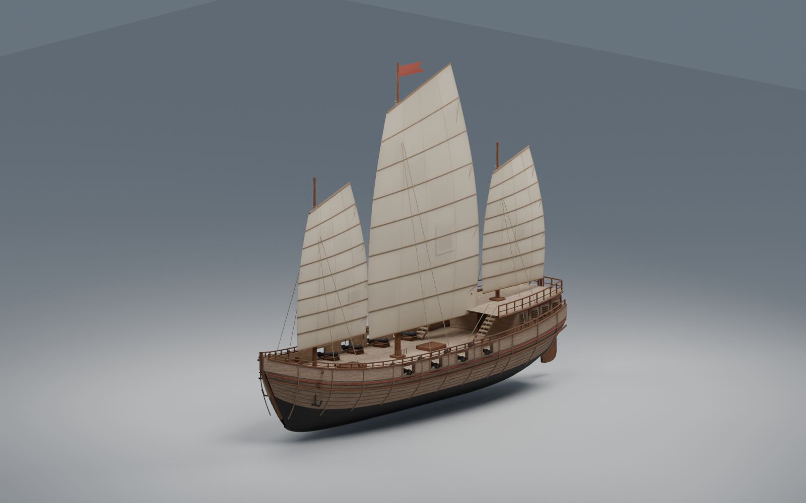
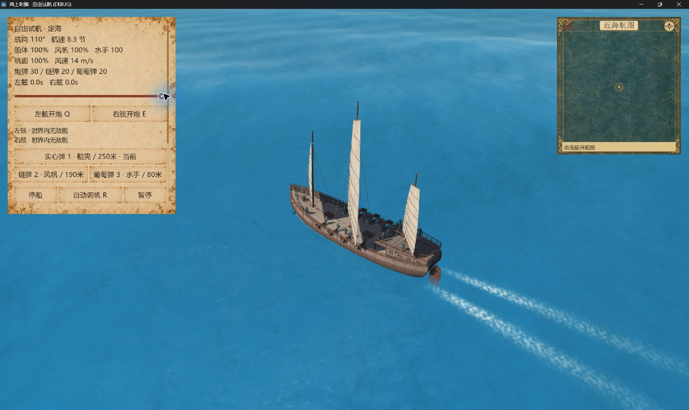

# R7c：灰暖木色与船体层次

当前正式福船默认已接入 `art_r7c`。本轮改善长舷、艉楼与深色下壳的明度组织；沿用此前 R6 已完成的船体与组件造型。实际 Blender 源文件、三档 GLB、AI 木纹原图、固定 GPU 证据及普通主菜单实机验收均已落盘。此状态是模型材质增量交付，整场氛围、性能和玩法目标仍在推进。

Git 检查点为 `b21e2a52c5e39dc14d1cc8353105361f1c4e5545`，标题 `chore: checkpoint cloud optimization and evidence`。用户要求“先提交当前所有代码和资源”时已完成该检查点并验证干净，随后继续本轮。R7c 与本轮研究续作当前未提交，未推送。

## 艺术结果

上舷和艉楼的宽面使用日晒灰暖木色；船壳宽面与小窗框使用中间旧木色；主要腰材保留深木，底部黑水线承托体量，朱红细线保持窄带。这样能在主镜头读出宽面、框架和艉楼折角，同时保持旧木、米白帆和浅甲板的区别。没有继续整体增亮环境、帆或甲板。

独立艺术审阅接受了完整海面中的静态试装及 Blender 三视图；随后才切生产默认并进行原生操船。已看视图没有阻塞性木纹接缝，但新图没有通过严格无缝认证，不能外推到全部距离、方向和运动。浅木亮度已接近本轮接受上限，不建议继续整体提亮。

## 源资产与配方

- Blender：[hero-fuchuan-v3-r7c.blend](../../../assets/production/hero-fuchuan-blender/hero-fuchuan-v3-r7c.blend)。可编辑的完整组件、材质与帆形态保留。
- 三档 GLB：[模型清单](../../../assets/models/hero_fuchuan_v3_r7c/manifest.json)。81 个节点/档，总三角形含投影代理为 110793 / 53653 / 31057，代理仍为 1614；本轮未减组件或改变原运动层级。
- 新 AI 木纹：[sunwashed-teak.png](../../../assets/textures/hero_fuchuan_r7/sunwashed-teak.png)，1254×1254。由内置 imagegen 编辑旧 AI 木纹生成，原始像素原样复制；完整提示、来源与 SHA 在 [provenance.json](../../../assets/textures/hero_fuchuan_r7/provenance.json)。它是 sRGB base color，不称测量 PBR 材质。
- 材质构建：[build_hero_fuchuan_r7_palette.py](../../../tools/blender/build_hero_fuchuan_r7_palette.py)。先由原函数生成几何和 UV，再替换限定组件的材质槽；中间色在线性空间乘 `[0.68,0.65,0.61]`，已检查导出后和 Godot 实际读回值。

| 资产 | SHA-256 |
| --- | --- |
| LOD0 | `b87af112855cb6883faf97ec02a5eeb5fd61a5d504f204d3b3a573e73735d02d` |
| LOD1 | `db9f01b8968f66f2a1c27c689e9a9e0cdd7f03ea27d86a9b6f2bb911872e461a` |
| LOD2 | `16aa79cb89074879354d82402540f478e9ad5279085d2c53d7f92d579aa2291d` |
| 新木纹 | `aec881ec7005d468a9dbf4e7d5f13ca2e4ebabe93f8bb092e04ffa22e99ebc3c` |

## 已执行验证

| 层次 | 实际结果 | 证据与边界 |
| --- | --- | --- |
| Blender 源文件 | Cycles 三视图，包装进程 exit 0、无错误、源 Blend SHA 不变 | [进程回执](v3-r7c-authoring-review-01-process.json)、[三视图清单](v3-r7c-authoring-review-01/BLENDER_REVIEW.json)；真实 Blender 渲染，非概念图 |
| 几何与材质 CPU | 三档严格通过 | [CPU delta](../../research/evidence/hero-fuchuan/r7c-palette-20261026/cpu-delta-01.json)：全部引用三角角点属性和 morph 解码值精确相等，无 epsilon；允许布局/索引顺序规范化，不称 GLB 二进制相等 |
| 独立 GPU 动作 | 257 帧，0–8 秒、1/32 秒步进，暂停/重置/运行内 hash 稳定 | [rig manifest](../../research/evidence/hero-fuchuan/r7c-palette-20261026/rig-01/manifest.json)；另有背光、细节、三档帆损截图。固定诊断序列，非原生录像或 FPS 验收 |
| 完整场景冻结试装 | 2 张、0 失败、exit 0，3 艘船/35 名可见船员，权威与显示包不变 | [world report](../../research/evidence/hero-fuchuan/r7c-palette-20261026/world-01/LIGHT_STUDY.json)、[process](../../research/evidence/hero-fuchuan/r7c-palette-20261026/world-01-process.json)；同正式相机/光照/AA4，非原生操船 |
| 最终相关回归 | 8 测试、914 断言、0 失败，exit 0 | [regression](../../research/evidence/hero-fuchuan/r7c-palette-20261026/final-audit-01/source-guard-regression.json)；含原 R6 对照、默认 R7c、三档/多实例/rig/材质/mip/水面/代理合同。headless，不替代画面 |
| 普通入口原生实机 | 主菜单→自由试航，真实输入操船并退出 | [18 张截图和范围清单](native-play-r7c-01/manifest.json)，下段列出已观察结果 |

实机观察到航向 `000→020→110°`；帆面 `100→42→0%` 并从滑行停到 `0.0` 节；一次明确右舷按钮输入对应弹药 `31→30` 和装填状态。暂停后控制禁用，继续后恢复。画质 `balanced→low→balanced` 后船模均保留；最后重新张满三帆，观察到 `8.3` 节和尾迹。初始与最终设置均为音效/音乐关闭，最终设置文件也读回 `false/false`。选择画质时有一次后续鼠标误触短暂开启音效，已改回关闭；不声称整轮始终没有开启声音。游戏窗口通过自身关闭按钮正常退出，日志未匹配 Godot ERROR、WARNING 或泄漏提示。

部分第一次输入后的截图仍显示前一状态，重新观察后才确认结果；早期弹药 `40→35→31` 的对应输入不明确，不认证这些按钮或快捷键。没有验证键盘快捷键、炮弹命中或敌船受损、全部船型原生表现、导出包，也没有录制连续原生视频。

## 保留的失败与审查修正

R7a 的旧 MixRGB 节点能在 Blender 渲染，却未将乘法系数导入 GLB，材质合同失败。R7b 使用现代 Mix/RGBA 修正系数后，LOD0 舵叶仍有 4 个 U 分量相差 1 个 float32 ULP（最大 `1.49e-8`），严格整体结果仍失败；原因未定位，不归咎于 Blender bug。两版资产和失败回执均保留。

R7c 导出后只在 P/N/indices 及顺序完全相等、有限值、无存储别名、每分量差不超过 `2e-8` 的条件下，从 R6 恢复舵叶差异 UV 字节。实际 LOD0 改 4 个 U 分量共 16 字节，LOD1/2 零改动。最终独立比较仍要求精确相等，接受标准没有放宽。[校正器](../../../tools/blender/canonicalize_palette_uv.py)的 24 个合成安全用例通过，三个真实 R6 副本 no-op 且 SHA 不变。

R7b 三张 Blender 图存在，但初版 PowerShell 重定向把 RTK stderr 提示报作 NativeCommandError、shell exit 1；不把这次称为进程通过。权威 Blender 证据采用随后 R7c 的 Python 包装运行，exit 0。

审查未发现本次生产接线的重要阻断项；两个 Minor 已修正：研究夹具更新过期 R6 默认注释，拒绝从非 R6 来源误标候选。新增断言先得到 82/6 RED，再 82/0 GREEN，其他船委托保留。构建 wrapper 另增加未来构建的校正器 SHA 记录与运行内稳定性检查，语法检查通过；未为元数据修改重建资产，也未改写旧构建回执。[事后文件审计](../../research/evidence/hero-fuchuan/r7c-palette-20261026/final-audit-01/post-build-audit.json)明确区分当前 hash 与历史构建时记录。研究夹具 guard 在原生启动后修正，生产 provider 与资产未在原生验收期间改变。

## 未完成项与下一步

帆面点划影、甲板高频黑点仍在；这一轮材质不解决细索/阴影的屏幕频率问题。海面仍偏鲜蓝，海岛与整场空气感尚未完成。当前完整游戏仍未达到流畅预算；本轮画质/窗口尺寸/位置变动的 FPS 输出不是可比较基准，不能称性能改善或 60 FPS。

旧严格全量回归仍为 303 项中 301 通过、2 项 60 秒超时；延长外部观察后原测试分别完成不改变严格失败结论。新增两份测试后已发现 305 项，本轮只完成上述相关 8 项，不称全量全绿。导出包尚未验收。

下一轮仍先处理船自身的点划影与细节尺度，在同镜头、同帆态的独立实验中保留真实投影并检查连续画面，再决定生产方案。海、岛和整体氛围随后沿项目研究流程推进；不会靠继续全局提亮掩盖船模问题。
